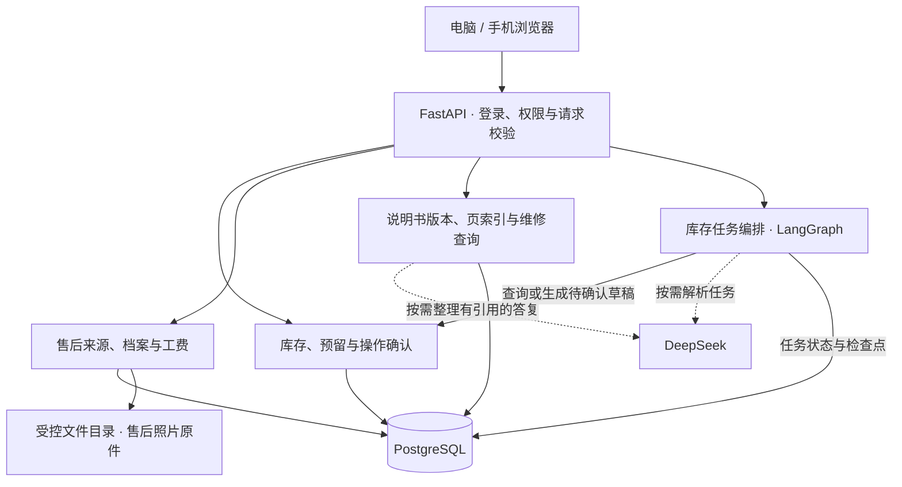

# 门店助手 · 售后、工费与库存协作系统

门店助手面向家电安装与维修门店，将接单员收到的群消息和纸本记录、老板安排的工单、师傅申报的工费，以及各库房的库存流水放在同一套工作台中。老板可以查清一笔工费由谁申报、扣过多少、是否结清；师傅可以按设备完整型号和故障码找到厂家说明书的对应页。

**部署形态**为单门店集中服务，电脑和手机通过浏览器使用。**当前阶段**为本机技术验证及门店试用准备。库存模块已审核结项，售后、维修知识和实际部署的剩余验收项记录在[开发计划](docs/plans/development-plan-v1.0.md#13-状态与阶段完成记录)。

## 门店使用指南

在 Windows 10 64 位门店常开电脑上运行交付的 `StoreAssistant-Win10-x64-Setup.exe`。安装包包含 Python 和 PostgreSQL。首次安装选择「新建门店」，设置老板账号；门店使用万和 GB1S 系列时，可同时选装已核对的说明书资料。安装后双击桌面的「门店助手」登录。

| 岗位 | 从哪里开始 | 完成后可以查什么 |
| --- | --- | --- |
| 接单员 | 在「售后来源」保存文字或照片，核对识别出的字段，再确认归档 | 在「售后档案」按电话或地址查记录，打开当时的原件 |
| 老板 | 在「工费台账」安排工作，核对师傅申报，按实际付款或扣款情况登记结算 | 按师傅、日期和结算状态查看待付、已扣和已付金额 |
| 师傅 | 在「工费台账」打开自己的工作单，填写实际项目、金额和已扣款；需要查说明书时打开「维修辅助」 | 查看自己的工费明细、核定结果，以及所选机型的厂家依据 |
| 库存经办人 | 在工作台输入库存任务，或进入入库、出库、预留页面，核对库房、型号与数量后确认 | 在库存查询和流水中核对余额、预留及本次变动 |

### 一笔售后业务如何流转

1. **接单留底。** 接单员保存报修消息或纸本照片。从同一页识别出的多条记录可以分别生成草稿，缺项留待补录。确认后，档案仍可追溯到原件。
2. **派工与查资料。** 老板安排师傅。以选装的 GB1S 资料为例，师傅选择完整型号 `L1PB30-G28B1S` 并输入 `E3`，即可离线查看故障含义、厂家处理建议及印刷第 19 页。现场观察可在首查后补充。
3. **申报与结算。** 师傅按实际工作填写工费，并单独填写已从代收款扣除的金额。老板核定工费，再按真实依据登记扣款或付款。核账时可以分别追踪师傅申报、老板核定和实际结算。

安装工作也可独立派单。库存有独立的确认流程，例如客户预留一台设备后，可售数先减少；客户提货时，在库数和对应预留数同时减少，避免重复扣减可售库存。

## 系统架构

服务端采用 Python 3.12、FastAPI、SQLAlchemy 和 PostgreSQL，使用 Alembic 管理迁移。原生 JavaScript 工作台随 FastAPI 一起提供，浏览器通过同源 API 访问数据。库存任务使用 LangGraph 保存计划解析的检查点，DeepSeek 按配置参与任务理解或维修答复整理。

### 工程亮点与设计取舍

| 问题 | 实现与设计依据 |
| --- | --- |
| 两人同时预留最后一台，或提交后断网重试 | 按库房和型号维护在库与预留，可售量由两者之差派生。确认时在数据库事务内锁定相关记录，重新检查余额和草稿状态；重试时按操作标识核对原结果。[库存事务](app/inventory/) · [确认与幂等](app/operations/service.py) |
| AI 任务恢复时如何避免重复记账 | LangGraph 检查点保存任务上下文。正式写入需要操作人确认，恢复任务先核对已提交操作的回执。这样，即使业务提交和检查点更新发生在不同时刻，也能识别已经完成的操作。[编排实现](app/agent/graph.py) · [运行与恢复说明](docs/guides/inventory-agent.md) |
| 同一个故障码在不同机型上可能有不同含义 | 检索先限定完整型号和已发布的说明书版本，再匹配已核对的关键词与摘录。明确的故障码可直接返回原文；模型整理的答复须通过引用校验，依据不足时保留原页供核对。[检索实现](app/knowledge/lookup.py) · [答复与引用校验](app/knowledge/repair.py) |
| 换电脑后怎样同时找回账目和原件 | 备份覆盖数据库和售后原件，恢复时校验文件清单与摘要。已用实际安装包中的运行环境完成向另一空库恢复，并重新核对 GB1S 三个型号的 E3、E4 查询和引用页。[安装与恢复实现](deploy/offline/manage.py) · [恢复演练](deploy/README.md) |

## 使用边界与验证状态

- **权限与资金。** 服务端按账号和角色校验读写权限。师傅查看本人工费，老板核定、登记和更正。工费台账记录线下发生的扣款与付款，资金支付由门店在线下完成。
- **维修依据。** 引用页适用于选定型号和说明书版次。故障码含义、厂家处理建议和现场诊断分别呈现，具体故障仍需具备资质的人员核实。[维修辅助评测](evals/repair/README.md)
- **联网能力。** 本机业务和已收录资料可离线使用。DeepSeek 和在线更新检查需要联网；安卓、鸿蒙手机外出访问还需固定 HTTPS 入口和移动网络真机验收。[外出访问试验](deploy/trial.md#外出访问试验)
- **验证范围。** 本机已做库存并发与权限回归、隔离库备份恢复，以及千条售后档案、万条库存流水的基准验证。干净 Win10 上的断网首装、重启自启、覆盖升级和异机恢复仍待实测。[全链路验收记录](docs/plans/m4-02-acceptance.md) · [阶段状态](docs/plans/development-plan-v1.0.md#13-状态与阶段完成记录)

## 运维与开发入口

| 目标 | 操作或入口 |
| --- | --- |
| 日常备份、换机 | 老板从 Windows 开始菜单选择「门店助手 → 导出门店备份」，将备份保存到妥善保管的移动介质。换机时选择「从本产品备份恢复」。 |
| 查看版本、升级 | 打开「账户与显示 → 版本与更新」。老板可检查新版，在空闲时间运行新版安装包；升级程序先备份门店数据。[发布步骤](deploy/trial.md#发布门店更新) |
| 在开发机运行 | 按指南准备独立开发库，安装锁定依赖，运行迁移并初始化老板账号。已配置的本机审核环境使用 8002 端口。[开发环境与测试命令](docs/guides/backend-development.md) |
| 阅读代码、复核行为 | [前端工作台](app/web/) · [业务模块](app/) · [数据库迁移](migrations/) · [自动化测试](tests/) · [评测样例](evals/) |
| 了解需求、设计与贡献约定 | [产品需求](docs/prd/store-service-agent-prd-v1.0.md) · [架构设计](docs/architecture/store-service-agent-architecture-v1.0.md) · [开发规范](docs/guides/development.md) · [完整文档目录](docs/README.md) |
