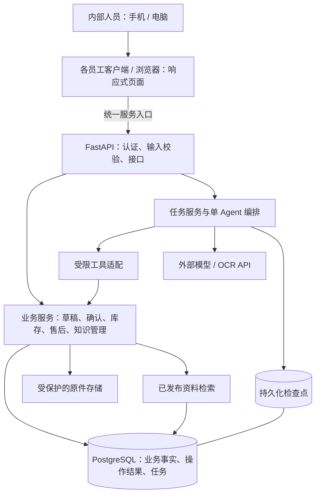
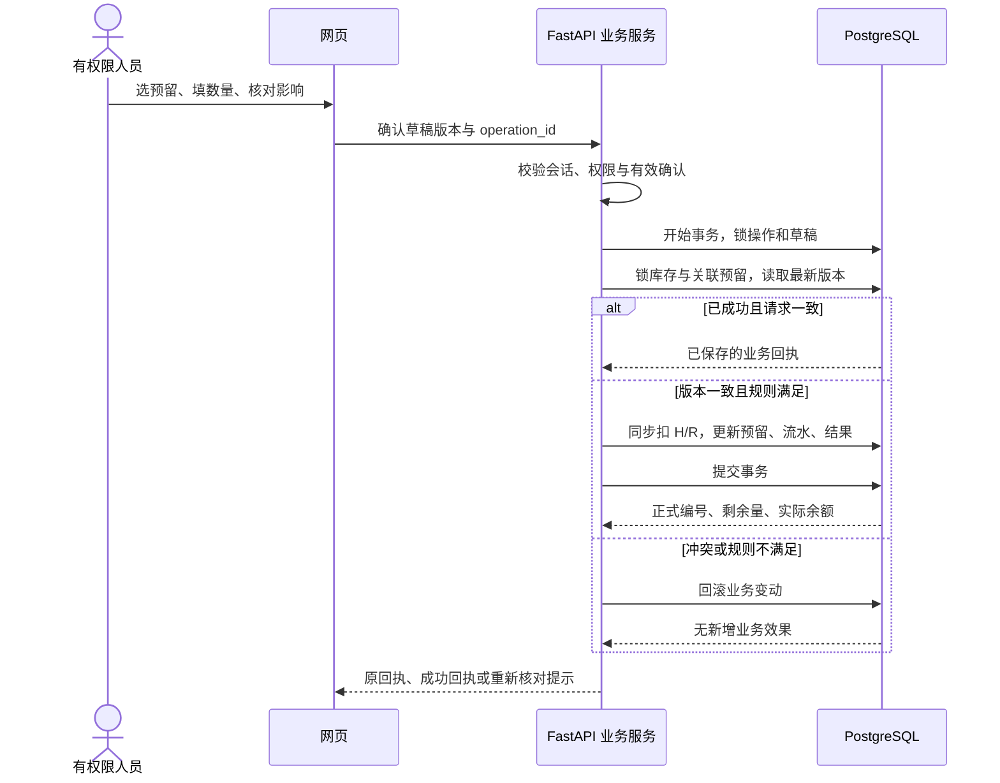

# 门店售后与库存协作智能体 · 项目架构

| 文档项 | 内容 |
| --- | --- |
| 版本 / 日期 | V1.0 / 2026-11-02，确认多客户端接入统一服务；保留M0首个切片契约 |
| 状态 | M1-01/M1-02已获准继续；M1-03入库/待核对已实现并完成本机验证并获用户审核通过；出库及后续待实施 |
| 适用范围 | 单门店内部使用，手机优先、电脑可用的 V1 |
| 需求基线 | [PRD V1.0](../prd/store-service-agent-prd-v1.0.md) |
| 项目规范 | [AGENTS.md](../../AGENTS.md) |
| 界面依据 | [设计资源 AI 版](../design/design-resources.md)、[HTML 可视化版](../design/design-resources.html) |
| 开发计划 | [阶段性开发计划 V1.0](../plans/development-plan-v1.0.md)，与PRD、本文组成需求/设计/计划三文档 |

## 1. 文档定位与当前状态

本文描述目标架构、模块边界、数据一致性、任务恢复及分阶段落地方式，不是已实现系统的说明，也不替代数据库迁移、接口详细设计和逐任务实现计划。

当前交付与待实施状态统一见[开发计划](../plans/development-plan-v1.0.md)的阶段记录；前端说明见[样板README](../../prototypes/frontend/README.md)。本文只维护目标实现设计，不重复维护页面完成状态。

全文采用以下区分：

- **项目约束**：沿用 AGENTS.md 和 PRD 的范围、数据与确认要求；PRD 中标注为产品建议的业务规则仍保留该性质。
- **架构建议**：本稿为实现当前范围提出的技术默认方案，不代表用户已经确认技术栈和具体参数。
- **待核定**：依赖真实材料、业务人员核对或技术验证的事项，见第 15 节。

## 2. 目标、边界与方案取舍

### 2.1 架构目标

1. 库存数量、统计和权限由确定性业务代码处理，能够脱离模型测试和使用。
2. 自然语言入口和结构化表单进入同一套业务校验、草稿、确认和提交机制。
3. 正式事实保留来源、修订和流水；任务可以恢复，重复提交只有一次业务效果。
4. 从库存闭环逐步扩展到售后档案和维修知识，控制部署组件及运行成本。
5. 复用既有 C 方向资源，手机完成日常任务，电脑支持资料对照。

### 2.2 首版范围

覆盖售后归档与历史、安装与维修工费台账、维修资料与辅助、分库房整机库存、预留和提货、统一任务入口及必要的内部管理。范围以 PRD 的全部 P0 为完整 V1 门槛，阶段版本须说明已交付范围。

公众报修、自动读取个人微信群、自动派工、通用财务结算、系统内付款、支付渠道对账、自动采购、跨店管理、配件库存、序列号流转和无真实需求的库房调拨，均不进入本文目标架构。

### 2.3 方案比较

| 方案 | 收益 | 代价与适用条件 | 本稿建议 |
| --- | --- | --- | --- |
| 模块化单体，同源网页与 API，一个 PostgreSQL | 库存和预留可在同一事务内处理；部署组件少 | 需要在代码中保持业务边界 | 作为首版方案 |
| 独立前端应用 + 同一业务后端 | 前端工程化和复杂交互更方便 | 引入构建、发布及接口协作成本；分域时增加认证配置 | 页面复杂度确有需要时再评估 |
| 按业务拆成微服务 | 可独立扩容和发布 | 分布式一致性与运维成本超过当前需求 | 当前不采用 |

2026-11-02用户确认“各员工可安装客户端，经统一后端共享同一家门店数据库”的方向（PRD F17）。模块化单体、具体数据库组件、客户端安装技术和部署位置仍是本稿技术建议或待验证事项，不能把方向确认写成全部技术选型已经确认。

### 2.4 已确认的客户端与共享服务边界

- 手机和电脑客户端复用响应式业务页面，通过统一API完成登录、查询、草稿与确认；浏览器访问也使用同一套服务，不复制库存计算和权限规则。
- 后端、共享数据库、原件和知识资料部署在独立于普通员工终端的服务环境。可以是持续运行的专用主机或云环境，位置见计划D-07；本次没有选择云厂商、购买服务器或承诺全天可用。
- 每位员工使用独立账号，后端按当前职责和对象范围授权。客户端不直连数据库，不携带数据库凭据或服务端模型密钥，也不安装每人一份业务库。
- 关闭、重装或卸载某个客户端不影响共享业务事实；只有统一服务、数据库或访问网络不可用时，相应业务服务才不可达。原件通过鉴权接口读取，不依赖上传者电脑上的文件路径。
- 首版以联网访问为边界，更新后的事实由后续查询读取；暂不引入离线写入队列、跨设备数据库同步或实时推送。结果未知时保存原操作标识，重连后按原标识核验，不能自动创建新操作补写。
- 安装方式和首批操作系统按计划D-08核定。在确定之前先实现同源网页与API，保留可安装入口的交付任务，不提前增加桌面壳、原生端或客户端独立登录协议。

## 3. 总体架构与信任边界



- 浏览器负责展示和收集输入，服务端决定权限、确认是否有效及业务结果。
- Agent 负责理解、补问和选工具；工具适配调用业务服务，不在模型侧提供任意 SQL、文件路径或通用执行能力。
- 业务数据库是库存、售后及操作结果的事实来源；检查点是继续任务的上下文，不能作为记账凭证。
- 原文、照片、手册和模型输出都作为待处理内容，不能提升账号权限或产生人工确认。
- 模型只接收任务必要内容；维修手册问答通常无需客户姓名、手机号和详细地址。

## 4. 技术组成与部署单位

| 部分 | 首版建议 | 说明与落地时点 |
| --- | --- | --- |
| 后端 | Python + FastAPI | 项目优先方向；按业务模块组织路由与服务 |
| 客户端与网页 | 先实现同源 HTML/CSS/JavaScript，按页拆分，再适配经核定的可安装入口 | 复用现有样式、API与认证；安装技术与平台见D-08，不预设独立原生端或前端框架 |
| 业务存储 | PostgreSQL | 保存业务事实、草稿、操作结果和任务；M1 建立 |
| 访问数据库与迁移 | SQLAlchemy + Alembic | 架构建议，M1 验证驱动、事务与版本兼容后锁定依赖 |
| Agent 编排 | 单 Agent + LangGraph 持久化检查点 | M1 工具稳定后接入；检查点与业务表分开管理 |
| 知识检索 | PostgreSQL 内的型号过滤和关键词基线；按评测加入 pgvector | M3 再安装确有需要的向量能力，中文检索效果须实测 |
| 原件 | 应用服务器的受保护持久化目录，数据库存元信息 | 与静态资源目录隔离；后续有容量或部署需要再迁对象存储 |
| 外部能力 | 模型 API；OCR 或视觉模型按样例选择 | 不预设供应商、价格、向量维度或识别准确率 |
| 运行 | 集中部署单应用服务 + PostgreSQL，服务端试用部署建议采用容器及持久卷 | 同源提供网页和API，提供HTTPS入口；员工终端不要求安装数据库或容器；服务位置见D-07 |

应用按业务模块组织是对 FastAPI 路由能力的项目级使用建议，参考其[多文件应用文档](https://fastapi.tiangolo.com/tutorial/bigger-applications/)。不把上述组件清单当作当前已安装依赖；具体版本在落地阶段选择受支持且相互兼容的组合，并写入锁定文件。

首版不预先引入 Redis、消息中间件、独立向量数据库或独立 Agent 平台。长任务先保存任务状态，再由应用内受控执行器处理；任务领取、失败和中断均落库，同一任务只允许一个有效执行者。阻塞解析不得占住请求事件循环；需要恢复时从任务记录继续，而非依赖内存后台回调。具体领取与重启回收机制在接入长任务时测试；出现吞吐或隔离需求后再拆独立工作进程。

## 5. 模块职责与依赖方向

| 模块 | 负责 | 边界 |
| --- | --- | --- |
| 身份与权限 `auth` | 内部账号、登录会话、账号启停、职责叠加、访问检查 | 权限来自后端；操作时检查当前权限 |
| 基础资料 `catalog` | 库房、标准型号、确认别名、启用状态 | 历史标识保留；不默认匹配相似型号 |
| 草稿与操作 `operations` | 草稿版本、确认、稳定操作标识、执行结果查询 | 不内置库存加减；协调具体业务服务在同一事务内提交 |
| 库存 `inventory` | 建账、余额、流水、预留、提货、更正、统计 | 所有余额和关联预留变动走本模块 |
| 售后 `service_records` | 客户与服务地址、归档、补充、修订、候选和历史检索 | 手机号不是绝对唯一客户键；关联由人员核对 |
| 工费台账 | 工作单、逐人申报、负责人确认、线下结算登记和更正、按人查账 | 复用身份与操作机制，维修可引用售后档案，安装可独立登记 |
| 来源 `sources` | 原文/原图保存、元信息、受控读取、处理状态 | 识别结果不能替换原件，存储键不由模型决定 |
| 知识 `knowledge` | 手册及案例版本、解析、审核发布、检索、引用定位、反馈 | 默认检索仅包含已发布且适用的依据 |
| 任务与 Agent `agent` | 任务上下文、补问、调用预算、工具选择、等待与恢复 | 不直接更新业务表；从工具结果组织反馈 |

HTTP 路由和 Agent 工具适配均依赖业务服务；业务服务依赖数据库及受控文件访问。库存、售后等业务服务不得反向依赖模型或 Agent。已有内部服务调用可直接使用 Python 函数，不为单进程模块增加内部 HTTP 请求。

通用角色权限按 PRD 第 3 节核定，同人可兼任。专业核对和发布为两个动作。工费权限按已确认的 FR-13 执行。

## 6. 目录建议与逐步创建方式

以下为目标目录，不表示这些文件已经存在；随对应阶段创建，不一次生成空模块。

```text
store-service-agent/
├─ AGENTS.md
├─ pyproject.toml                 # Python 依赖与工具配置，落地时生成锁定文件
├─ app/
│  ├─ main.py                     # 应用装配、路由注册和生命周期
│  ├─ config.py                   # 环境配置与必要限额，不保存密钥值
│  ├─ db.py                       # 连接、会话及事务基础
│  ├─ auth/                       # 登录、权限、会话
│  ├─ catalog/                    # 库房和型号
│  ├─ operations/                 # 草稿、确认、幂等与结果
│  ├─ inventory/                  # 库存、预留、流水、统计、更正
│  ├─ service_records/            # 客户、地址、档案和修订
│  ├─ sources/                    # 来源元信息和原件访问
│  ├─ knowledge/                  # 资料发布、检索和引用
│  ├─ agent/                      # 编排、状态、工具与模型接入
│  └─ web/                        # 业务 HTML、CSS、JS 和公共素材
├─ migrations/                    # 受版本控制的数据库迁移
├─ tests/                         # 按业务划分的单元与 PostgreSQL 集成测试
├─ evals/                         # 标注任务、评测脚本和结果说明
├─ deploy/                        # 容器及备份恢复操作说明
├─ docs/architecture/             # 本架构文档
├─ docs/prd/                      # 现有需求基线
├─ docs/design/                   # 现有设计规范、概念图和核对证据
├─ docs/plans/                    # 当前阶段开发计划
├─ docs/guides/                   # 按任务加载的开发与Git规范
└─ prototypes/                    # 核心前端与原工作台样板及历史证据
```

模块从少量 `router.py`、`schemas.py`、`models.py`、`service.py` 开始，按实际规模拆分；不为单次使用建立通用仓储框架或插件系统。业务页面从样板复用资源时指定唯一维护源并同步引用，不建立无人维护的重复副本。运行原件、数据库卷、备份、模型密钥和真实客户材料放在代码仓库之外。

## 7. 数据模型与事实归属

### 7.1 核心实体

以下名称是逻辑实体建议，字段、索引和物理表名由对应阶段迁移确定。

| 实体组 | 必要内容与关系 |
| --- | --- |
| 用户、权限、会话 | 用户启用状态、多职责权限、可撤销会话；首个负责人通过受控初始化建立 |
| 客户、服务地址及关联 | 原始与规范化联系方式/地址、候选关系；支持同号多址及同址多人，不能据手机号唯一约束客户 |
| 来源材料 | 原文或存储键、类型、业务用途与访问范围、已知页码/群名/消息时间、提交人、提交时间、识别状态；可关联任务、草稿及正式记录 |
| 售后记录、来源关联、修订 | 客户地址关联、问题、型号、处理及结果、日期精度、记录版本；修订保留前后值、原因和新增来源 |
| 工作单、工费与结算记录 | 工作单保存计划与实际工作，可关联售后档案。每位师傅在该单有独立申报与确认金额，关联结算及更正事件 |
| 库房、型号、别名 | 稳定编号、启用状态、经核对的别名 |
| 库存账、余额 | 每个库房型号一份建账状态、T0、期初 H0/R0、当前 H/R 和版本；期初来源保留 |
| 库存原单、流水、更正关联 | 原操作类型、原量/当前有效量、发生与登记时间、数量差额、原单及预留编号、操作者 |
| 预留 | 明确客户，或足以区分的称呼和联系方式；库房、型号、登记量、累计已提/已取消、依据、是否期初、版本 |
| 草稿、确认、操作结果 | 业务类型、结构化参数、缺项、目标版本、草稿版本、确认人/时间、操作标识、参数摘要、提交结果 |
| 任务、检查点 | 登录主体、选中候选、关联草稿/操作、当前阶段、运行记录；检查点只保存继续任务所需上下文 |
| 知识版本、片段、引用和反馈 | 适用型号、来源类型、审核/发布状态、文件版本、页/章节、检索内容；历史回答保留具体版本引用 |

预留可在尚无售后档案时登记，不能为了留货虚构一份售后记录。客户及地址关联采用显式关系，避免预先限制为“一手机号一客户”或“一地址只属于一人”。

### 7.2 数据不变量

- 库存以 `(warehouse_id, model_id)` 唯一标识，重复建账受数据库唯一性保护；未建账与已建账为零分开表示。
- 当前余额保存 H、R；A 从 `H - R` 派生，不提供可单独编辑的可售字段。数量均为整数，满足 `H >= 0`、`0 <= R <= H`。
- 单笔预留满足 `登记量 >= 累计已提 + 累计已取消`；剩余从三者派生。R 等于本库房型号所有有效预留剩余之和。
- 库存余额、相关预留、有效单量、流水和业务操作成功结果在同一数据库事务内更新。
- 流水及历史修订留痕，正式原单不能普通编辑或物理删除；更正链和当前有效量均可追溯。
- 售后记录与来源是多对多关系；一份照片可关联多条记录，一条记录也可增加后续来源。

行内条件用数据库 CHECK、外键及唯一约束兜底；跨行合计由统一业务写入路径、行锁、事务与对账测试保证，不能把预留总和写成普通跨表 CHECK。约束能力与限制参考 [PostgreSQL Constraints](https://www.postgresql.org/docs/current/ddl-constraints.html)。

### 7.3 时间与未知值

同时保存业务发生时间、提交/登记时间和修订时间。精确时刻按带时区时间保存，展示与自然日统计使用 `Asia/Shanghai`；只有日期、月份或完全未知时单独保存精度及相应值，不补造时分秒，也不将上传时间当维修时间。

T0 为每个库房型号的精确建账时刻。常规库存事件须确认在 T0 之后且尚未记账；同日只有日期、前后不明时停在待核对。统计按发生日期、包含开始和结束自然日，展示各对象建账覆盖范围及查询截至时间。数据库中缺值和业务上的零不混用。

## 8. 人工确认、幂等与库存事务

### 8.1 草稿和确认契约

1. 表单或 Agent 提交业务参数，后端校验并生成可编辑草稿，返回缺项、对象和预计影响。
2. 待确认版本由后端分配稳定 `operation_id`，绑定草稿 ID、版本、操作类型和规范化业务参数。模型和浏览器不能修改它所绑定的内容。
3. 用户点击确认控件时，后端校验真实登录主体及当前权限，记录确认人与时间，并绑定本版本参数和目标版本。原文中的“已确认”和模型输出不构成凭据。
4. 修改关键字段或目标状态变化时，旧确认失效；新草稿版本分配新操作标识，必须重新展示并确认。网络重试与恢复继续使用原版本的操作标识。
5. `operation_id` 唯一；一个草稿版本最多有一次成功提交。相同标识但参数或确认主体不一致时拒绝；成功结果只向当前有权查看的人返回。
6. 代办需要当前登录人员具有对应职责，并重新核对确认；不能把原人的确认自动转给另一人。

### 8.2 提货时序示例



### 8.3 并发与原子性

库存提交采用 PostgreSQL 事务和行锁。所有写入按固定顺序锁定：操作记录 → 草稿 → 库存余额 → 关联预留 → 被更正原单；同类多行按稳定 ID 排序。读取最新版本后重新验证数量、建账状态、T0 边界及关联关系，再执行变动。行锁行为参考 [PostgreSQL Explicit Locking](https://www.postgresql.org/docs/17/explicit-locking.html)。

预览不持有长期锁；库存或关联记录变化后需刷新草稿和重新确认。首次建账没有余额行可锁，依靠库房型号唯一键与同一事务防止并发初始化。不同操作标识提交同一草稿版本，也必须通过草稿锁与成功提交约束阻止重复效果。

数据库锁持有期间不调用模型、OCR 或文件解析。事务出错全部回滚；失败诊断在回滚后记录，不能留下“已成功”结果。连接中断、提交结果未知时先查原操作，不直接判定失败或换标识重试。

### 8.4 更正和统计

- 入库数量更正：有效量从 old 改为 new，H 增加 `new - old`，R 不变；进货按原单更正后的有效量统计，不重复累计更正单。
- 普通出库更正：H 减少 `new - old`，R 不变，仍满足当前可售约束。
- 预留提货更正：H、R 同时减少 `new - old`，同步改累计已提和剩余；减记可使已结束预留重新进行中。
- 盘点调整不算进货；改库房、型号或日期按 PRD 走受约束的原单冲正及重新登记，分别确认。
- 增记提货不得侵占已取消部分；任何更正不能产生负在库、负剩余或预留超额。

具体更正规则仍属于 PRD 中的产品建议，真实启用前由门店核定。统计和更正使用同一有效原单口径，并提供对账查询：期初加有效变动等于当前余额；预留剩余合计等于 R。

### 8.5 工费台账的权限、事务与查询

M2-05 设计边界，实施依赖 M2-03 的最小手工归档与查询。业务规则见 [PRD FR-13](../prd/store-service-agent-prd-v1.0.md#713-fr-13-安装与维修工费台账--p0)。

- 服务端以工作单及师傅账号标识个人工费记录。老板登记安排，师傅提交本人实际工作和申报。临时补录走待核对入口，老板核对工作归属后确认，已有同单时关联已有工作。计划人员与实际参加者分别保留。
- 共享工作内容与个人金额分开授权。师傅的查询、详情和写入均核验本人记录。老板可读全店，只有老板可确认金额、登记已扣或已付、执行更正。未确认申报在查询中独立显示。
- 金额按人民币分的整数存储，分别保留申报、确认金额及可选的代收和交回金额。已扣和已付都保存结算时间和核对依据或备注。未提供的历史代收金额保持空值。
- 每人每单只允许一种有效的已结方式，已结金额等于该笔确认金额。登记结算和更正校验当前版本，锁定同一笔工费后在一个事务中更新状态、追加结算或更正记录并保存操作回执。按稳定操作标识重试返回原结果，防止并发或重复登记产生两笔有效结算。
- 汇总读取有效记录，按工作日期、师傅和状态筛选。待付总额只累加已确认且未结的金额，历史更正保留原事件。补录边界由负责人核定，登记时间与工作、结算发生时间分别保存。

M2-05 首个闭环使用 `work_orders`、`worker_fees` 和 `work_fee_events`，迁移为 `0012_work_fees`。工作单可引用正式售后档案。个人工费按工作单与师傅唯一约束，申报项目的金额是每项实际申报小计，工费确认金额单独保存。

- `/api/work-fees` 和明细接口按当前账号授权。老板安排工作、补加同单人员，师傅提交本人申报或补报口头安排。正式确认、结算登记和更正使用当前版本、显式确认及操作标识。审核、状态更新与事件同事务保存。金额更正必须在待付状态完成，已结的错账先更正为待付。
- 旧单补录由老板逐笔提供核实的首个纳入日期。早于该日的工作被拒绝，所用日期与核对依据保存在记录中。首个闭环支持一张旧单补录一位师傅。实际账期起点及人员范围按 D-09 核对。

## 9. Agent 任务与恢复

M1-06当前实现详见[库存Agent运行与接口](../guides/inventory-agent.md)：LangGraph只保存受限计划解析检查点，人工等待/正式事实由持久化任务、草稿和操作关联表达。DeepSeek没有确认工具；查询和草稿复用现有Python业务服务。短事务领取、120秒租约及栅栏隔离模型网络调用，恢复先核验原Operation.result。补充说明先作废未提交旧预览，成功项保持不变；非零期初预留转原表单逐笔核对。迁移0007冻结锁定版本PostgresSaver表结构；具体限制、接口与技术证据由运行说明及开发计划维护。2026-11-04真实模型首轮12次调用已有记录，字段质量观察与精确费用限制见运行说明。

### 9.1 工具和状态

首版单 Agent 只使用业务能力工具：客户候选/档案/来源查询、库存/预留/统计查询、资料检索、草稿创建与修正、受控提交、操作结果核验。写工具调用仍须通过第 8 节的后端检查，不向模型暴露可自行构造的确认授权。

任务状态采用 PRD 口径：处理中 → 待补信息 / 待确认 / 待结果核验 → 已完成，另有失败和取消。业务操作另存待确认、提交核验中、已成功、失败未提交和已取消；任务完成文案不能覆盖实际提交状态。一句话多笔写入分别产生草稿、确认和回执。

LangGraph 以持久化检查点支持等待与恢复，任务和编排线程由后端关联，客户端传入线程 ID 不能绕过任务访问检查。框架的中断恢复可能重跑节点，因此节点副作用仍须幂等，详见官方[持久化](https://docs.langchain.com/oss/python/langgraph/persistence)及[中断](https://docs.langchain.com/oss/python/langgraph/interrupts)说明。

### 9.2 提交与检查点的边界

不假定业务事务与编排检查点在同一次提交中完成。业务提交成功而检查点尚未更新是正常需要处理的故障窗口：恢复后先按 `operation_id` 查询数据库结果，再推进任务，不能根据旧检查点重新创建出库。

恢复还须检查当前账号状态、权限、草稿和目标版本。待确认任务继续等待；旧预览失效则重新核对；已成功操作回显原业务回执。取消任务只能停止未提交工作，已提交事实另走更正。

模型/OCR 调用期间不持有业务事务，保存当前阶段和必要输入引用。每任务限制模型轮次、工具次数、时长和费用；参数通过样例实测核定。超限保留已完成与未完成部分，读操作有限重试，写操作先核验结果。模型不可用时仍提供档案检索、库存查询和有权限的表单记账。

## 10. 售后来源与知识检索

### 10.1 售后资料路径

原文/照片提交 → 保存来源 → 提取或手工填写分条草稿 → 查询候选 → 人工选择客户地址并修正 → 确认归档 → 按手机号/地址查询 → 打开来源或补充修订。

原件先保存成功才报告已接收；识别失败仍能手工录入和查看原件。一页多条分别确认，同号多址不自动合并；历史未知日期单独表达。售后并发修订校验目标版本，后提交者不能覆盖已确认内容。普通用户不硬删除档案，负责人确认作废仍保留历史。

文件与数据库没有共同事务：上传先写受控暂存区并完成持久化，再登记来源元信息，返回成功前校验可读取。失败或中断时允许重试并清理未被引用的暂存文件，不能因此合并业务记录。文件内容摘要只用于完整性和疑似重复提示。原件定位通过服务端存储键，不接受任意磁盘路径。

来源保存时即绑定提交人、业务用途和本门店访问范围，不等待正式记录建立后才授权。未归档阶段，提交人在仍具有对应来源访问权限时可查阅自己提交的材料；有对应核对职责且有权访问关联任务/草稿的人员可查阅办理所需原件。尚未生成草稿或识别失败的来源保留上述范围，可由有权核对该业务范围的人员继续处理，不因失败自动公开。归档后新增正式记录关联，读取仍检查当前来源访问权限和关联记录的业务范围；账号停用或撤权后不沿用旧任务授权。多条记录共用原图时按整份来源核验范围，不能只因其中一条可访问就开放其他超权限内容。这是本稿的来源授权建议，具体职责沿 PRD 权限矩阵核定。

M2-01 当前在 service_sources 保存原文及照片元信息，单张 JPEG 或 PNG 原图在受控目录落盘，使用服务端来源编号定位。提交事务完成前校验文件可读取；读取按当前售后权限和提交者核验，并检查大小及摘要。草稿核对授权和多记录关联随 M2-02/03 实现。配置和恢复行为见[M2-01 实施记录](../plans/m2-01-implementation.md)。

M2-02 首个切片在 `service_record_drafts` 以外键关联来源，一份来源可有多条待核对草稿。通过 `/api/sources/{source_id}/drafts` 创建及分页列出，附草稿编号后读取或按版本提交完整字段。当前沿用来源提交者的访问范围及 `service.read`，写草稿还需 `service.draft` 和 CSRF 校验。重复提交同来源、同请求标识及同创建内容时返回当前草稿，编辑用行锁校验版本。字段可以留空，原始手机号和不确定标记分开保存，日期精度独立于来源提交时间。正式归档在 M2-03 接入。

M2-03 最小闭环在 `service_contacts` 保存人工选择的客户和服务地址组合。一个手机号可对应多条组合，各组合使用独立编号。现有库存客户资料与售后组合各自保留。正式档案存于 `service_records`，以唯一草稿编号关联原件，以客户地址组合编号关联历史。字段保存归档时的快照，维修日期精度继续保留。

- 在草稿路径下用 `archive-preview` 预览已有组合或明确新建。服务端保存预览所绑定的草稿版本、主体、组合和操作标识。修改草稿会作废预览。只有来源提交者且仍有 `service.confirm` 才能预览和确认。
- `archive-confirm` 检查 CSRF、当前权限、草稿版本和显式确认。同一事务锁定草稿、保存档案及必要的新组合、返回回执。已归档草稿只读。同一成功操作再次确认返回原回执，其他操作不得重复归档。
- `POST /api/service-records/search` 从请求正文读取手机号或地址，避免把检索内容放进访问日志的 URL。手机号规范化后精确匹配，地址按规范化关键词查找。选择组合后用 `GET /api/service-records/contacts/{contact_id}` 读取该组合的历史。模糊手机号可保留原表达，只有可用且已核对的号码进入检索索引。
- 门店内有 `service.read` 的账号可读归档字段。原件链接仅返回给有权查阅该来源的提交者，原件接口仍逐次校验权限。跨人移交原件和未归档草稿的授权待实施。

### 10.2 维修资料路径

手册/案例上传 → 解析并保留页/章节 → 核对型号及版本 → 必要专业审核 → 发布 → 按已确认机型过滤 → 检索 → 组织带条件的建议 → 展示结论对应的原文入口。

先用真实资料建立关键词检索基线，再比较向量检索或组合检索；中文分词、故障码、精确型号、表格及扫描页均需样例验证。若采用向量，使用同一 PostgreSQL 内的 [pgvector](https://github.com/pgvector/pgvector)，嵌入模型、维度和重建规则在选型后确定。检索索引可以重建，不能充当唯一资料副本。

只默认检索已发布且适用的版本；未审核经验不进入正式依据，停用版本不默认命中，但历史引用可追溯。相似型号须人工消歧，缺依据或来源冲突时显示缺口，不能用模型常识填成指定机型结论。疑似燃气泄漏等紧急输入中止普通问答，具体提示由师傅审核。

维修回答保留适用范围、检查前提、条件化修理建议、逐项引用和未知信息；不自动变成实际维修结果或配件出库。反馈用于评测，不能未经审核直接改写知识事实。

## 11. API 与前端交互约定

### 11.1 API 能力分组

以下为建议资源边界，不是已经实现或冻结的接口路径；请求字段与错误码在各阶段详细设计中确定。

| 资源组 | 能力 |
| --- | --- |
| `/api/auth`、`/api/users` | 登录/退出、当前主体、负责人维护账号权限 |
| `/api/warehouses`、`/api/models` | 库房型号维护与候选 |
| `/api/drafts`、`/api/operations` | 草稿读改、显式确认提交、按标识查询结果 |
| `/api/inventory`、`/api/reservations` | 余额、建账、预留、流水、进货统计与更正的业务能力 |
| `/api/sources`、`/api/service-records` | 来源上传及受控读取、客户地址候选、档案与修订 |
| 工费台账资源 | 安排工作、提交本人完工申报、按人查账、负责人核对、结算登记和更正 |
| `/api/knowledge` | 资料解析/审核/发布、原文定位、维修问答和反馈 |
| `/api/tasks` | 发起、读取、补信息、恢复和取消任务 |

正式写入统一经草稿和操作机制；不能因库存接口按资源分组就另开可绕过确认的直接写接口。业务回执包含正式编号、操作标识、登记时间和实际结果；查询注明覆盖范围和截至时间。状态码区分未登录、无权限、字段非法、版本冲突和暂时不可用，界面使用业务措辞。

### 11.2 页面组织与认证

一级入口保持工作台 / 待核对 / 售后 / 库存；维修辅助从工作台或售后详情进入，低频管理置于资料与设置。二级办理页使用返回和本页操作区，避免叠加两条底栏。页面采用既有编号：`home`、`service-draft`、`service-search`、`service-detail`、`repair-assistant`、`inventory`、`reserved-pickup`、`inbound-statistics`。

七页之外，按业务阶段补齐登录、待核对列表、入出库、预留选择/取消、流水、建账、更正及资料账号管理；这些是流程支撑范围，不意味着现在已有完整视觉样板。

首版建议使用服务端可撤销会话与 HttpOnly Cookie；部署时使用 HTTPS、Secure 及合适的 SameSite，修改请求校验 CSRF 与来源。用户身份从会话读取，不接受浏览器或模型自报操作者。首个负责人通过部署初始化创建，日常账号由负责人分配，不开放公众注册。

网页通过任务查询展示阶段和回执，首版可采用有限轮询；是否流式输出以后按实际体验决定。刷新后从后端重读草稿和结果，本地内存不承担恢复依据。复用 tokens、ui.css、SVG 和纹理；每次页面实现同步两版设计资源索引、实际截图和核对记录。检查 320/390px 窄屏、电脑布局、长内容、未知字段、多候选、键盘焦点和固定栏遮挡，未覆盖项如实记录。

安装客户端继续复用本节认证和业务API。若所选安装技术需要额外协议、来源或会话适配，先在D-08技术验证中明确来源校验、凭据保存和更新边界，不通过放宽CORS、取消CSRF或信任客户端角色字段解决。客户端更新不执行数据库迁移；迁移只由服务端发布流程执行。客户端与API的兼容策略在M4-06验证，旧端不兼容时提示更新并阻止写入，不允许静默使用不匹配的字段。

## 12. 安全、运行与备份恢复

- 入口统一鉴权，后端检查操作权限及对象访问范围；原件和照片不能以公开静态链接暴露。禁用账号和撤销权限后，旧任务仍要重新检查。
- 附件类型、大小、张数和保存时长在真实样本验证后核定，页面显式说明。文件名不作为磁盘路径，不执行上传内容。
- 密钥从部署环境注入，不进入仓库、网页或日志；模型和工具输入保留必要摘要，手机号、地址及错误信息脱敏。
- 运行记录关联任务 ID、草稿版本、操作标识、业务编号、模型/提示词/知识版本、耗时、用量、人工修改和异常。费用估算与实际账单分开记录，不保存隐藏推理过程。
- PostgreSQL 不直接向公网开放；应用和数据库数据持久化，原件目录与代码发布分离。发布迁移先备份，迁移失败不得继续开放写业务。
- 备份包含业务库、任务和检查点、来源文件、知识版本及恢复所需配置说明。数据库与文件建立一致的备份点及清单，恢复后抽查来源关联；凭据独立保管。
- 初始每日备份、7 份滚动保留、恢复点不超过 24 小时来自 PRD 的建议，尚非服务承诺，须核定保存策略和备份位置。索引可从原件重建。
- 试用前在独立测试环境演练恢复：检查余额/流水/预留、原件读取、历史引用、待确认任务、已提交操作及重复恢复无新增效果，并保留记录。

## 13. 验证策略与需求追溯

业务测试不依赖真实模型才能运行；模型和 OCR 用可控替身覆盖失败，再用获准真实样本评测质量。并发、约束和事务测试使用真实 PostgreSQL，不以进程内锁或另一数据库的通过结果代替。

FR/AC与阶段任务的映射统一维护在[开发计划的需求与验收追踪](../plans/development-plan-v1.0.md#10-需求与验收追踪)，避免两处追踪表漂移。

重点失败窗口还须注入测试：更新余额后事务失败应全部回滚；提交成功后响应丢失或检查点写入失败应查询原结果；相同草稿不同操作标识不得重复提交；提货减记须恢复对应预留和状态。

AI 评测分别记录工具选择、任务过程、最终业务状态和引用支持，不只评价回答流畅度。按 PRD 准备并逐步扩充标注集，调优和保留评测样本分开；维修问答比较通用 AI、同模型同资料和自建 RAG。任务完成率、耗时、费用和建议通过率均以测量结果报告，不预写收益数字。

## 14. 分阶段落地

阶段顺序、任务、交付与退出条件统一见[开发计划](../plans/development-plan-v1.0.md)，本文不重复维护路线表。首次正式写入必须已有权限、有效确认、事务、幂等和持久化，不能拖到最终试用阶段。

## 15. 待核定事项与设计者默认值

技术组成仍是第4节的架构建议，兼容性验证后才锁定版本。业务口径、真实资料、模型/OCR、保存策略与部署的待核定项，统一见[开发计划的缺口清单](../plans/development-plan-v1.0.md#12-待核定事项与缺口处理)。

迁移DDL、索引、精确接口字段、错误码、任务领取实现和生产页文件名，在对应阶段详细设计时确定并更新本文；必须满足上述权限、事务、来源和恢复边界，不自行扩展产品范围。

## 16. 文档维护与参考

业务含义以 PRD 和用户最新明确要求为依据，视觉以已选 C 和设计资源为依据。架构改变时在此说明原因、影响和验证方式；不将 PRD 的产品建议或架构建议改写为已经确认的业务事实。

可靠性随首次正式业务写入建立，最终阶段做完整回归；具体任务与进展在开发计划维护。

外部技术能力于 2026-10-28 查阅官方资料，具体版本仍须在落地时验证：

- [FastAPI 多文件应用](https://fastapi.tiangolo.com/tutorial/bigger-applications/)：模块化路由。
- [PostgreSQL 约束](https://www.postgresql.org/docs/current/ddl-constraints.html)：CHECK、唯一键、外键及约束边界。
- [PostgreSQL 行锁](https://www.postgresql.org/docs/17/explicit-locking.html)：事务内并发控制；链接版本不表示项目已经锁定 PostgreSQL 17。
- [LangGraph 持久化](https://docs.langchain.com/oss/python/langgraph/persistence)与[中断恢复](https://docs.langchain.com/oss/python/langgraph/interrupts)：检查点、等待及重跑副作用。
- [pgvector 官方仓库](https://github.com/pgvector/pgvector)：PostgreSQL 内的向量检索候选。

## 17. M0细化：M1首个切片契约

本节为M1-01～M1-04的实施基线，范围是“登录 → 建账 → 查询 → 入库草稿 → 人工确认 → 回执”。M1-01身份及M1-02基础资料、查询、建账草稿/确认/回执已实现；M1-03入库接口已实现并经用户审核通过。2026-10-29用户同意先用明确标注的虚构数据，并在**开发样例**中沿用PRD权限建议；真实职责、盘点、T0和材料仍按[计划中的缺口登记](../plans/development-plan-v1.0.md#52-真实资料与评测缺口)核对。

本节细化第7～8节，不改变PRD业务规则；具体依赖版本、驱动、会话库与迁移DDL在M1-01技术验证后确定。后续留货、更正、售后与Agent按各自切片扩展，不预建全部模块。

### 17.1 字段与最小关系

标识使用后端分配的UUID；版本为从1递增的整数；数量为整数，不接受小数、布尔值或负的正常操作量。时刻使用带时区时间，日期使用独立日期字段。以下是逻辑关系和字段约定，物理表名随迁移确定。

| 关系 | 首个切片必要字段与约束 |
| --- | --- |
| 用户、职责、会话 | 用户`id / username / password_hash / enabled`，用户名唯一；职责关联`user_id / role`唯一；会话保存令牌摘要、用户、到期和撤销时间，不保存明文令牌；权限每次从当前账号配置检查 |
| 库房、型号 | 各有`id / name / enabled`；API用稳定ID，不以名称或模型猜测匹配；已使用的ID保留 |
| 客户引用 | `id / display_name / phone / address`；电话、地址可空，手机号不设唯一客户键；示例中的未知字段保持空值，人员显式选择客户ID；不为期初留货虚构售后档案 |
| 库存账与余额 | `id / warehouse_id / model_id / t0 / opening_on_hand / opening_reserved / on_hand / reserved / version / opening_operation_id`；库房型号组合唯一，`0≤reserved≤on_hand`；无账户表示未建账，已建账为0有实际账户；`available`只派生 |
| 期初预留 | `id / account_id / customer_id / registered_quantity / picked_quantity / cancelled_quantity / is_opening / basis_note / version`；建账时登记量为T0剩余，已提/已取消均为0；剩余与状态派生，余额R等于各预留剩余之和；期初资料与盘点备注留痕 |
| 草稿 | `id / created_by / version / kind / parameters / target_versions / missing_fields / preview / state`；参数结构化并严格校验，预计影响由后端计算；已成功草稿不得再编辑，新的业务意图另建草稿 |
| 操作与确认 | `id / draft_id / draft_version / actor_id / parameters_digest / target_versions / state / confirmed_at / result`；操作ID唯一，一个草稿最多一次成功；摘要覆盖类型、规范化参数及绑定版本，不能只对数量求摘要；确认人来自当前会话 |
| 业务原单与流水 | 原单关联账户、操作、类型、原量/有效量、发生日期/时刻/精度、登记时间和操作者；流水关联原单与操作，保存H/R差额及版本；建账标为`opening`，不作`inbound`统计；入库5只产生一次正式入库效果 |

建账在同一事务创建账户、期初预留、期初原单/流水与回执；入库在同一事务更新账户、入库原单/流水与回执。用户、原单、客户、预留、操作之间用外键关联；跨行预留合计仍按第7.2节由事务及对账验证，不写成跨表CHECK。客户引用暂不承担M2的完整地址消歧模型。

### 17.2 请求与返回约定

JSON字段使用`snake_case`。登录主体、权限、确认人、登记时间、操作标识和实际余额由后端产生；请求中的同名自报值不能覆盖。未知字段拒绝，不能静默忽略数量差异。下表身份、基础资料、余额和建账草稿/操作路径已实现；`inventory_inbound`已在M1-03实现。实际调用方式见[后端开发说明](../guides/backend-development.md)。

| 接口 | 请求要点 | 返回与约束 |
| --- | --- | --- |
| `POST /api/auth/login`、`POST /api/auth/logout`、`GET /api/auth/me` | 登录提交用户名/密码；退出撤销当前会话 | 返回当前主体和职责；首次负责人通过受控初始化建立，不提交默认密码；Cookie为HttpOnly，HTTPS启用Secure并采用SameSite策略；写接口含登录/退出做来源和CSRF防护，具体令牌流程在M1-01验证 |
| `GET /api/catalog/warehouses`、`GET /api/catalog/models` | 登录后查询；停用项可按当前用途区分 | 稳定ID与名称；维护仅负责人可显式提交确认表单，后端留痕；维护写入字段随M1-02实际需要细化 |
| `GET /api/inventory/balance?warehouse_id=…&model_id=…` | 当前主体有`inventory.read` | 返回对象、`status / t0 / on_hand / reserved / available / version / queried_at`；未建账时状态为`uninitialized`，数量、T0和版本为null；已建账为0返回0和真实版本 |
| `POST /api/drafts` | `kind / parameters`；首个切片支持`inventory_opening`和`inventory_inbound` | 后端读取目标状态、规范化参数；返回草稿ID/版本、缺项、预计影响和目标版本；具备条件时分配绑定当前主体的`operation_id`，否则不生成可执行确认 |
| `PATCH /api/drafts/{id}` | `expected_version / parameters` | 校验访问权限和旧版本；编辑后版本增加、旧操作不可执行；重新读取目标状态并预览，满足条件才产生新操作标识；已成功草稿拒绝编辑 |
| `POST /api/operations/{id}/confirm` | `draft_id / draft_version / parameters`，由人工确认控件提交并携带当前会话与CSRF凭据 | 参数必须与后端绑定值一致；检查当前权限、草稿和目标版本、T0、数量后事务执行；成功返回持久化回执；重复请求一致则返回原回执，不能另造一次成功 |
| `GET /api/operations/{id}` | 同一操作标识，按当前权限和对象范围核验 | 返回操作状态及已持久化结果；超时、断连、重启后先查本接口；未找到不代表可以换标识重做，无权人员不可读取他人回执 |

`inventory_opening.parameters`包含`warehouse_id / model_id / t0 / on_hand / opening_reservations / basis_note`；每条期初预留包含`customer_id / remaining_quantity / basis_note`。负责人核对，预留合计由服务计算并校验不超过实物；`on_hand`允许0，预留条目数量为正整数。未建账目标版本为空，由唯一键防止并发双建账。

`inventory_inbound.parameters`包含`warehouse_id / model_id / quantity / occurred / basis_note`。`quantity`为正整数；`occurred`包含`precision`（`date`或`datetime`）和对应的`date`或`at`。只知日期时不补时分秒；若日期等于T0当天，`occurred`另需人员核实的`t0_relation / boundary_note`：关系取`after / at_or_before / unknown`，仅核实为`after`才可进入确认，`at_or_before`拒绝常规记账，`unknown`待补信息。精确时刻在T0及之前同样拒绝常规记账。

草稿创建时绑定后端读取的余额版本。确认请求回传参数仅用于核对摘要，不成为新的参数来源；入库5的原操作标识改成6必须拒绝。Agent将来可以创建/修正草稿和查询结果，不能制造确认凭据，来源文本中的“已确认”也不能调用受控确认通道。

### 17.3 冲突、回执与恢复

| 条件 | 接口结果与业务效果 |
| --- | --- |
| 会话无效、账号停用或权限不足 | 返回401/403，拒绝提交；对象与结果查询仍按访问范围处理，不能泄露客户或他人回执 |
| 缺字段、T0同日边界不明 | 草稿保持待补信息并列出缺项；确认入口拒绝执行，不能产生正式流水 |
| 未建账、T0及之前的普通入库、非法数量 | 业务校验拒绝（422），返回明确原因，无库存效果 |
| 草稿旧版、目标版本变化、操作参数/主体不符、重复建账 | 返回409及对应原因；展示最新状态，修改或刷新草稿后重新人工确认；同一成功操作的合法重试优先返回原结果 |
| 提交响应丢失或结果尚未核验 | 页面显示待核验，保留原操作标识并查询；不能显示“失败”后自动换标识提交；查询返回实际持久化状态 |
| 明确在提交前失败且事务已回滚 | 返回失败未提交及可处理原因，不保存成功回执；失败诊断在回滚后记录 |

成功回执至少包含`operation_id / draft_id / draft_version / business_id / kind / account_id / quantity / occurred / registered_at / actor_id / balance / ledger_ids`。建账数量表示期初实物，并额外列出期初预留及T0；入库数量表示本次实际入库量。`balance`包含提交后的H/R/A和版本。回执不可由浏览器预测结果替代，后续更正不会改写原回执所述的当时成功事实。

事务与锁定顺序沿用第8节；锁内复查当前权限、版本和业务状态，不调用模型。重复已成功请求先核验原绑定和当前查看权限，返回原回执，不以“当前余额已改变”拒绝合法重试。旧待确认请求遇到余额变化则冲突；这两种情况必须分开测试。

### 17.4 开始实现前的验证边界

[M0样例与38项AC](../../evals/README.md)提供前置和预期，执行状态逐项维护。M1首个切片至少覆盖计划第11节的建账、入库、重复确认、参数冲突、旧草稿、越权、T0边界、事务回滚和重启恢复，并补充：已建账0与未建账区别、同草稿不同操作标识不重复、撤权后确认/回执访问被拒绝、库存改变后的合法原回执重放、并发建账仅一份起点。均使用实际服务与PostgreSQL，保留命令、环境和断言证据。当前建账、入库及T0边界已有对应技术证据（AC-15/16/34/35）；完整库存、Agent检查点及完整恢复仍待后续切片。

### 17.5 M1-01身份实现选择

本机依赖版本、启动及身份接口见[后端开发说明](../guides/backend-development.md)，完成状态和验证成绩仅在开发计划记录。当前采用同步SQLAlchemy与psycopg 3，Alembic独立执行迁移，不在服务启动时自动建表。物理身份表为`users / user_roles / auth_sessions / account_audit / login_throttles`；开发与测试库隔离，未接入真实业务库。

密码采用随机盐PBKDF2-SHA256（600000轮）；会话随机令牌仅存SHA256摘要。登录前匿名会话15分钟、登录后会话8小时；登录轮换，退出只撤销当前会话，停用账号撤销其会话。CSRF以原始会话随机令牌为HMAC密钥派生、仅存摘要；所有写入校验精确Origin及同会话CSRF，HTTPS强制Secure，Cookie使用HttpOnly和SameSite=Strict。多标签页读取CSRF不使已有表单失效。

账号初始化仅允许本地交互在空账号库执行；账号创建和职责/启用状态变更要求负责人、显式确认和同事务审计。账号管理用PostgreSQL事务级advisory lock串行复核当前权限及最后负责人；登录与停用锁相同用户行。身份事务在HTTP响应发送前提交。

登录预算在数据库按账号及直接连接来源分别计数，固定顺序锁定计数行；同账号5次失败/5分钟、同来源30次尝试/5分钟，成功只重置账号失败计数；401和429作为正常事务结果提交计数，避免异常回滚使限流失效。可信代理配置、生产网络和持久化备份恢复仍须后续阶段验证，不能把本机技术结果当作正式部署。


### 17.6 M1-03入库落地

建账与入库复用草稿/操作接口，kind绑定业务权限。确认锁操作、草稿和库存账户并复核目标版本，正式余额/原单/流水/回执同事务提交；已成功且原绑定合法的请求先重放原回执。GET /api/drafts只返回当前主体仍获授权的未完成草稿，不把其他账号回执开放给负责人。

原单新增occurred_precision、occurred_date、t0_relation、boundary_note，occurred_at允许空；CHECK保证日期或带时区时刻互斥，旧原单为datetime。日期按Asia/Shanghai判断T0自然日，同日未知不生成操作，明确after且有核实依据方可确认。降级遇到日期原单拒绝，避免丢失精度。

同源入库表单展示后端前后数量和版本，待核对页恢复当前草稿；提交异常保留原标识查询。精确时刻恢复支持秒/小数秒，字段未修改时沿用原始值，避免只修改备注就改写发生时刻。当前技术结果及未覆盖项见开发计划和页面核对。


### 17.7 M1-04出库、预留与流水落地

统一草稿kind新增`inventory_outbound / reservation_create / reservation_cancel / reservation_pickup`，分别要求`inventory.outbound / reservation.confirm / reservation.cancel / reservation.pickup`当前权限。接单职责可单独GET/POST客户引用；库房/型号维护仍仅负责人。客户未知电话和地址保持空，人工选稳定ID，同名客户的留货选项显示编号，不创建售后档案或按电话合并。

出库参数沿用入库的库房/型号、数量、occurred和basis_note；留货增加customer_id及basis_kind（oral/deposit/paid），只表示依据类型，不是收款确认。取消/提货只接受reservation_id、quantity、occurred、basis_note，拒绝额外库房/型号；服务从具体预留取得原账户，绑定账户、资料、预留版本后按第8节固定顺序加锁复核。新办理仍要求已建账及资料启用，停用不自动释放任何预留，恢复办理前由负责人核实并启用。

余额、预留累计/版本、业务原单、H/R差额流水、操作回执在同一事务更新。出库H减q且q≤A；留货R加q且q≤A；取消R减q且q≤所选剩余；提货H/R同时减q且q≤所选剩余。R等于有效剩余合计，结束状态由剩余0派生；已成功原请求即使库存继续变化也返回当时回执。

迁移0005增加预留basis_kind（旧期初未知为null）和原单reservation_id外键/索引，保留旧原单；留货、取消、提货分别有来源原单和关联预留。存在本阶段草稿或正式操作时拒绝降级，避免使用旧代码破坏新语义；空库可往返。升级前备份不等于完成恢复演练。

`GET /api/inventory/reservations`按q（客户称呼/已知电话/地址/预留编号）、warehouse_id、model_id、active_only筛选，返回具体客户、原对象、登记/累计/剩余、依据和版本。`GET /api/inventory/ledger`要求具体warehouse_id/model_id，可按start/end（北京时间自然日，包含起止）、kind及reservation_id查询，返回H/R差额、有效数量、发生精度、登记时间、操作者、原单/流水/预留编号。期初原单聚合多个期初预留，不伪造一对一reservation_id；预留明细保留期初标记与依据。统计与更正关系待M1-05扩展。

页面`app/web/movements.js`接真实草稿/确认/核验，预留列表明确选单；手机与电脑回执显示后端事实。发生日期不补时刻，T0边界沿用17.6；同账号页内返回保留预留筛选，刷新后重新查询。具体证据、AC和限制见M1-04实施记录与开发计划，不视为门店验收。


新办留货的依据与备注可选，依据类型仍须选择。预览与正式确认沿用同一规则，按旧规则缺备注的草稿可在原编号下重新保存并预览。

### 17.8 M1-04审核反馈：库房名称与多型号查询

库房创建接口允许只传name及confirmed:true，由后端生成不超过32位的唯一内部code；兼容旧客户端显式code。重命名只改name，稳定ID、code、版本和历史外键保持。界面仅一个名称输入，同名库房在人工候选和维护摘要显示只读区分code，不把名称当作稳定主键。

`GET /api/inventory/overview?warehouse_id=…[&model_id=…]`要求inventory.read，缺库房拒绝，未知对象404；型号可省略。ProductModel与限定该库房的InventoryAccount左连接，同一查询读取所有分项；无账户的已登记型号标uninitialized，H/R/A、T0、版本为null，不表示该库已实际存放该型号。有账户且数量0仍为opened。返回warehouse、queried_at、items及totals（H/R/A、opened_model_count、uninitialized_model_count）；仅合计已建账分项，没有已建账项时数量合计null。旧balance接口保持单库单型号契约，正式库存写入与权限、锁、事务均不变。

网页从基础资料候选解析输入库房名，精确唯一可查；模糊或重名必须人工选明确ID。客户端只传选定ID和可选型号，不自行汇总、不默认第一个候选。查询结果分已建账与未建账，跳转预留/流水/建账保留对象；库房多型号依赖原有账户组合唯一约束，不增加型号只能归属一个库房的限制。

M1-04后续审核修订（2026-11-02）：网页库存查询每次进入均为空，必须选择型号并明确提交；不读取上次inventorySearch，也不在选候选后requestSubmit。overview可选model_id作为已有只读接口能力保留，当时页面仅提交具体warehouse_id/model_id（现行改为下述全部型号选择）；没有改动正式写入、权限或库存算法。

M1-04电脑/手机模式修订（2026-11-02）：型号必选保留，但增加all显式选项，all时省略model_id调用既有overview；不将all传UUID参数。库房名称检索沿用稳定ID解析，旁侧按钮独立展开全部目录；人工选定更新ID/名称并清空结果，不自动提交。名称被人工改动后清除旧选择。shell共用侧栏按已有权限筛选，只包含已实现页面；state.viewMode控制DOM容器的data-view及按钮aria-pressed，不重建表单或发请求。首次/刷新按1000px窗口阈值初始化，手动选择保留在当前页面会话；手机模式在宽窗口仍使用单列，窄窗口电脑模式可操作紧凑侧栏（保留左侧导航）。无数据迁移或后端写入变化。


### 17.9 M1-05统计、更正与对账

迁移0006为InventoryDocument增加original_document_id自关联、old_quantity/new_quantity和version（旧行1）；更正记录不可被普通编辑。inventory_adjustment参数warehouse_id/model_id/on_hand/occurred/basis_note；inventory_correction仅document_id/new_quantity/basis_note。数量非负整数含0，原因必填才能确认，权限均inventory.correct。未填保存missing草稿。

复用prepare_draft/confirm_operation：操作→草稿→身份权限锁→账户→预留→被更正原单；绑定账户/资料/预留/原单version。确认时重算差额，入库H加d、出库H减d、提货H/R均减d且累计已提加d，不能侵占已取消份额；减记可恢复进行中。盘点按目标与当前H之差调整，R保持。余额、预留、原单effective/version、新correction或adjustment文档、流水和回执同事务。原单original_quantity及发生时间不改，历史成功回执保持原当时事实；数量更正单的发生/登记为本次时刻。调整/更正新单effective存有符号差额，old/new保存前后量。

GET /api/inventory/statistics要求inventory.read，start/end为北京时间自然日含两端，可按date/warehouse/model分组及对象筛选；只汇总原inbound的effective，correction/adjustment不重复计进货，返回原单更正链及各对象T0/未建账/部分覆盖说明。GET /documents只读列原inbound/outbound/pickup及更正链。GET /reconciliation要求inventory.correct，以单条聚合SQL核对余额、流水、客户剩余预留与原单有效量重建（排除correction独立重复差额）；未建账数量null，一致性null。流水查询包含adjustment/correction及关联原单、old/new。只读对账不自动改账。

原单有效量归0是受约束冲正；库房/型号/日期改错须再另行正常登记并分别确认，不提供直接改历史对象接口。0006有更正/盘点草稿或历史时拒绝降级。真实职责及生产盘点仍需人工核定。

### 17.10 M1-06库存Agent与收尾校验

Agent任务/子项、检查点及12项受限工具见[运行与接口契约](../guides/inventory-agent.md)。自然语言只产生查询或既有业务草稿，模型没有正式确认能力；任务领取、版本及栅栏先保存，网络期间不持有业务事务，恢复先核验原操作。正式事实仍由既有权限、事务、人工确认和幂等机制保证。

收尾增加动作字段白名单及数值/留货依据类型的原文evidence引文核对。无依据值保持未知；补充返回完整计划，未核实数量不能从旧计划合并回来。Agent库房匹配仅规范数字和后缀等价，不改主键或目录，不省略业务名称前缀，重名/未知先补选。该校验不等于通用语义证明，继续要求原文及预计影响人工核对。实际验证和预算选择见[收尾记录](../design/qa/m1-06/closeout.md)。

审核反馈修订（2026-11-04）：入库与普通出库在各自stock_event_context调用中关闭依据必填，正式确认仍重做同一校验，T0、建账及其他业务约束保留。Agent列表增加month=YYYY-MM（北京时间创建日期范围，不截最近30项）及pending_only=true（按原操作核验状态后过滤完成项）；不删除历史或业务回执，待核对在恢复焦点/可见时刷新。

新增/api/agent/settings负责本机密钥配置，account.manage及Origin/CSRF校验；保存要求显式confirmed。原环境变量兼容，本机文件覆盖优先，停用标记不重新回退旧环境密钥。文件原子替换，Windows DPAPI绑定当前服务用户，其他系统依赖本机文件权限；不创建新数据库表或将密钥放进检查点/浏览器存储。配置只返回布尔状态、模型及来源。实现、范围和验证见[审核反馈核对](../design/qa/m1-06-review/README.md)。


M1-06后续侧栏反馈（2026-11-04）：用户撤回待核对月份变更。普通出库movement_preview仅对inventory_outbound关闭basis_required，留货/提货/取消约束不变；旧缺备注草稿仍需人工重新保存预览，不在GET时变更。真实库存侧栏由权限过滤后的既有路由生成三组，日常常开、次级组原生details/summary，当前组展开；页面/模式/窗口变化仅调整导航内滚动，非业务操作。普通出库入口对应原movement路由，读者不获写权限。模拟售后导航保留。详见[核对](../design/qa/m1-06-navigation/README.md)。
