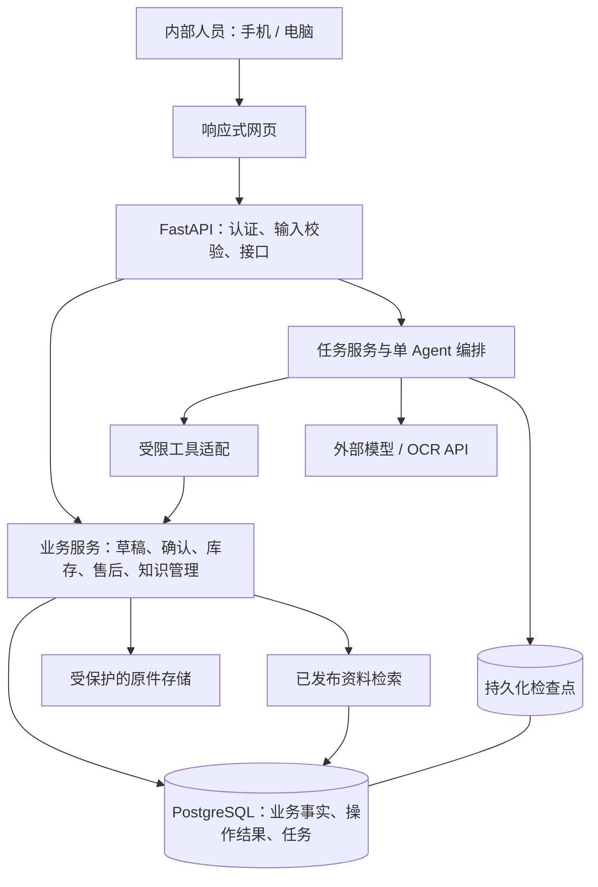
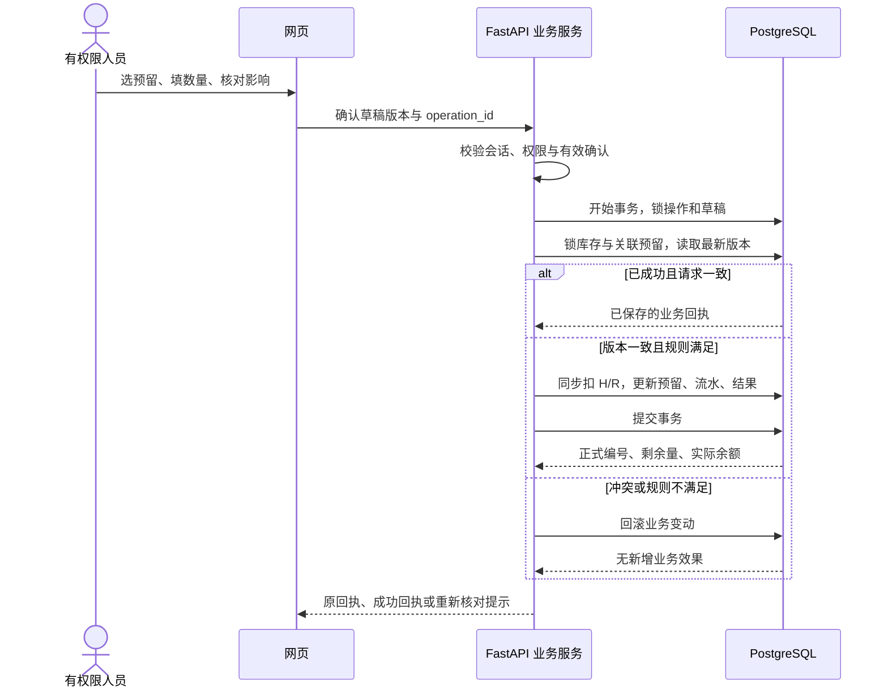

# 门店售后与库存协作智能体 · 项目架构

| 文档项 | 内容 |
| --- | --- |
| 版本 / 日期 | V1.0 / 2026-10-28 |
| 状态 | 架构建议稿，供后续技术设计与开发使用；尚未实施或完成业务验收 |
| 适用范围 | 单门店内部使用，手机优先、电脑可用的 V1 |
| 需求基线 | [PRD V1.0](../prd/store-service-agent-prd-v1.0.md) |
| 项目规范 | [AGENTS.md](../../AGENTS.md) |
| 界面依据 | [设计资源 AI 版](../design/design-resources.md)、[HTML 可视化版](../design/design-resources.html) |
| 开发计划 | [阶段性开发计划 V1.0](../plans/development-plan-v1.0.md)，与PRD、本文组成需求/设计/计划三文档 |

## 1. 文档定位与当前状态

本文描述目标架构、模块边界、数据一致性、任务恢复及分阶段落地方式，不是已实现系统的说明，也不替代数据库迁移、接口详细设计和逐任务实现计划。

当前交付与待实施状态统一见[开发计划](../plans/development-plan-v1.0.md)的阶段记录；前端说明见[样板README](../../prototypes/frontend/README.md)。本文只维护目标实现设计，不重复维护页面完成状态。

全文采用以下区分：

- **项目约束**：沿用 AGENTS.md 和 PRD 的范围、数据与确认要求；PRD 中标注为产品建议的业务规则仍保留该性质。
- **架构建议**：本稿为实现当前范围提出的技术默认方案，不代表用户已经确认技术栈和具体参数。
- **待核定**：依赖真实材料、业务人员核对或技术验证的事项，见第 15 节。

## 2. 目标、边界与方案取舍

### 2.1 架构目标

1. 库存数量、统计和权限由确定性业务代码处理，能够脱离模型测试和使用。
2. 自然语言入口和结构化表单进入同一套业务校验、草稿、确认和提交机制。
3. 正式事实保留来源、修订和流水；任务可以恢复，重复提交只有一次业务效果。
4. 从库存闭环逐步扩展到售后档案和维修知识，控制部署组件及运行成本。
5. 复用既有 C 方向资源，手机完成日常任务，电脑支持资料对照。

### 2.2 首版范围

覆盖售后归档与历史、维修资料与辅助、分库房整机库存、预留和提货、统一任务入口及必要的内部管理。范围以 PRD 的全部 P0 为完整 V1 门槛，阶段版本须说明已交付范围。

公众报修、自动读取个人微信群、自动派工、财务结算、自动采购、跨店管理、配件库存、序列号流转和无真实需求的库房调拨，均不进入本文目标架构。

### 2.3 方案比较

| 方案 | 收益 | 代价与适用条件 | 本稿建议 |
| --- | --- | --- | --- |
| 模块化单体，同源网页与 API，一个 PostgreSQL | 库存和预留可在同一事务内处理；部署组件少 | 需要在代码中保持业务边界 | 作为首版方案 |
| 独立前端应用 + 同一业务后端 | 前端工程化和复杂交互更方便 | 引入构建、发布及接口协作成本；分域时增加认证配置 | 页面复杂度确有需要时再评估 |
| 按业务拆成微服务 | 可独立扩容和发布 | 分布式一致性与运维成本超过当前需求 | 当前不采用 |

上述选择是设计者建议，尚未作为用户已选技术方案。实现前如有新的明确技术要求，应更新本稿。

## 3. 总体架构与信任边界



- 浏览器负责展示和收集输入，服务端决定权限、确认是否有效及业务结果。
- Agent 负责理解、补问和选工具；工具适配调用业务服务，不在模型侧提供任意 SQL、文件路径或通用执行能力。
- 业务数据库是库存、售后及操作结果的事实来源；检查点是继续任务的上下文，不能作为记账凭证。
- 原文、照片、手册和模型输出都作为待处理内容，不能提升账号权限或产生人工确认。
- 模型只接收任务必要内容；维修手册问答通常无需客户姓名、手机号和详细地址。

## 4. 技术组成与部署单位

| 部分 | 首版建议 | 说明与落地时点 |
| --- | --- | --- |
| 后端 | Python + FastAPI | 项目优先方向；按业务模块组织路由与服务 |
| 网页 | 同源 HTML/CSS/JavaScript，按页拆分 | 复用现有样式和素材；首版不预设前端框架 |
| 业务存储 | PostgreSQL | 保存业务事实、草稿、操作结果和任务；M1 建立 |
| 访问数据库与迁移 | SQLAlchemy + Alembic | 架构建议，M1 验证驱动、事务与版本兼容后锁定依赖 |
| Agent 编排 | 单 Agent + LangGraph 持久化检查点 | M1 工具稳定后接入；检查点与业务表分开管理 |
| 知识检索 | PostgreSQL 内的型号过滤和关键词基线；按评测加入 pgvector | M3 再安装确有需要的向量能力，中文检索效果须实测 |
| 原件 | 应用服务器的受保护持久化目录，数据库存元信息 | 与静态资源目录隔离；后续有容量或部署需要再迁对象存储 |
| 外部能力 | 模型 API；OCR 或视觉模型按样例选择 | 不预设供应商、价格、向量维度或识别准确率 |
| 运行 | 单应用服务 + PostgreSQL，试用部署采用容器及持久卷 | 同源提供网页和 API；部署环境提供 HTTPS |

应用按业务模块组织是对 FastAPI 路由能力的项目级使用建议，参考其[多文件应用文档](https://fastapi.tiangolo.com/tutorial/bigger-applications/)。不把上述组件清单当作当前已安装依赖；具体版本在落地阶段选择受支持且相互兼容的组合，并写入锁定文件。

首版不预先引入 Redis、消息中间件、独立向量数据库或独立 Agent 平台。长任务先保存任务状态，再由应用内受控执行器处理；任务领取、失败和中断均落库，同一任务只允许一个有效执行者。阻塞解析不得占住请求事件循环；需要恢复时从任务记录继续，而非依赖内存后台回调。具体领取与重启回收机制在接入长任务时测试；出现吞吐或隔离需求后再拆独立工作进程。

## 5. 模块职责与依赖方向

| 模块 | 负责 | 边界 |
| --- | --- | --- |
| 身份与权限 `auth` | 内部账号、登录会话、账号启停、职责叠加、访问检查 | 权限来自后端；操作时检查当前权限 |
| 基础资料 `catalog` | 库房、标准型号、确认别名、启用状态 | 历史标识保留；不默认匹配相似型号 |
| 草稿与操作 `operations` | 草稿版本、确认、稳定操作标识、执行结果查询 | 不内置库存加减；协调具体业务服务在同一事务内提交 |
| 库存 `inventory` | 建账、余额、流水、预留、提货、更正、统计 | 所有余额和关联预留变动走本模块 |
| 售后 `service_records` | 客户与服务地址、归档、补充、修订、候选和历史检索 | 手机号不是绝对唯一客户键；关联由人员核对 |
| 来源 `sources` | 原文/原图保存、元信息、受控读取、处理状态 | 识别结果不能替换原件，存储键不由模型决定 |
| 知识 `knowledge` | 手册及案例版本、解析、审核发布、检索、引用定位、反馈 | 默认检索仅包含已发布且适用的依据 |
| 任务与 Agent `agent` | 任务上下文、补问、调用预算、工具选择、等待与恢复 | 不直接更新业务表；从工具结果组织反馈 |

HTTP 路由和 Agent 工具适配均依赖业务服务；业务服务依赖数据库及受控文件访问。库存、售后等业务服务不得反向依赖模型或 Agent。已有内部服务调用可直接使用 Python 函数，不为单进程模块增加内部 HTTP 请求。

权限矩阵以 PRD 第 3 节为待核定的业务建议：同人可兼任；负责人组织专业审核不等于自动具有维修专业审核资格。专业核对和发布是两个不同的动作。

## 6. 目录建议与逐步创建方式

以下为目标目录，不表示这些文件已经存在；随对应阶段创建，不一次生成空模块。

```text
store-service-agent/
├─ AGENTS.md
├─ pyproject.toml                 # Python 依赖与工具配置，落地时生成锁定文件
├─ app/
│  ├─ main.py                     # 应用装配、路由注册和生命周期
│  ├─ config.py                   # 环境配置与必要限额，不保存密钥值
│  ├─ db.py                       # 连接、会话及事务基础
│  ├─ auth/                       # 登录、权限、会话
│  ├─ catalog/                    # 库房和型号
│  ├─ operations/                 # 草稿、确认、幂等与结果
│  ├─ inventory/                  # 库存、预留、流水、统计、更正
│  ├─ service_records/            # 客户、地址、档案和修订
│  ├─ sources/                    # 来源元信息和原件访问
│  ├─ knowledge/                  # 资料发布、检索和引用
│  ├─ agent/                      # 编排、状态、工具与模型接入
│  └─ web/                        # 业务 HTML、CSS、JS 和公共素材
├─ migrations/                    # 受版本控制的数据库迁移
├─ tests/                         # 按业务划分的单元与 PostgreSQL 集成测试
├─ evals/                         # 标注任务、评测脚本和结果说明
├─ deploy/                        # 容器及备份恢复操作说明
├─ docs/architecture/             # 本架构文档
├─ docs/prd/                      # 现有需求基线
├─ docs/design/                   # 现有设计规范、概念图和核对证据
├─ docs/plans/                    # 当前阶段开发计划
├─ docs/guides/                   # 按任务加载的开发与Git规范
└─ prototypes/                    # 核心前端与原工作台样板及历史证据
```

模块从少量 `router.py`、`schemas.py`、`models.py`、`service.py` 开始，按实际规模拆分；不为单次使用建立通用仓储框架或插件系统。业务页面从样板复用资源时指定唯一维护源并同步引用，不建立无人维护的重复副本。运行原件、数据库卷、备份、模型密钥和真实客户材料放在代码仓库之外。

## 7. 数据模型与事实归属

### 7.1 核心实体

以下名称是逻辑实体建议，字段、索引和物理表名由对应阶段迁移确定。

| 实体组 | 必要内容与关系 |
| --- | --- |
| 用户、权限、会话 | 用户启用状态、多职责权限、可撤销会话；首个负责人通过受控初始化建立 |
| 客户、服务地址及关联 | 原始与规范化联系方式/地址、候选关系；支持同号多址及同址多人，不能据手机号唯一约束客户 |
| 来源材料 | 原文或存储键、类型、业务用途与访问范围、已知页码/群名/消息时间、提交人、提交时间、识别状态；可关联任务、草稿及正式记录 |
| 售后记录、来源关联、修订 | 客户地址关联、问题、型号、处理及结果、日期精度、记录版本；修订保留前后值、原因和新增来源 |
| 库房、型号、别名 | 稳定编号、启用状态、经核对的别名 |
| 库存账、余额 | 每个库房型号一份建账状态、T0、期初 H0/R0、当前 H/R 和版本；期初来源保留 |
| 库存原单、流水、更正关联 | 原操作类型、原量/当前有效量、发生与登记时间、数量差额、原单及预留编号、操作者 |
| 预留 | 明确客户，或足以区分的称呼和联系方式；库房、型号、登记量、累计已提/已取消、依据、是否期初、版本 |
| 草稿、确认、操作结果 | 业务类型、结构化参数、缺项、目标版本、草稿版本、确认人/时间、操作标识、参数摘要、提交结果 |
| 任务、检查点 | 登录主体、选中候选、关联草稿/操作、当前阶段、运行记录；检查点只保存继续任务所需上下文 |
| 知识版本、片段、引用和反馈 | 适用型号、来源类型、审核/发布状态、文件版本、页/章节、检索内容；历史回答保留具体版本引用 |

预留可在尚无售后档案时登记，不能为了留货虚构一份售后记录。客户及地址关联采用显式关系，避免预先限制为“一手机号一客户”或“一地址只属于一人”。

### 7.2 数据不变量

- 库存以 `(warehouse_id, model_id)` 唯一标识，重复建账受数据库唯一性保护；未建账与已建账为零分开表示。
- 当前余额保存 H、R；A 从 `H - R` 派生，不提供可单独编辑的可售字段。数量均为整数，满足 `H >= 0`、`0 <= R <= H`。
- 单笔预留满足 `登记量 >= 累计已提 + 累计已取消`；剩余从三者派生。R 等于本库房型号所有有效预留剩余之和。
- 库存余额、相关预留、有效单量、流水和业务操作成功结果在同一数据库事务内更新。
- 流水及历史修订留痕，正式原单不能普通编辑或物理删除；更正链和当前有效量均可追溯。
- 售后记录与来源是多对多关系；一份照片可关联多条记录，一条记录也可增加后续来源。

行内条件用数据库 CHECK、外键及唯一约束兜底；跨行合计由统一业务写入路径、行锁、事务与对账测试保证，不能把预留总和写成普通跨表 CHECK。约束能力与限制参考 [PostgreSQL Constraints](https://www.postgresql.org/docs/current/ddl-constraints.html)。

### 7.3 时间与未知值

同时保存业务发生时间、提交/登记时间和修订时间。精确时刻按带时区时间保存，展示与自然日统计使用 `Asia/Shanghai`；只有日期、月份或完全未知时单独保存精度及相应值，不补造时分秒，也不将上传时间当维修时间。

T0 为每个库房型号的精确建账时刻。常规库存事件须确认在 T0 之后且尚未记账；同日只有日期、前后不明时停在待核对。统计按发生日期、包含开始和结束自然日，展示各对象建账覆盖范围及查询截至时间。数据库中缺值和业务上的零不混用。

## 8. 人工确认、幂等与库存事务

### 8.1 草稿和确认契约

1. 表单或 Agent 提交业务参数，后端校验并生成可编辑草稿，返回缺项、对象和预计影响。
2. 待确认版本由后端分配稳定 `operation_id`，绑定草稿 ID、版本、操作类型和规范化业务参数。模型和浏览器不能修改它所绑定的内容。
3. 用户点击确认控件时，后端校验真实登录主体及当前权限，记录确认人与时间，并绑定本版本参数和目标版本。原文中的“已确认”和模型输出不构成凭据。
4. 修改关键字段或目标状态变化时，旧确认失效；新草稿版本分配新操作标识，必须重新展示并确认。网络重试与恢复继续使用原版本的操作标识。
5. `operation_id` 唯一；一个草稿版本最多有一次成功提交。相同标识但参数或确认主体不一致时拒绝；成功结果只向当前有权查看的人返回。
6. 代办需要当前登录人员具有对应职责，并重新核对确认；不能把原人的确认自动转给另一人。

### 8.2 提货时序示例



### 8.3 并发与原子性

库存提交采用 PostgreSQL 事务和行锁。所有写入按固定顺序锁定：操作记录 → 草稿 → 库存余额 → 关联预留 → 被更正原单；同类多行按稳定 ID 排序。读取最新版本后重新验证数量、建账状态、T0 边界及关联关系，再执行变动。行锁行为参考 [PostgreSQL Explicit Locking](https://www.postgresql.org/docs/17/explicit-locking.html)。

预览不持有长期锁；库存或关联记录变化后需刷新草稿和重新确认。首次建账没有余额行可锁，依靠库房型号唯一键与同一事务防止并发初始化。不同操作标识提交同一草稿版本，也必须通过草稿锁与成功提交约束阻止重复效果。

数据库锁持有期间不调用模型、OCR 或文件解析。事务出错全部回滚；失败诊断在回滚后记录，不能留下“已成功”结果。连接中断、提交结果未知时先查原操作，不直接判定失败或换标识重试。

### 8.4 更正和统计

- 入库数量更正：有效量从 old 改为 new，H 增加 `new - old`，R 不变；进货按原单更正后的有效量统计，不重复累计更正单。
- 普通出库更正：H 减少 `new - old`，R 不变，仍满足当前可售约束。
- 预留提货更正：H、R 同时减少 `new - old`，同步改累计已提和剩余；减记可使已结束预留重新进行中。
- 盘点调整不算进货；改库房、型号或日期按 PRD 走受约束的原单冲正及重新登记，分别确认。
- 增记提货不得侵占已取消部分；任何更正不能产生负在库、负剩余或预留超额。

具体更正规则仍属于 PRD 中的产品建议，真实启用前由门店核定。统计和更正使用同一有效原单口径，并提供对账查询：期初加有效变动等于当前余额；预留剩余合计等于 R。

## 9. Agent 任务与恢复

### 9.1 工具和状态

首版单 Agent 只使用业务能力工具：客户候选/档案/来源查询、库存/预留/统计查询、资料检索、草稿创建与修正、受控提交、操作结果核验。写工具调用仍须通过第 8 节的后端检查，不向模型暴露可自行构造的确认授权。

任务状态采用 PRD 口径：处理中 → 待补信息 / 待确认 / 待结果核验 → 已完成，另有失败和取消。业务操作另存待确认、提交核验中、已成功、失败未提交和已取消；任务完成文案不能覆盖实际提交状态。一句话多笔写入分别产生草稿、确认和回执。

LangGraph 以持久化检查点支持等待与恢复，任务和编排线程由后端关联，客户端传入线程 ID 不能绕过任务访问检查。框架的中断恢复可能重跑节点，因此节点副作用仍须幂等，详见官方[持久化](https://docs.langchain.com/oss/python/langgraph/persistence)及[中断](https://docs.langchain.com/oss/python/langgraph/interrupts)说明。

### 9.2 提交与检查点的边界

不假定业务事务与编排检查点在同一次提交中完成。业务提交成功而检查点尚未更新是正常需要处理的故障窗口：恢复后先按 `operation_id` 查询数据库结果，再推进任务，不能根据旧检查点重新创建出库。

恢复还须检查当前账号状态、权限、草稿和目标版本。待确认任务继续等待；旧预览失效则重新核对；已成功操作回显原业务回执。取消任务只能停止未提交工作，已提交事实另走更正。

模型/OCR 调用期间不持有业务事务，保存当前阶段和必要输入引用。每任务限制模型轮次、工具次数、时长和费用；参数通过样例实测核定。超限保留已完成与未完成部分，读操作有限重试，写操作先核验结果。模型不可用时仍提供档案检索、库存查询和有权限的表单记账。

## 10. 售后来源与知识检索

### 10.1 售后资料路径

原文/照片提交 → 保存来源 → 提取或手工填写分条草稿 → 查询候选 → 人工选择客户地址并修正 → 确认归档 → 按手机号/地址查询 → 打开来源或补充修订。

原件先保存成功才报告已接收；识别失败仍能手工录入和查看原件。一页多条分别确认，同号多址不自动合并；历史未知日期单独表达。售后并发修订校验目标版本，后提交者不能覆盖已确认内容。普通用户不硬删除档案，负责人确认作废仍保留历史。

文件与数据库没有共同事务：上传先写受控暂存区并完成持久化，再登记来源元信息，返回成功前校验可读取。失败或中断时允许重试并清理未被引用的暂存文件，不能因此合并业务记录。文件内容摘要只用于完整性和疑似重复提示。原件定位通过服务端存储键，不接受任意磁盘路径。

来源保存时即绑定提交人、业务用途和本门店访问范围，不等待正式记录建立后才授权。未归档阶段，提交人在仍具有对应来源访问权限时可查阅自己提交的材料；有对应核对职责且有权访问关联任务/草稿的人员可查阅办理所需原件。尚未生成草稿或识别失败的来源保留上述范围，可由有权核对该业务范围的人员继续处理，不因失败自动公开。归档后新增正式记录关联，读取仍检查当前来源访问权限和关联记录的业务范围；账号停用或撤权后不沿用旧任务授权。多条记录共用原图时按整份来源核验范围，不能只因其中一条可访问就开放其他超权限内容。这是本稿的来源授权建议，具体职责沿 PRD 权限矩阵核定。

### 10.2 维修资料路径

手册/案例上传 → 解析并保留页/章节 → 核对型号及版本 → 必要专业审核 → 发布 → 按已确认机型过滤 → 检索 → 组织带条件的建议 → 展示结论对应的原文入口。

先用真实资料建立关键词检索基线，再比较向量检索或组合检索；中文分词、故障码、精确型号、表格及扫描页均需样例验证。若采用向量，使用同一 PostgreSQL 内的 [pgvector](https://github.com/pgvector/pgvector)，嵌入模型、维度和重建规则在选型后确定。检索索引可以重建，不能充当唯一资料副本。

只默认检索已发布且适用的版本；未审核经验不进入正式依据，停用版本不默认命中，但历史引用可追溯。相似型号须人工消歧，缺依据或来源冲突时显示缺口，不能用模型常识填成指定机型结论。疑似燃气泄漏等紧急输入中止普通问答，具体提示由师傅审核。

维修回答保留适用范围、检查前提、条件化修理建议、逐项引用和未知信息；不自动变成实际维修结果或配件出库。反馈用于评测，不能未经审核直接改写知识事实。

## 11. API 与前端交互约定

### 11.1 API 能力分组

以下为建议资源边界，不是已经实现或冻结的接口路径；请求字段与错误码在各阶段详细设计中确定。

| 资源组 | 能力 |
| --- | --- |
| `/api/auth`、`/api/users` | 登录/退出、当前主体、负责人维护账号权限 |
| `/api/warehouses`、`/api/models` | 库房型号维护与候选 |
| `/api/drafts`、`/api/operations` | 草稿读改、显式确认提交、按标识查询结果 |
| `/api/inventory`、`/api/reservations` | 余额、建账、预留、流水、进货统计与更正的业务能力 |
| `/api/sources`、`/api/service-records` | 来源上传及受控读取、客户地址候选、档案与修订 |
| `/api/knowledge` | 资料解析/审核/发布、原文定位、维修问答和反馈 |
| `/api/tasks` | 发起、读取、补信息、恢复和取消任务 |

正式写入统一经草稿和操作机制；不能因库存接口按资源分组就另开可绕过确认的直接写接口。业务回执包含正式编号、操作标识、登记时间和实际结果；查询注明覆盖范围和截至时间。状态码区分未登录、无权限、字段非法、版本冲突和暂时不可用，界面使用业务措辞。

### 11.2 页面组织与认证

一级入口保持工作台 / 待核对 / 售后 / 库存；维修辅助从工作台或售后详情进入，低频管理置于资料与设置。二级办理页使用返回和本页操作区，避免叠加两条底栏。页面采用既有编号：`home`、`service-draft`、`service-search`、`service-detail`、`repair-assistant`、`inventory`、`reserved-pickup`、`inbound-statistics`。

七页之外，按业务阶段补齐登录、待核对列表、入出库、预留选择/取消、流水、建账、更正及资料账号管理；这些是流程支撑范围，不意味着现在已有完整视觉样板。

首版建议使用服务端可撤销会话与 HttpOnly Cookie；部署时使用 HTTPS、Secure 及合适的 SameSite，修改请求校验 CSRF 与来源。用户身份从会话读取，不接受浏览器或模型自报操作者。首个负责人通过部署初始化创建，日常账号由负责人分配，不开放公众注册。

网页通过任务查询展示阶段和回执，首版可采用有限轮询；是否流式输出以后按实际体验决定。刷新后从后端重读草稿和结果，本地内存不承担恢复依据。复用 tokens、ui.css、SVG 和纹理；每次页面实现同步两版设计资源索引、实际截图和核对记录。检查 320/390px 窄屏、电脑布局、长内容、未知字段、多候选、键盘焦点和固定栏遮挡，未覆盖项如实记录。

## 12. 安全、运行与备份恢复

- 入口统一鉴权，后端检查操作权限及对象访问范围；原件和照片不能以公开静态链接暴露。禁用账号和撤销权限后，旧任务仍要重新检查。
- 附件类型、大小、张数和保存时长在真实样本验证后核定，页面显式说明。文件名不作为磁盘路径，不执行上传内容。
- 密钥从部署环境注入，不进入仓库、网页或日志；模型和工具输入保留必要摘要，手机号、地址及错误信息脱敏。
- 运行记录关联任务 ID、草稿版本、操作标识、业务编号、模型/提示词/知识版本、耗时、用量、人工修改和异常。费用估算与实际账单分开记录，不保存隐藏推理过程。
- PostgreSQL 不直接向公网开放；应用和数据库数据持久化，原件目录与代码发布分离。发布迁移先备份，迁移失败不得继续开放写业务。
- 备份包含业务库、任务和检查点、来源文件、知识版本及恢复所需配置说明。数据库与文件建立一致的备份点及清单，恢复后抽查来源关联；凭据独立保管。
- 初始每日备份、7 份滚动保留、恢复点不超过 24 小时来自 PRD 的建议，尚非服务承诺，须核定保存策略和备份位置。索引可从原件重建。
- 试用前在独立测试环境演练恢复：检查余额/流水/预留、原件读取、历史引用、待确认任务、已提交操作及重复恢复无新增效果，并保留记录。

## 13. 验证策略与需求追溯

业务测试不依赖真实模型才能运行；模型和 OCR 用可控替身覆盖失败，再用获准真实样本评测质量。并发、约束和事务测试使用真实 PostgreSQL，不以进程内锁或另一数据库的通过结果代替。

FR/AC与阶段任务的映射统一维护在[开发计划的需求与验收追踪](../plans/development-plan-v1.0.md#10-需求与验收追踪)，避免两处追踪表漂移。

重点失败窗口还须注入测试：更新余额后事务失败应全部回滚；提交成功后响应丢失或检查点写入失败应查询原结果；相同草稿不同操作标识不得重复提交；提货减记须恢复对应预留和状态。

AI 评测分别记录工具选择、任务过程、最终业务状态和引用支持，不只评价回答流畅度。按 PRD 准备并逐步扩充标注集，调优和保留评测样本分开；维修问答比较通用 AI、同模型同资料和自建 RAG。任务完成率、耗时、费用和建议通过率均以测量结果报告，不预写收益数字。

## 14. 分阶段落地

阶段顺序、任务、交付与退出条件统一见[开发计划](../plans/development-plan-v1.0.md)，本文不重复维护路线表。首次正式写入必须已有权限、有效确认、事务、幂等和持久化，不能拖到最终试用阶段。

## 15. 待核定事项与设计者默认值

技术组成仍是第4节的架构建议，兼容性验证后才锁定版本。业务口径、真实资料、模型/OCR、保存策略与部署的待核定项，统一见[开发计划的缺口清单](../plans/development-plan-v1.0.md#12-待核定事项与缺口处理)。

迁移DDL、索引、精确接口字段、错误码、任务领取实现和生产页文件名，在对应阶段详细设计时确定并更新本文；必须满足上述权限、事务、来源和恢复边界，不自行扩展产品范围。

## 16. 文档维护与参考

业务含义以 PRD 和用户最新明确要求为依据，视觉以已选 C 和设计资源为依据。架构改变时在此说明原因、影响和验证方式；不将 PRD 的产品建议或架构建议改写为已经确认的业务事实。

可靠性随首次正式业务写入建立，最终阶段做完整回归；具体任务与进展在开发计划维护。

外部技术能力于 2026-10-28 查阅官方资料，具体版本仍须在落地时验证：

- [FastAPI 多文件应用](https://fastapi.tiangolo.com/tutorial/bigger-applications/)：模块化路由。
- [PostgreSQL 约束](https://www.postgresql.org/docs/current/ddl-constraints.html)：CHECK、唯一键、外键及约束边界。
- [PostgreSQL 行锁](https://www.postgresql.org/docs/17/explicit-locking.html)：事务内并发控制；链接版本不表示项目已经锁定 PostgreSQL 17。
- [LangGraph 持久化](https://docs.langchain.com/oss/python/langgraph/persistence)与[中断恢复](https://docs.langchain.com/oss/python/langgraph/interrupts)：检查点、等待及重跑副作用。
- [pgvector 官方仓库](https://github.com/pgvector/pgvector)：PostgreSQL 内的向量检索候选。
