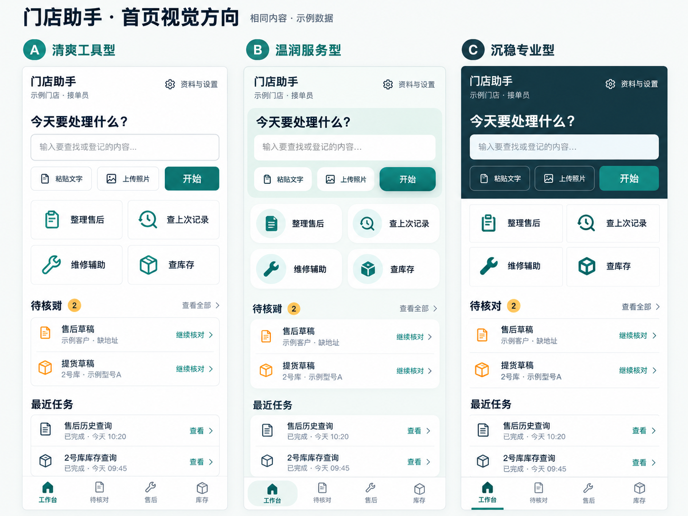

# 门店售后与库存协作智能体 · 界面简报

| 项目 | 内容 |
| --- | --- |
| 版本 / 日期 | V1.0 / 2026-10-26 |
| 需求依据 | [PRD V1.0](../prd/store-service-agent-prd-v1.0.md) |
| 本轮产物 | 产品与用户说明、体验方向、品牌配色、要与不要、页面结构线框 |
| 使用终端 | 手机优先，电脑便于批量整理和对照资料 |
| 本轮决定 | 信息层级、品牌主色及颜色用途；用户已选定首页视觉方向 C（沉稳专业型） |
| 后续细化 | 以 C 为视觉基准，细化组件参数、交互状态和其他核心页面 |

本简报依据现有 PRD 制定。用户已选定第 10 节记录的首页视觉方向 C；具体业务页面尚未经过门店人员的界面试用。线框为低保真结构示意，方框只代表区域和控件位置，不代表最终卡片样式、尺寸、字体或装饰。所有人名、型号、数量和日期示意均为样例。

## 1. 产品是做什么的

这是门店内部日常工作用的售后与库存助手，界面简称建议使用“门店助手”。

它帮助接单人员把群消息、纸本照片整理为可追溯档案；帮助维修师傅按手机号、地址查上次怎么处理，并按机型查询有出处的维修建议；帮助进出货人员登记和查询各库房的在库、预留、可售数量及进货情况。

AI 负责理解表达、整理草稿、查资料和衔接任务。人通过界面核对对象、字段和数量，明确确认后才形成正式业务记录。用户应能看到查到了什么、依据在哪里、本次会改什么、最后是否登记成功。

## 2. 给谁用，在什么场景用

| 使用人 | 主要任务 | 界面重点 |
| --- | --- | --- |
| 接单人员 | 整理文字/照片、查客户历史、补充维修结果、登记留货 | 查找入口明显；原文与字段便于对照；可以稍后继续核对 |
| 维修师傅 | 上门前或现场查历史、查手册、提供处理结果 | 手机快速检索；型号与地址醒目；建议和出处容易查看 |
| 进出货人员 | 收货、发货、客户提货时登记 | 库房、型号、数量不易看错；短表单；登记前后数量清楚 |
| 门店负责人 | 盘点建账、核对差异、管理资料与权限 | 明确看到数据范围、原单和更正关系；低频管理与日常操作分层 |

同一人可能兼任多个角色。导航骨架保持一致，实际按钮根据权限提供。手机承担日常查询和现场登记，电脑承担资料整理、原件对照和较多明细查看。

## 3. 整体应该是什么感觉

**清楚、稳妥、顺手，有门店日常工具的务实感。**

- **清楚**：先看到对象、问题、数量和状态，随后看到说明与证据。长地址、完整型号不能被关键位置的省略号遮掉。
- **稳妥**：草稿、待核对、已归档、已登记分别表达；数量变化和来源随时可查。遇到未知或失败，说明当前状态和下一步。
- **顺手**：高频查询和登记有直接入口，用户既可自然表达，也可点选、填表；查到后可以接着处理，不需要反复复制信息。
- **有人情味**：使用接单人员和师傅熟悉的词，如“查上次记录”“留货”“提货”“查看原件”，语气平实、简短。

首页进入日常工作，不安排品牌宣传页。AI 能力通过任务结果、补问和可核对的草稿体现。界面不展示 Token、向量、工具函数名或模型思考过程等实现信息。

## 4. 品牌色与颜色用途

### 4.1 确定主色：深青绿 `#0F766E`

将深青绿作为本门店工具的界面品牌色，用于主按钮、当前导航、选中项与少量强调。希望它传达耐看、清晰的工作工具感。首页采用第 10 节选定的 C 方向：深色顶部搭配白色内容区，品牌主色承担主操作与选中态。

这套配色是本次界面建议，不作厂家官方视觉规范的声明。未来提供门店标识后，再核对标识与主色的组合关系。

| 色彩角色 | 色值 | 用途 |
| --- | --- | --- |
| 品牌主色 | `#0F766E` | 主操作、当前导航、选中态、关键入口 |
| 主色浅底 | `#E7F3F1` | 与主色文字配合的轻量强调区域；使用前核对具体对比度 |
| 页面背景 | `#F7F9F8` | 内容区之外的浅色基底 |
| 内容底色 | `#FFFFFF` | 表单、原文、列表与主要阅读区域 |
| 正文/标题 | `#17313B` | 核心内容、字段标签、库存数字 |
| 次要文字 | `#52646F` | 时间、来源补充和辅助说明 |
| 成功 | `#166534` | 已登记、已归档等完成状态，与文字一起使用 |
| 待核对/注意 | `#92400E` | 缺少信息、需要核对、数量发生变化 |
| 错误/危险 | `#B91C1C` | 提交失败、非法数量、不可执行及需要谨慎处理的操作 |
| 信息提示 | `#1D4ED8` | 处理中、资料说明等中性信息 |

**使用规则**：

1. 白字放在品牌主色上；正文和辅助说明分别使用指定深色。初步计算：白字/主色对比度约 5.47:1，正文/白底约 13.65:1，次要文字/白底约 6.16:1；最终组件仍须按实际背景核验。
2. 状态颜色必须配合明确文字。不能仅靠红绿区分在库、预留和可售。
3. 三项库存主要通过标签、数字和顺序区分；“已预留”本身不代表异常，不自动涂成警报色。
4. 主色用于明确可执行的主操作；取消、返回、查看更多的权重应低于主操作。危险操作另有明确文案和核对信息。
5. 组件形态以选定的 C 参考图为依据；精确字体、间距、圆角和状态细节在后续设计中核定，不要求每个内容块都做成卡片。

## 5. 想要什么，要避免什么

| 想要 | 要避免 |
| --- | --- |
| 首页直接给出任务输入、高频入口、待核对和最近任务 | 首页铺宣传口号、欢迎大图或无关经营大屏 |
| 自然语言和结构化操作并存，用户可直接找到业务页 | 所有操作都塞进长聊天，必须从头描述才能查记录 |
| 地址、手机号、型号、库房始终有明确标签 | 只显示“这个客户”“这台机器”“当前库房”等含糊指代 |
| 原始文字/照片便于与提取字段对照 | 只给 AI 总结，把原始资料藏到难找的位置 |
| 库存同时显示在库、预留、可售及时间口径 | 只有一个“库存数”，或把已售未提货直接当作已出库 |
| 提交前显示本次对象、数量和预计影响 | 直接执行聊天中的写入，提交后才告知改了什么 |
| 维修建议就近提供适用型号、检查前提与引用 | 大段肯定答案、出处集中堆在底部却对应不上结论 |
| 把未知、无匹配、未建账、待核对分别说明 | 用同一个“暂无数据”覆盖所有情况，把未知显示成 0 |
| 按权限提供操作，保留清楚的任务进度与业务回执 | 用户无法操作时只让按钮失灵，或把“正在核验”显示成“已成功” |
| 手机单列、清晰字段标签、足够点击空间，电脑合理分栏 | 手机依赖悬停、横向滚动长表格、细小图标或只有占位符的表单 |
| 用少量主色强调和可信的文字反馈建立秩序 | 以持续闪烁、夸张动效、机器人装饰抢占工作内容 |
| 使用实际支持的照片/文字入口和真实业务数据 | 擅自加入语音、自动读群、自动派工、支付或其他 PRD 外功能 |

## 6. 页面结构与导航

### 6.1 手机一级导航

底部保持四个入口：**工作台 / 待核对 / 售后 / 库存**。

- 维修辅助从工作台高频入口进入，也可从售后详情带入已知机型信息。
- 进货统计、预留明细、流水从库存进入。
- 手册资料、账号、库房型号、期初建账和更正通过“资料与设置”次级入口提供，并按权限显示。
- 二级办理页使用顶部返回和底部操作区，不同时堆叠两条底栏；返回应保留此前筛选和已保存草稿。

### 6.2 工作路径

| 任务 | 页面路径 |
| --- | --- |
| 整理售后 | 工作台提交文字/照片 → 待核对 → 草稿核对 → 归档回执 |
| 查历史 | 工作台或售后检索 → 必要时选客户/地址 → 档案详情 → 原始资料 |
| 问维修 | 工作台维修辅助 → 确认型号与问题 → 回答与出处 → 查看资料 |
| 登记库存 | 库存 → 选择操作与对象 → 填写/核对 → 预计影响 → 明确确认 → 实际回执 |
| 查进货 | 库存 → 进货统计 → 日期/库房/型号筛选 → 汇总与原单明细 |

自然语言任务进入相应业务页或办理页时保留已提供的信息。缺参数用就近的补全区或候选选择解决，不要求用户重新抄一遍。

## 7. 主页面与核心页面线框

以下以手机纵向结构为主。`[文字]` 表示按钮、选择项或输入区域；位置和顺序有约束，框线、比例、组件外观与实际像素没有约束。顶部是页面信息，底部操作区须兼顾键盘和系统安全区域，不能挡住字段。

### WF-01 手机工作台：首页

**目的**：进入后知道能做什么，快速发起新任务，继续未完成的核对。

```text
┌────────────────────────────────┐
│ 门店助手            [资料与设置] │
│ 当前门店 / 登录人员              │
├────────────────────────────────┤
│ 今天要处理什么？                │
│ [输入要查找或登记的内容……]      │
│ [粘贴文字] [上传照片]   [开始]   │
├────────────────────────────────┤
│ 高频入口                       │
│ [整理售后]       [查上次记录]    │
│ [维修辅助]       [查库存]        │
├────────────────────────────────┤
│ 待核对                 [查看全部]│
│ 售后草稿 · 缺地址      [继续核对]│
│ 提货草稿 · 待确认      [继续核对]│
├────────────────────────────────┤
│ 最近任务                       │
│ 查某户历史 · 已完成       [查看]│
│ 库存查询 · 已完成         [查看]│
├────────────────────────────────┤
│ [工作台] [待核对] [售后] [库存] │
└────────────────────────────────┘
```

首屏优先保留任务入口和高频入口，待核对摘要紧随其后。空任务时用简短示例帮助发起，不展示虚构业务统计。来源上传选择与所发起任务匹配，库存登记仍需进入草稿核对。

**待核对一级页结构**：顶部标题及“全部 / 售后 / 库存”筛选；中部只展示该账号有权处理的草稿，列出对象摘要、缺失项、保存时间和“继续核对”；底部保留四项导航。进入草稿后才展开完整表单，避免列表页堆满输入项。

### WF-02 售后草稿核对

**目的**：对着原件改字段、选对客户或地址，明确确认归档。

```text
┌────────────────────────────────┐
│ [返回] 售后核对         草稿1/2 │
├────────────────────────────────┤
│ 来源：纸本照片 / 已知页码       │
│ [原件预览区域]          [展开] │
├────────────────────────────────┤
│ 需要核对：手机号有一处不清     │
│ 客户关联 [选已有档案 / 新建]   │
│ 候选不唯一时在这里列出并选择   │
├────────────────────────────────┤
│ 姓名/称呼  [                  ]│
│ 手机号     [                  ]│
│ 服务地址   [                  ]│
│ 问题描述   [                  ]│
│ 型号/故障码[ 未提供可保持未知 ]│
│ 维修日期   [ 未知 / 已知日期  ]│
│ [展开处理方法、配件、结果]     │
├────────────────────────────────┤
│ 当前状态：草稿，尚未正式归档   │
│ [稍后核对]          [确认归档] │
└────────────────────────────────┘
```

先原件、再待核对项、再表单，确保字段的根据容易找。当前草稿满足最低归档条件后才允许确认；缺少必需信息或客户关联未明确时，确认区说明缺什么。未知日期、型号不强制编造。归档日期另作系统信息，不能替代维修日期。一页多记录逐条核对，回执明确本条结果。

### WF-03 售后检索与候选选择

**目的**：按手机号、地址定位到正确客户和服务地址。

```text
┌────────────────────────────────┐
│ 售后档案                       │
│ [手机号 / 地址关键词       ]  │
│                         [查找] │
├────────────────────────────────┤
│ 找到多个服务地址，请先选择     │
│ 示例客户甲 · 138****0001        │
│ 示例小区 1号楼 101             │
│ [选择这个地址]                 │
├────────────────────────────────┤
│ 示例客户甲 · 138****0001        │
│ 示例小区 2号楼 202             │
│ [选择这个地址]                 │
├────────────────────────────────┤
│ [修改查询条件]                 │
│ 无匹配时说明当前归档范围       │
├────────────────────────────────┤
│ [工作台] [待核对] [售后] [库存] │
└────────────────────────────────┘
```

无歧义时可直接进入结果；有歧义才展示候选。用于消歧的地址、姓名和联系方式按必要范围显示，不能为了省空间把两个地址都截成相同文字。

### WF-04 售后档案详情与来源

**目的**：看清同一客户、同一服务地址的维修经过，并回到对应原件。

```text
┌────────────────────────────────┐
│ [返回] 售后档案                │
│ 示例客户甲 / 联系方式          │
│ 示例小区 1号楼 101             │
│ 已知设备型号 / 未提供          │
├────────────────────────────────┤
│ 历史记录                       │
│ 已知维修日期 · 问题摘要 [展开]│
│ 日期未知     · 问题摘要 [展开]│
├────────────────────────────────┤
│ 当前展开的这次记录             │
│ 问题 / 故障码 / 已知机型       │
│ 处理方法                       │
│ 更换配件                       │
│ 最终结果 / 尚未记录            │
│ [查看对应原件] [查看修订]      │
├────────────────────────────────┤
│ [补充处理结果]     [查维修依据]│
└────────────────────────────────┘
```

查看原件在独立阅读层打开，显示原文/照片、已知群名或纸本页码与返回入口，关闭后留在原记录位置。按钮文案为“查看保存的群原文/纸本照片”，不承诺跳回未接入的微信群。补充结果进入草稿；提供内容的权限和确认归档的权限按 PRD 区分。

### WF-05 维修辅助

**目的**：围绕已确认机型和故障信息查依据，给出带前提的修理建议。

```text
┌────────────────────────────────┐
│ [返回] 维修辅助                │
├────────────────────────────────┤
│ 设备型号 [选择/输入准确型号]   │
│ 故障码   [没有可留空        ]  │
│ 故障表现 [                 ]  │
│                    [查维修依据]│
├────────────────────────────────┤
│ 本次依据：适用机型 / 资料版本  │
│ 待补信息或资料不足时在此说明   │
├────────────────────────────────┤
│ 故障含义与可能原因      [出处1]│
│ 检查前提与排查项        [出处2]│
│ 条件化修理建议          [出处2]│
│ 需要现场核对的信息             │
├────────────────────────────────┤
│ 资料依据                       │
│ 文档名称 · 页/章节 [查看原文]  │
│ [有用] [不适用/出处错误]       │
├────────────────────────────────┤
│ [补充检查结果，继续询问……]    │
└────────────────────────────────┘
```

与建议对应的出处按钮就近放置，下方资料列表提供完整文档定位。资料缺口优先呈现；不把空白处填成肯定结论。机型或关键条件改动后提示需要重新查询，旧回答不冒充新条件下的结论。手机原文单独阅读；电脑可在回答旁展示对应页。

### WF-06 库存总览

**目的**：快速知道哪个库房、哪个型号有多少实物、多少已留、多少可售。

```text
┌────────────────────────────────┐
│ 库存                  [登记变动]│
│ 库房 [全部/选择库房]           │
│ 型号 [搜索准确型号         ]  │
├────────────────────────────────┤
│ 示例2号库 / 示例型号A          │
│ 实物在库    已预留    可售     │
│   10台       3台      7台      │
│ [查看流水]        [预留明细]   │
├────────────────────────────────┤
│ 示例3号库 / 示例型号A          │
│ 实物在库    已预留    可售     │
│    6台       2台      4台      │
│ [查看流水]        [预留明细]   │
├────────────────────────────────┤
│ [进货统计]                     │
│ 查询时间 / 最近登记时间        │
│ 数据依据已登记记录             │
├────────────────────────────────┤
│ [工作台] [待核对] [售后] [库存] │
└────────────────────────────────┘
```

库房和型号在每组数量上方，不依靠记住顶部筛选理解归属。“未建账”有独立状态，不写成 0/0/0。可售作为销售可用量优先阅读，但在库和预留始终可见。全部库房可给分项和明确标注的合计。

“登记变动”按权限提供入库、普通出库、留货、取消留货、预留提货。预留明细列出客户、登记量、已提、已取消、剩余和依据；期初预留标清登记量为建账时剩余量。流水列出业务发生时间与登记时间、操作类型、数量、操作者及关联单。

### WF-07 库存操作与确认：以预留提货为例

**目的**：先确定原预留，再核对提货数量和影响，最后明确登记。

```text
┌────────────────────────────────┐
│ [返回] 预留提货                │
├────────────────────────────────┤
│ 客户 [查找并选择明确客户]      │
│ 预留 [选择具体预留单       ]   │
│ 库房/型号：来自所选预留        │
│ 该单剩余：3台                  │
├────────────────────────────────┤
│ 本次提货 [2] 台                │
│ 发生日期 [选择/核对日期    ]   │
│ 备注     [                ]   │
├────────────────────────────────┤
│ 预计影响（尚未登记）           │
│             当前    登记后     │
│ 实物在库    10台      8台      │
│ 已预留       3台      1台      │
│ 可售         7台      7台      │
│ 本次同时减少在库和对应预留     │
├────────────────────────────────┤
│ [取消本次操作]      [确认提货] │
└────────────────────────────────┘
```

同一页面容纳必要字段和确认预览，避免为每个字段增加一步。修改在字段区完成，确认按钮写具体动作。输入未明确或数量不合法时就近说明原因。提交中显示“正在登记/核验结果”，成功后再展示实际数量、操作编号和“查看记录/返回库存”；结果未知时不显示成功。

**共用结构、不同内容**：入库/普通出库选择库房和型号；留货增加客户与口头/定金/全款依据；取消留货选择具体剩余预留及取消量；预留提货使用原单的库房和型号。库存更正由负责人入口进入，额外显示原单、原因和更正前后，不能混在普通出库中。

### WF-08 进货统计

**目的**：按实际登记范围查看某段时间、库房和型号进了多少货。

```text
┌────────────────────────────────┐
│ [返回] 进货统计                │
│ 日期 [开始日期] 至 [结束日期] │
│ 库房 [全部/选择] 型号 [选择]   │
│                         [查询] │
├────────────────────────────────┤
│ 已登记进货合计：数量 / 台      │
│ 范围：建账起点之后的已登记记录 │
│ 查询截至时间                   │
├────────────────────────────────┤
│ [按日期] [按库房] [按型号]     │
│ 分组名称              有效数量 │
│ 日期/库房/型号分项        台数 │
│ 日期/库房/型号分项        台数 │
├────────────────────────────────┤
│ [查看对应入库单]               │
│ 期初和盘点调整不计入进货       │
└────────────────────────────────┘
```

合计之后保留分项与原单查看。不同对象建账起点不同，应能看到覆盖差异；未覆盖历史与已覆盖但数量为零分开表达。首版线框以数字和明细满足查询，不强制加入趋势图或其他图表。

## 8. 电脑端布局

### WF-09 电脑工作台

把手机的纵向内容合理分栏，保留同一套任务和入口。

```text
┌───────────┬──────────────────────────┬───────────────────┐
│ 门店助手  │ 当前门店 / 工作台        │ 登录人员 / 设置   │
├───────────┼──────────────────────────┼───────────────────┤
│ 工作台    │ 任务输入                 │ 待核对摘要        │
│ 待核对    │ [描述要处理的事……]      │ 对象 / 缺失项     │
│ 售后档案  │ [文字/照片]      [开始]  │ [继续核对]        │
│ 库存      ├──────────────────────────┤                   │
│           │ 整理售后 / 查历史        │                   │
│           │ 维修辅助 / 查库存        │                   │
│           ├──────────────────────────┤                   │
│ 资料与设置│ 最近任务与业务回执       │                   │
└───────────┴──────────────────────────┴───────────────────┘
```

右侧只放与工作有关的待核对信息，不变成多组经营 KPI。屏幕变窄时右侧内容下移，不挤压正文。

### WF-10 电脑核对与来源对照

```text
┌───────────┬──────────────────────────────────────────────┐
│ 一级导航  │ 售后草稿核对 / 当前条目 / 返回              │
├───────────┼──────────────────────┬───────────────────────┤
│           │ 原始资料             │ 待核对字段            │
│           │ 图片/原文阅读        │ 客户关联              │
│           │ 已知来源信息         │ 电话、地址、问题      │
│           │ 放大/翻页            │ 日期、型号、处理结果  │
│           │                      │ 缺失/冲突提示         │
│           │                      │ [稍后核对][确认归档]  │
└───────────┴──────────────────────┴───────────────────────┘
```

同样的对照原则可用于维修回答：一侧是回答和检查条件，另一侧是当前引用的文档页。首版不要求拖拽分栏或复杂窗口系统。

## 9. 支撑页面与关键状态

### 9.1 资料与设置

作为次级页面按权限组织四组内容：手册资料；库房/型号；账号权限；期初建账/库存更正。

- 手册列表显示名称、机型、版本、发布/审核状态，详情可查看原件与适用范围。专业审核与发布职责按 PRD 区分。
- 期初建账页把盘点时点、在库与既有留货放在同一个核对流程中；使用“建账起点”等业务表达。
- 更正页先定位原单与核实差异，再看对在库、预留和有效进货量的影响。
- 这些页面保持与日常业务相同的标签、确认和回执方式，不扩展新的管理范围。

### 9.2 必须考虑的页面状态

| 状态 | 页面怎么表达 | 用户下一步 |
| --- | --- | --- |
| 首次使用、尚无资料 | 说明当前可用范围，展示直接入口 | 提交资料、建账或发起已有范围的查询 |
| 无匹配 | 保留查询条件，说明当前归档范围内未找到 | 修改条件或明确新建草稿 |
| 多候选 | 显示可区分的客户/地址/机型信息 | 选择正确对象 |
| 缺字段/识别不清 | 原件和对应字段附近明确标记 | 修正、补充或稍后核对 |
| 未建账 | 显示“未建账”，不显示零库存 | 由有权限人员确认起点 |
| 资料未覆盖 | 在回答前部说明机型或依据缺口 | 补准确型号、资料或询问师傅 |
| 正在处理 | 显示当前阶段，如“正在识别资料” | 可返回任务列表后继续，避免重复发起 |
| 提交结果待核验 | 明确“结果正在核验”，保留任务入口 | 等待核验或返回继续查看 |
| 库存变化/版本冲突 | 展示最新对象与数量，说明原预览需重核 | 核对新草稿后重新确认 |
| 成功 | 展示业务编号、实际结果和登记时间 | 看记录、回列表或继续下一条 |
| 失败/无权限 | 明确失败原因或所需职责，不伪装成空列表 | 修正、重试或交相应人员处理 |

## 10. 已选视觉方向与后续细化

### 10.1 用户已选：C · 沉稳专业型

选择日期：2026-10-26。用户从同一张三栏对照图中选择了**最右侧 C**，该画面作为首页视觉基准。



选定方向的主要特征：

- 头部与任务输入区组成深墨青色区域，使用清楚的浅色文字和输入面。
- 下方保持白色业务内容区，使用明确标题、克制的边界和整齐的列表分隔。
- 主操作、功能图标及选中态沿用深青绿 `#0F766E`；深色区域以 `#17313B` 为设计色值基准，后续实现时核对对比度。
- 高频入口保留 2×2 结构；待核对和最近任务保留相同业务内容与顺序。
- 底部导航使用明确的选中标识，整体保持沉稳、专业、便于快速阅读。

参考图为生图概念稿，文案准确性及业务行为以本简报和 PRD 为准。正式设计应修正可能出现的文字细节误差；选择视觉方向不代表交互和业务功能已经实现。

### 10.2 后续细化范围

以 C 为基准继续细化**工作台、售后草稿核对、库存总览**，再扩展维修辅助等页面。沿用本简报的内容顺序、业务信息与任务路径；具体组件参数和交互状态在该视觉方向内核定。涉及业务数据时使用获准材料或明确标注的样例。

概念图评审应回答：

- 进入首页能否立刻找到查历史、整理资料、问维修和查库存？
- 能否看出当前对象、未知信息和需要自己核对的字段？
- 能否一眼分清在库、预留、可售，并找到当前库房和型号？
- 在点击确认前，能否说清这次将改变什么？
- 维修建议与保存原件是否容易找到出处？
- 手机操作和电脑对照是否都成立？

### 10.3 C 方向手机核心页面概念稿

已按用户确认的 7 页完成概念图，整理于 2026-10-28：[页面图册](mobile-pages-c-v1.md)（[并排浏览](mobile-pages-c-v1.html)）。范围为售后草稿核对、售后检索与候选选择、售后档案详情、维修辅助、库存总览、预留提货确认、进货统计。图片采用示例数据，页面控件尚未实现交互。

### 10.4 C 方向 HTML 视觉样板

用户于 2026-10-28 要求先以选定版本实现视觉风格。当前样板包含[手机工作台](../../prototypes/ui-sample/index.html)和[视觉组件页](../../prototypes/ui-sample/ui-kit.html)，共用配色、按钮、表单、状态、列表与库存数量组件。SVG 图标和细颗粒背景保存为可复用素材，使用方式见[样板说明](../../prototypes/ui-sample/README.md)。

样板提供本地演示交互，完整业务页面及后端尚待实现；设计核对证据见[design-qa.md](../../design-qa.md)。

## 11. 本轮核对范围

本轮依据 PRD 检查页面覆盖、术语与库存样例；已计算指定主色及主要文字配色的初步对比度。尚未进行可点击原型、真实浏览器界面验证或门店用户试用。

布局参考检索未得到可直接采用的门店业务页匹配，因此页面结构以 PRD 为依据，并采用通用的清晰标签、明确反馈、手机优先和可读性原则；没有套用检索返回的官网宣传布局。配色与线框均为本次设计选择。
