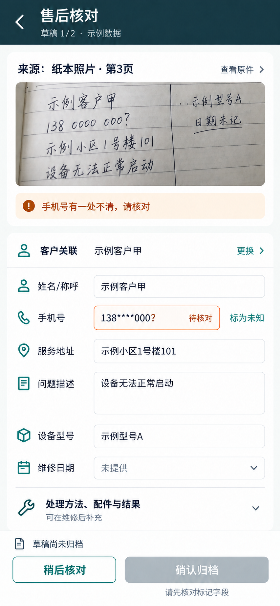
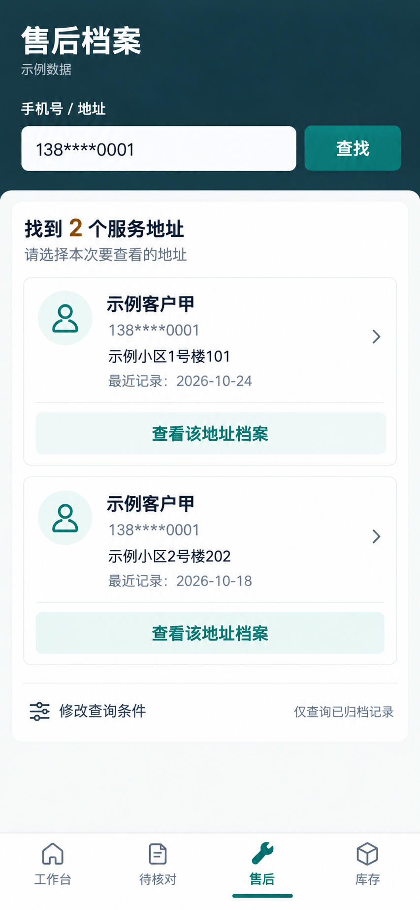
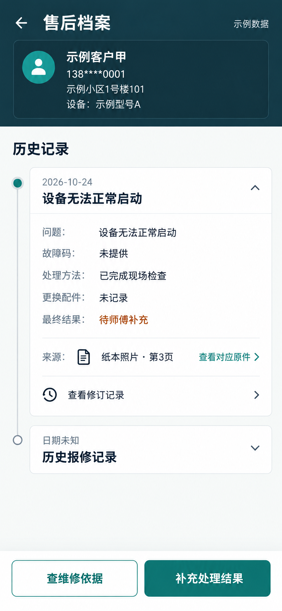
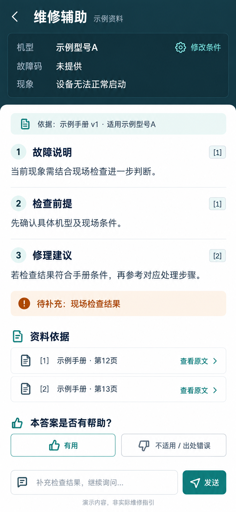
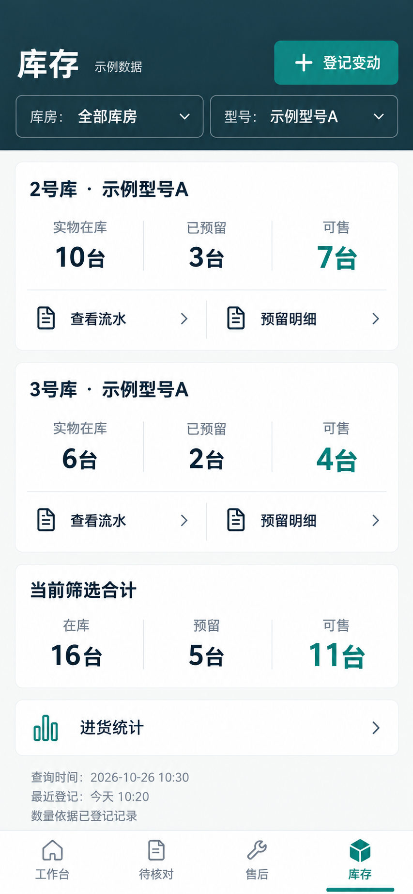
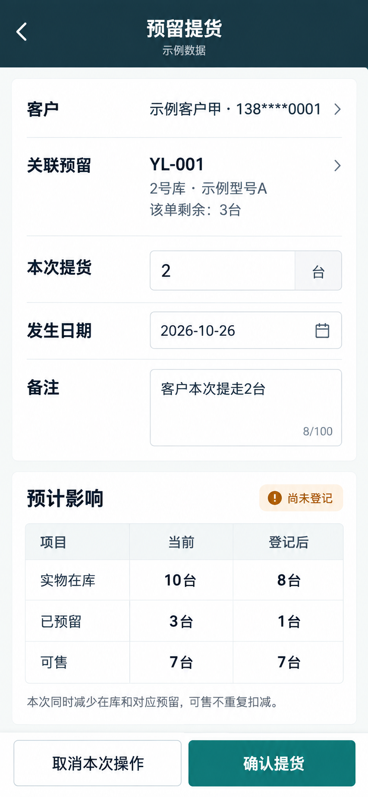
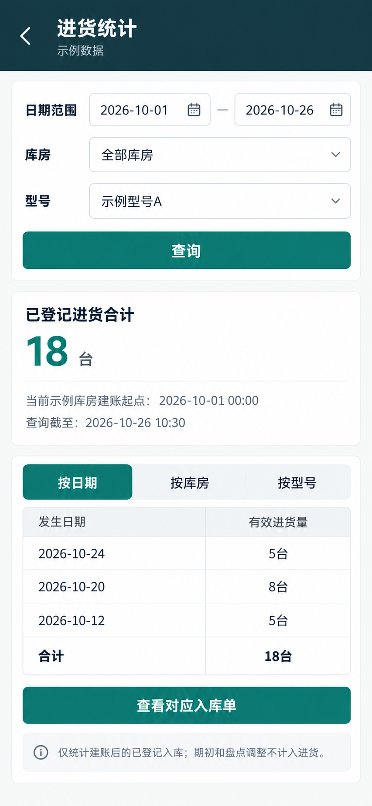

# C 方向 · 手机核心页面图册

完成整理：2026-10-28。沿用用户已选 C 的深墨青顶部、白色内容区和深青绿操作色。

本轮仅包含用户确认的 7 个手机核心页。以下为内置 ImageGen 生成的概念效果图，采用示例数据；页面中的按钮和流程尚未实现交互。样例日期保留原概念稿的 2026-10-26。

[并排浏览图册](mobile-pages-c-v1.html) · [界面简报](interface-brief-v1.0.md) · [复现提示词与局部修正记录](mobile-pages-c-prompts-v1.md)

## 售后与维修

### 1. 售后草稿核对

对照纸本原件，核对模糊手机号；未核对时确认归档不可用。

### 2. 售后检索与候选选择

同一手机号匹配两个地址，逐个展示候选，由接单人选择。

### 3. 售后档案详情

呈现历史记录、待补充结果、对应原件与修订入口。

### 4. 维修辅助

建议旁附依据，保留检查前提、资料缺口和追问入口。

## 库存与登记

### 5. 库存总览

按库房和型号展示在库、预留、可售及筛选合计。

### 6. 预留提货确认

确认前预览数量影响：在库和预留各减 2，可售保持 7。

### 7. 进货统计

按日期统计有效进货，明确建账起点和统计范围。

## 核对说明

- 原件照片日期已修正为“日期未记”，与表单“维修日期未提供”一致。
- 检索候选按两个服务地址区分；档案中未记录的结果仍显示待补充。
- 维修页采用虚构示例手册，建议与检查前提、引用相邻展示。
- 库存合计为 16−5=11；预留提货前后为 10−3=7、8−1=7；进货统计为 5+8+5=18。
- 本轮检查限于图片内容、业务样例一致性与文件链接；触控尺寸、响应式布局、交互和真实资料需在后续实现中验证。
