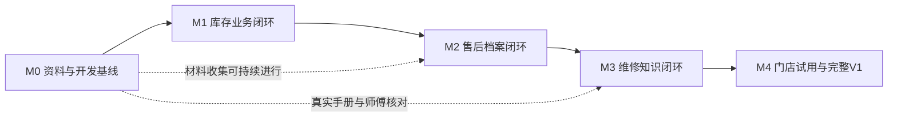

# 门店助手 · 阶段性开发计划

从C方向前端样板推进到真实业务V1。本文维护阶段任务、依赖、验收与状态，不代表任务已经实施；执行方式和Git操作遵循当次用户授权。

| 项目 | 内容 |
| --- | --- |
| 版本 / 日期 | V1.0 / 2026-10-29 |
| 文档职责 | 三文档中的“开发计划 / 任务”，需求和技术设计分别复用已有PRD与架构稿 |
| 状态 | 待实施；本表中的后端、资料和上线任务均未宣称完成 |
| 阶段编号 | 沿用PRD的M0～M4；M1内部再拆小步，不另改里程碑含义 |
| 排期方式 | 以依赖和退出条件推进，不设未经确认的天数、交付日期或费用 |

## 执行依据

- 范围、业务规则和验收以[PRD](../prd/store-service-agent-prd-v1.0.md)为准，保留建议与待验证事项的性质。
- 模块、数据、确认、事务与恢复契约以[架构](../architecture/store-service-agent-architecture-v1.0.md)为准，不在计划另写一套实现设计。
- 页面按[设计规范](../design/design-resources.md)推进；代码与交付遵守[开发规范](../guides/development.md)。

## 重点复核

| 易遗漏条件 | 应有行为 | 对应验证任务 |
| --- | --- | --- |
| 提交已经成功，但响应或Agent检查点丢失 | 查原操作回执，不换标识再次扣库存 | M1-03、M1-06 |
| 同一手机号对应不同地址；来源还未归档或识别失败 | 人工消歧；原件按当前权限可追溯，不串户或公开 | M2-01、M2-03 |
| 只知道日期，恰好与T0同日 | 核实发生在建账前后，不擅自再次计入 | M1-02、M1-03 |
| 预留已结束后减记提货，或增记量侵占已取消部分 | 同步恢复正确预留，或整体拒绝；不只改在库 | M1-05 |
| 资料停用、型号不明，或恢复任务时账号已撤权 | 不默认命中过期资料，不继承旧权限强行执行 | M3-01、M3-02、M1-06、M4-02 |

## 1. 使用方式

三文档职责与变更顺序见[文档入口](../README.md)。本计划只维护任务与完成证据；需求变化回到PRD，实现变化回到架构。

本文件是项目阶段计划。后续实施时先把**当前切片**细化为可执行任务，确定字段类型、函数签名、迁移、接口和测试；尚未开始的阶段保留这里的目标与验收边界。避免在真实资料和兼容性验证前，一次冻结全部API、表结构和模型版本。

## 2. 当前起点与尚缺能力

截至2026-10-29的仓库检查：根目录包含文档、`prototypes/`和项目规范；尚无`app/`、数据库迁移、后端依赖声明或服务端测试目录。

| 内容 | 当前实际情况 | 后续处理 |
| --- | --- | --- |
| PRD与架构 | 已有需求基线草案和架构建议稿 | 继续沿用，按阶段核定建议与详细契约 |
| 手机/电脑页面 | [核心样板](../../prototypes/frontend/README.md)已有工作台、待核对及七个核心视图 | 复用C方向，在对应阶段接入真实接口 |
| 样板验证 | 已有[2026-10-28核对记录](../design/qa/frontend-c/README.md) | 仅为样板证据，本轮未重跑，不计为正式业务验收 |
| 登录、权限、数据库 | 未实现 | 从M1第一个切片开始建立 |
| 业务写入与恢复 | 当前只有会话内模拟，刷新重置 | 改为后端事实、版本确认、稳定操作标识及持久化 |
| 售后原件、OCR、维修资料 | 当前为构造示例，未接入真实材料或模型 | M0准备材料；M2/M3逐步接入并验证 |
| 部署、备份、门店试用 | 未完成 | 基础备份能力随数据落库建设，M4做完整演练与试用 |

现有样板库存余额与进货统计是不同验收场景，不能作为连续台账导入正式库。测试与演示种子必须重新构造为能对账的数据集。

## 3. 阶段总览与依赖



| 阶段 | 可交付结果 | 依赖 | 退出条件摘要 |
| --- | --- | --- | --- |
| M0 资料与基线 | 字段、样例、决策和验收清单 | 现有PRD、架构与前端样板 | 首个切片的口径可执行，缺真实材料项有明确处理方式 |
| M1 库存闭环 | 登录、建账、入出库、留货/提货、统计、更正及库存Agent | M0；M1内部按任务依赖推进 | 库存、并发、确认、幂等及恢复有数据库证据 |
| M2 售后闭环 | 来源提交、提取与核对、归档、检索、补充和修订 | M1共享身份、草稿、操作与任务能力 | 原件可追溯，消歧和并发修订正确，刷新/重启可恢复 |
| M3 知识闭环 | 资料发布、按型号检索、带引用建议、反馈及评测 | 共享基础和真实资料；材料准备可提前 | 有适用的真实出处，专业核对通过，缺口不冒充结论 |
| M4 试用与V1 | 全链路、运维恢复、真机试用、成本和质量报告 | M1～M3达到各自退出条件 | 全部P0及发布门槛有证据，剩余问题明确 |

默认按表中主线顺序实施；资料收集、标注和师傅核对可以提前。真实手册不足时继续库存、售后或样例验证，不用虚构手册宣布M3完成。只交付部分阶段时使用对应阶段名称，不称为完整V1。

## 4. 目标目录与文件责任

目标目录统一见[架构第6节](../architecture/store-service-agent-architecture-v1.0.md#6-目录建议与逐步创建方式)。各阶段任务表标出实际涉及的模块和测试路径；依赖文件与锁定方式在M1-01兼容性验证后确定，按需创建，不预建全部空模块。

每个业务模块先从实际需要的`router.py / schemas.py / models.py / service.py`组织，不建立通用仓储框架或内部微服务。生产公共样式与素材明确唯一维护源；原`prototypes/`作为历史样板保留，迁移后在设计资源两版说明生产入口，不让原型脚本参与正式业务计算。

## 5. M0：资料与开发基线

**目标**：让M1首个切片可按明确口径实施，并提前准备M2/M3所需材料。

**前置**：阅读三份主文档和项目规范；核对当前工作区，保留已有修改。

| 任务 | 行动与交付物 | 验证方式 |
| --- | --- | --- |
| M0-01 | 梳理库房、型号、职责和建账样例；记录哪些是真实材料、哪些是构造数据 | 能说明每个字段来源；未取得的真实数保持未知 |
| M0-02 | 为首个切片记录权限、T0、确认和回执规则；补齐M1需要的数据关系及接口契约 | PRD、设计与测试预期没有冲突；可走通第11节演算 |
| M0-03 | 收集获准使用的小批售后材料和机型手册，登记来源、适用范围、版本及专业核对人 | 覆盖模糊电话、一页多记录、未知日期、同号多址；缺项有记录 |
| M0-04 | 建立按FR/AC编号追踪的验收清单；区分调优集、保留集和独立业务测试 | 每项有输入、前置、权限、应否确认、预期结果和依据 |

**退出条件**：

- [ ] M1首个切片可使用一组明确标注、能对账的样例开始，不依赖猜测真实库存。
- [ ] 下表涉及M1的决策有实施结论或样例开发的临时口径；真实启用前的核对责任明确。
- [ ] 售后与手册缺项有清单，允许后续补齐；不把“已建清单”写成“真实资料已收齐”。

## 6. M1：库存业务闭环

**目标**：让受控记账先独立成立，再让Agent使用同一套业务能力。

**前置**：M0首个切片基线明确；独立开发/测试库可用。正式业务启用还需核对真实职责和期初数据。

### 6.1 任务拆分

| 任务 / 顺序 | 实施范围与文件 | 可验证结果 |
| --- | --- | --- |
| M1-01 工程、身份与环境 | `app/main.py`、`app/config.py`、`app/db.py`、`app/auth/`、首批迁移及依赖文件；账号初始化、登录/退出、撤销会话、多职责权限、CSRF与来源校验 | 可复现启动与迁移；服务端拒绝无权限请求；停用/撤权后旧会话不能继续写入 |
| M1-02 基础资料与建账 | `app/catalog/`、`app/inventory/`及最小`app/operations/`；库房/型号维护，负责人核对T0、实物和既有预留，显式确认一次建账；登录、建账、查询页接真实接口 | 10/3/7正确，预留关联完整；未建账与已建账为0分开；重复建账无额外效果，期初不计进货 |
| M1-03 入库与确认基础 | 扩展`app/operations/`、`app/inventory/`；草稿版本、服务器分配操作标识、人工确认、事务、回执和按原标识核验；入库表单和待核对页接入 | 入库5得到15/3/12；重复、旧版、参数冲突、未授权、T0边界、超时及重启不造成错误记账 |
| M1-04 普通出库、留货与提货 | `app/inventory/`及对应表单；选择具体预留，支持部分提货/取消、预留明细和流水；客户可独立于售后档案登记 | 普通出库不能占用预留；提货同时扣H/R；最后一台并发只允许一方成功；冲突后重新核对 |
| M1-05 统计、更正与对账 | `app/inventory/`及负责人更正页、统计页；按有效原单统计，盘点差额、入库/出库/提货数量更正，库房/型号/日期错误按受约束流程处理 | 有效进货排除期初和调整；更正不重计；余额、预留、有效原单及流水一致，提货减记可恢复预留 |
| M1-06 库存Agent与任务恢复 | `app/agent/`、任务/检查点持久化及工作台；先查询再补问、草稿、人工确认、结果核验；长任务领取、预算和有限重试 | 自然语言与表单使用同一业务服务；重启、响应丢失或检查点落后不重复记账；多笔任务分别报告结果 |

依赖顺序：M1-01 → M1-02 → M1-03 → M1-04 → M1-05 → M1-06。每个切片同时交付迁移、必要页面和测试；不等全部接口写完才联调，也不等Agent接入才验证库存。

### 6.2 首次写入即具备的契约

| 对象 | 必须有的内容和边界 |
| --- | --- |
| 库存查询 | 库房、标准型号、建账状态、T0、H/R/A、数据版本、查询截至时间；A由后端派生 |
| 草稿 | 草稿编号、版本、操作类型、结构化参数、缺项、目标数据版本和预计影响；编辑参数使旧确认失效 |
| 确认 | 登录主体、当前权限、草稿当前版本及服务器分配的`operation_id`绑定；不能信任模型或客户端自报“已授权” |
| 执行 | 唯一操作及成功结果、固定加锁顺序、当前余额复核；余额/预留/原单/流水/结果在一个事务内成功或回滚 |
| 回执/恢复 | 正式编号、操作标识、实际数量、操作者、发生日期精度及登记时间；未知结果按原标识查询，不能直接换新标识重试 |

建账确认从M1-02开始使用最小草稿/操作基础，M1-03继续扩展，不能在共享机制建好前另写一个可绕过确认的“初始化接口”。同一草稿即使出现不同操作标识，也不能重复产生成功效果。

### 6.3 关键测试与退出条件

后续测试文件约定为`tests/integration/test_inventory_opening.py`、`test_inventory_operations.py`、`test_inventory_corrections.py`、`test_operation_recovery.py`及`test_inventory_agent.py`；细化时可按实际规模调整并更新本表。

- [ ] AC-14～AC-29、AC-34～AC-38中库存相关用例通过，包含并发最后库存和事务失败回滚。
- [ ] AC-05、AC-21、AC-22验证当前版本、相同标识不同参数、同草稿不同标识及重复确认。
- [ ] 在事务更新后注入失败，确认余额、预留、流水、操作结果都没有部分成功。
- [ ] AC-28覆盖确认前重启、数据库提交后响应丢失、业务成功但检查点未保存；恢复后查询原结果。
- [ ] AC-30～AC-32覆盖资料注入、两笔任务部分成功、模型不可用；表单查询与有权限的记账继续可用。
- [ ] 真实PostgreSQL集成测试核对余额与有效流水、预留总和；不能用SQLite或前端样例测试替代。
- [ ] 库存总览、提货、统计及新增表单已在手机和电脑接真实接口，页面成功文案来自后端回执。

## 7. M2：售后档案闭环

**目标**：从保存原件到核对归档、再次找到、补充修订形成可追溯流程。

**前置**：身份、来源所需权限、草稿/操作和任务能力可复用；有可用样例及获准真实材料。先打通手工原文与表单，再接提取/OCR。

| 任务 | 实施范围与文件 | 可验证结果 |
| --- | --- | --- |
| M2-01 来源保存与受控阅读 | `app/sources/`、来源迁移及上传/阅读页；原文、原图独立保存，来源从上传时绑定权限，限额/类型/保存策略由配置明确展示 | 上传失败不伪称已保存；识别失败保留原件；未归档、停用账号、撤权和多记录共用来源均按当前权限检查 |
| M2-02 提取与逐条草稿 | `app/service_records/`、`app/agent/`及草稿核对页；一份来源可生成多条草稿，原文/字段对照，日期精度和不确定项保留 | 模糊字段不补造；先保存草稿，缺最低条件不归档；文本/照片提取失败可手工录入 |
| M2-03 客户消歧、归档和查询 | 客户/地址关系、检索、归档服务及检索/详情页；手机号不是唯一客户键，人工关联或明确新建 | 同号两址选对对象；未知日期独立表达；无匹配只说明当前归档范围；正式记录能回到对应来源 |
| M2-04 补充、修订与售后Agent | 追加结果、新来源、修订、有效/作废状态和版本冲突；任务中断后继续，补充与新报修区分 | 同次报修更新同一记录，保留旧内容；两人并发不静默覆盖；维修建议不自动当作实际结果 |

建议测试路径：`tests/integration/test_sources.py`、`test_source_access.py`、`test_service_records.py`、`test_service_revisions.py`及`tests/acceptance/test_service_workflows.py`。

**退出条件**：

- [ ] AC-01～AC-09通过，尤其是同号多址、未知日期、两条独立草稿和并发修订。
- [ ] 增加来源权限用例：未归档可授权核对、识别失败仍可处理、撤权不可读取、多条记录共用原件不泄露超权限内容。
- [ ] 刷新和服务重启后可查看已保存来源、草稿和正式回执；原件不可访问时明确重试，不伪称已打开。
- [ ] 文本/照片提取使用同一批人工标注样例核对，逐字段报告准确率与修改情况，不预填成绩。
- [ ] 手机完成提交、核对、查询和补充；电脑能对照来源；设计资源两版、截图和核对记录已同步。

## 8. M3：维修知识闭环

**目标**：只对已有适用、可核对资料的范围提供带条件、带出处的维修辅助。

**前置**：取得真实机型与手册，明确专业核对和发布职责；来源阅读、任务与权限能力可复用。虚构示例只能开发界面与测试结构，不能代替本阶段真实资料验收。

| 任务 | 实施范围与文件 | 可验证结果 |
| --- | --- | --- |
| M3-01 资料导入、版本与发布 | `app/knowledge/`、资料迁移及手册管理页；解析、型号/版本核对、专业审核和发布，解析失败和停用状态 | 未审核经验不默认检索；停用版本不默认命中；历史引用仍可定位原版本；案例去掉无关客户信息 |
| M3-02 检索基线与引用 | 型号过滤、关键词检索、片段/页码定位及原文阅读；按同一评测样本比较是否需要向量/重排序 | 相似型号不混用；扫描图表无法可靠解析时提供原页人工核对；检索和生成质量分开记录 |
| M3-03 条件化回答与反馈 | 问答工具、维修辅助页和评测脚本；适用机型、检查前提、条件化建议、逐项引用、缺口及反馈 | 依据支持对应结论；改型号后旧结果失效；无依据或冲突不编结论；紧急风险输入按师傅审核文案中止普通建议 |
| M3-04 公平对照评测 | `evals/repair/`；通用AI、同模型同资料、自建RAG三组对照，尽量固定模型/问题/资料版本 | 师傅评价机型适用、前提、出处和建议可用性；记录例外、样本量、失败案例、成本和耗时 |

建议测试路径：`tests/integration/test_knowledge_versions.py`、`test_repair_retrieval.py`及`tests/acceptance/test_repair_assistant.py`。具体解析、检索和模型方案依据样本验证，暂不预设供应商、向量维度或“必须上向量库”。

**退出条件**：

- [ ] AC-10～AC-13通过，并覆盖型号不明、错误引用、来源冲突、未审核经验和停用版本。
- [ ] 所开放真实机型的回答可打开对应资料版本与页/章节；每条关键结论有直接依据。
- [ ] 师傅完成专业核对，三组对照形成真实报告；PRD的建议指标与实测结果分列。
- [ ] 资料缺口、追问、反馈和模型故障可恢复；反馈不会未经审核直接改写知识。

## 9. M4：门店试用与完整V1

**目标**：把已验证的模块整合到可持续使用、可恢复、可说明真实效果的版本。

**前置**：M1～M3达到退出条件；真实使用需核对权限、登记责任人、T0与留货，以及原件和知识资料的使用范围。

| 任务 | 行动与交付物 | 验证方式 |
| --- | --- | --- |
| M4-01 运行与备份恢复 | 完善`deploy/`的应用/数据库/原件持久化、配置、备份、恢复和迁移说明 | 在独立测试环境恢复数据库、文件、知识版本与任务状态；AC-33通过，无新增记账效果 |
| M4-02 全链路与权限回归 | `tests/acceptance/`，覆盖全部P0、AC-01～AC-38和补充权限用例 | 保存每项结果、失败原因、修复和复验记录；账号撤权及任务恢复一起验证 |
| M4-03 真实手机与电脑试用 | 接单、维修、进出货人员按实际职责走核心任务；同人兼任也记录；补齐账号等低频管理入口 | 真机检查软键盘、安全区、长内容、焦点、底栏、上传和弱网；电脑核对资料对照；不以浏览器截图替代试用 |
| M4-04 性能、质量和成本 | 逐步扩充至PRD建议规模的任务基准，记录数据量、并发、耗时、模型/OCR及估算/实际费用 | 指标是测量结果，建议目标不当作成绩；未达项有处置结论 |
| M4-05 发布准备与交付 | 核对已知限制、业务登记与备份责任、回退步骤，形成启动/操作说明、演示任务和阶段报告 | 按PRD第13.4节逐项核对；发布/真实启用遵循用户当次授权，不因计划勾选自动部署 |

备份从M1数据落库起就建立基础路径，M4验证完整一致恢复。PRD中每日备份、7份保留、恢复点≤24小时，及5并发/1,000档案/10,000流水下查询p95≤2秒、AI任务60秒内完成或给可恢复状态，均为**待核定的建议目标**，不是当前承诺。

手机与电脑共用服务端事实，响应式布局不要求两套前端或两次记账。真机试用需有可访问的测试网络入口；电脑上的`127.0.0.1`不能直接当成手机访问地址。试用网络、HTTPS与权限在部署方案中一起核对。

**退出条件**：

- [ ] 全部P0与AC-01～AC-38及必要补充用例有实际证据，关键失败已修复或阻止发布。
- [ ] 备份恢复、停用账号、并发、重复确认、断网/重启核验和模型不可用均经过正式环境配置下的测试。
- [ ] 真实盘点、T0、职责和资料覆盖范围明确；接单/师傅/进出货人员能够完成相应任务。
- [ ] 发布报告区分真实与样例、建议与实测、已完成与未覆盖；所有影响业务正确性的遗留项有处理结果。

## 10. 需求与验收追踪

下表的“通过”均指未来实际运行验证；目前不预勾选。跨模块用例需在各实现阶段验证，M4再做全链路回归。

| 需求/关键条件 | 主要实施任务 | 验收编号或补充验证 |
| --- | --- | --- |
| FR-01 来源提交 | M2-01、M2-02 | AC-01、AC-02；未归档/识别失败来源权限 |
| FR-02 草稿提取与人工核对 | M2-02、M2-03 | AC-03、AC-04、AC-05 |
| FR-03 结果补充、修订 | M2-04 | AC-06、AC-07；作废保留历史 |
| FR-04 历史与来源查询 | M2-03 | AC-08、AC-09；不同客户来源隔离 |
| FR-05 知识资料管理 | M3-01 | AC-13；停用、版本与历史引用 |
| FR-06 维修辅助 | M3-02～M3-04 | AC-10、AC-11、AC-12；引用支持和专业核对 |
| FR-07 基础资料与建账 | M1-02 | AC-14、AC-15、AC-34、AC-35 |
| FR-08 入库、普通出库 | M1-03、M1-04 | AC-16、AC-17 |
| FR-09 留货与取消 | M1-04 | AC-18、AC-19、AC-23、AC-24 |
| FR-10 预留提货 | M1-04 | AC-20；分次提货、剩余状态 |
| FR-11 库存、流水和统计 | M1-04、M1-05 | AC-25；日期口径、覆盖范围、有效量与对账 |
| FR-12 更正 | M1-05 | AC-26、AC-27、AC-36、AC-37、AC-38 |
| 确认、权限、幂等 | M1-01～M1-06，M2复用 | AC-05、AC-21、AC-22、AC-29 |
| Agent、恢复与降级 | M1-06，M2/M3扩展 | AC-28、AC-30、AC-31、AC-32 |
| 备份恢复与全量回归 | M4-01、M4-02 | AC-33及全部AC回归 |

## 11. 下一步执行单：M0与M1首个切片

建议下一次开发先实施M0，再完成M1-01～M1-03。第一轮先用有标识的测试数据形成“登录 → 建账 → 查询 → 入库草稿 → 确认 → 回执”闭环，暂不同时开发售后、RAG和所有管理页。

### 11.1 开工与详细设计

- [ ] 核对当前分支、工作区、规范和用户授权范围；保留原修改，不自动包含无关文件。
- [ ] 完成M0-01、M0-02；为M1-01～M1-03补齐设计中的最小表关系、约束、接口字段、确认绑定、错误/恢复状态及测试清单。
- [ ] 验证Python/FastAPI、PostgreSQL驱动、SQLAlchemy/Alembic兼容性后锁定依赖；确认开发库与真实业务库隔离。
- [ ] 为最小切片编写失败测试，再创建实际需要的应用、迁移、业务服务和页面；不一次生成后续模块。

### 11.2 最小验收样例

每个独立用例重置到指定前置状态；不能顺序运行后仍拿旧余额作预期。

| 用例 | 前置与动作 | 预期 |
| --- | --- | --- |
| 建账 | 示例2号库/示例型号A，T0明确，在库10、具体既有预留3 | H/R/A=10/3/7；一份起点，期初有效进货为0 |
| 入库 | 从10/3/7开始，发生日期已确认在T0后，入库5，人工确认 | 15/3/12；一次入库流水，进货有效量5 |
| 重复确认 | 上笔入库成功后，用原操作标识再次请求 | 返回原回执，仍是15/3/12，不再增加流水 |
| 参数冲突 | 原操作标识换成入库6 | 拒绝参数冲突，无额外写入 |
| 草稿修改 | 创建入库5草稿，改为6后触发旧版确认 | 拒绝旧版；新版需重新核对与确认 |
| 无权限 | 维修师傅职责账号直接请求确认入库 | 后端拒绝，余额与流水均不变 |
| 期初边界 | 提交T0前的旧入库；或同日只有日期且前后关系不明 | 前者拒绝常规记账，后者待核对，不增加库存或进货 |
| 事务失败 | 在更新余额后、提交前注入失败 | 余额、流水、操作结果全部回滚 |
| 重启/响应丢失 | 确认前重启；或提交成功后丢失响应再恢复 | 待确认继续等待；已提交返回原回执，不再次入库 |

建议测试名为`test_opening_is_once_and_not_inbound`、`test_inbound_updates_balance_once`、`test_operation_rejects_parameter_mismatch`、`test_old_draft_confirmation_is_rejected`、`test_denied_actor_cannot_confirm`、`test_t0_boundary_is_not_recounted`、`test_inventory_transaction_rolls_back`、`test_committed_operation_survives_restart`。用真实服务和PostgreSQL断言最终状态，不能只断言按钮文案。

### 11.3 验证命令与完成证据

以下是**后续实现后的命令约定**，依赖、配置、迁移和测试文件目前尚未创建，本次不执行，也不声称通过：

```powershell
python -m alembic upgrade head
python -m pytest tests/integration/test_inventory_opening.py tests/integration/test_inventory_operations.py tests/integration/test_operation_recovery.py -q
python -m uvicorn app.main:app --reload --host 127.0.0.1
```

迁移须在空的测试库建立全部当期结构；测试退出码为0且报告无失败。启动后在手机宽度与电脑宽度走完整切片，并查询数据库验证回执、余额和流水；测试连接配置与种子创建命令写入当期启动说明。

- [ ] 上述最小用例有失败→实现→通过的记录，阶段内相关回归通过。
- [ ] 后端重启后仍能读取相同草稿/结果；正式编号和实际状态来自服务端。
- [ ] 当前切片页面已接真实接口，原型保留为历史，示例数据和业务库边界清楚。
- [ ] 更新三文档、设计资源两版和本阶段验证记录。只把完成的M1切片标为完成，不把M1整体或完整V1提前标为完成。

## 12. 待核定事项与缺口处理

| 编号 | 待核定内容 | 核定时点与参与人 | 未核定时的处理 |
| --- | --- | --- | --- |
| D-01 | 实际职责及叠加、最低归档条件、预留/取消和更正规则 | M0开始；相关门店人员在正式启用对应能力前核对 | 样例按PRD建议测试，清楚标注；不把建议当既有制度 |
| D-02 | 库房、标准型号、盘点时刻T0、实物与既有未提留货 | M0整理，负责人在正式建账前确认 | 开发用构造种子；不导入原型独立样例作为正式台账 |
| D-03 | 后端依赖版本、驱动、包管理/锁定方式与会话实现 | M1-01兼容性验证；开发者记录结果 | 不预填版本或声称已安装；有结果后更新设计和锁定文件 |
| D-04 | OCR/模型、文件类型/大小/张数、保存时长与删除规则 | M2前用实际材料验证；开发者与资料持有人核对 | 先做原文/手工表单；原型10MB限制不是生产规格 |
| D-05 | 手册覆盖、版本、专业审核人及紧急风险提示 | M3接入前；资料持有人和师傅核对 | 可以开发结构，不能开放没有真实依据的维修结论 |
| D-06 | 模型/OCR预算、工具次数、超时与质量建议阈值 | 首次模型接入时测量，试用前核定 | 有限调用并记录；超限返回可恢复状态，不写虚构成本 |
| D-07 | 部署入口、HTTPS、备份位置/频率、恢复目标和登记责任 | M1建立基础方案，M4真实试用前由负责人核对 | 保持隔离的开发/测试环境，不宣称已经生产可用 |

真实资料不足只阻止依赖该资料的验收；其余样例开发和确定性验证继续推进。会改变业务事实的分歧先核对，能通过项目文件或技术试验解决的实现问题由开发者记录结论。

## 13. 状态与阶段完成记录

每次更新只修改实际发生的事项。计划完成不等于代码完成；代码完成不等于测试通过；技术验证不等于门店试用通过。

| 阶段 | 当前状态（2026-10-29） | 本阶段证据 | 下一步 |
| --- | --- | --- | --- |
| 前端样板 | 已有交付，限本地演示 | 见既有样板README与核对记录，未作生产验收 | 作为后续页面依据 |
| M0 | 待实施 | 尚无本阶段完成记录 | 核对样例、口径和待核定事项 |
| M1 | 待实施 | 尚无后端或数据库验收记录 | 完成M0后先做M1-01～M1-03 |
| M2 | 待实施 | 尚无真实来源和归档验收记录 | 提前收集材料，依赖共享基础 |
| M3 | 待实施 | 尚无真实资料检索和专业评测记录 | 提前准备手册与师傅核对 |
| M4 | 待实施 | 尚无完整恢复演练或门店试用记录 | 依赖M1～M3交付 |

后续每个切片追加一条记录：`任务编号 / 本次范围 / 状态 / 变更文件 / 测试命令与结果 / 数据或截图证据 / 未覆盖项 / 阻塞与下一步`。测试结果写明环境、样例或真实数据性质；如有提交则记录实际提交号，不预填编号。
