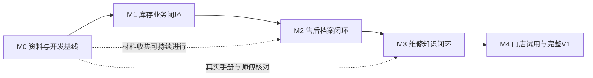

# 门店助手 · 阶段性开发计划

从C方向前端样板推进到真实业务V1。本文维护阶段任务、依赖、验收与状态，不代表任务已经实施；执行方式和Git操作遵循当次用户授权。

| 项目 | 内容 |
| --- | --- |
| 版本 / 日期 | V1.0 / 2026-11-02，纳入已确认的客户端与共享服务方向 |
| 文档职责 | 三文档中的“开发计划 / 任务”，需求和技术设计分别复用已有PRD与架构稿 |
| 状态 | M0样例基线已准备；M1-01/M1-02已获准继续，M1-03已获用户审核通过；M1-04实现及本机技术验证完成，待用户审核；真实资料与上线仍待完成 |
| 阶段编号 | 沿用PRD的M0～M4；M1内部再拆小步，不另改里程碑含义 |
| 排期方式 | 以依赖和退出条件推进，不设未经确认的天数、交付日期或费用 |

## 执行依据

- 范围、业务规则和验收以[PRD](../prd/store-service-agent-prd-v1.0.md)为准，保留建议与待验证事项的性质。
- 模块、数据、确认、事务与恢复契约以[架构](../architecture/store-service-agent-architecture-v1.0.md)为准，不在计划另写一套实现设计。
- 页面按[设计规范](../design/design-resources.md)推进；代码与交付遵守[开发规范](../guides/development.md)。

## 重点复核

| 易遗漏条件 | 应有行为 | 对应验证任务 |
| --- | --- | --- |
| 提交已经成功，但响应或Agent检查点丢失 | 查原操作回执，不换标识再次扣库存 | M1-03、M1-06 |
| 同一手机号对应不同地址；来源还未归档或识别失败 | 人工消歧；原件按当前权限可追溯，不串户或公开 | M2-01、M2-03 |
| 只知道日期，恰好与T0同日 | 核实发生在建账前后，不擅自再次计入 | M1-02、M1-03 |
| 预留已结束后减记提货，或增记量侵占已取消部分 | 同步恢复正确预留，或整体拒绝；不只改在库 | M1-05 |
| 资料停用、型号不明，或恢复任务时账号已撤权 | 不默认命中过期资料，不继承旧权限强行执行 | M3-01、M3-02、M1-06、M4-02 |

## 1. 使用方式

三文档职责与变更顺序见[文档入口](../README.md)。本计划只维护任务与完成证据；需求变化回到PRD，实现变化回到架构。

本文件是项目阶段计划。后续实施时先把**当前切片**细化为可执行任务，确定字段类型、函数签名、迁移、接口和测试；尚未开始的阶段保留这里的目标与验收边界。避免在真实资料和兼容性验证前，一次冻结全部API、表结构和模型版本。

## 2. 当前起点与尚缺能力

2026-10-29的起点检查中，仓库只有文档、`prototypes/`和项目规范。2026-11-02已新增M1-01身份基础及M1-02基础资料、期初建账、查询和同源页面；已支持入库，出库及后续业务未实现，实际验证范围见第13节。

| 内容 | 当前实际情况 | 后续处理 |
| --- | --- | --- |
| PRD与架构 | 已有需求基线草案和架构建议稿 | 继续沿用，按阶段核定建议与详细契约 |
| 手机/电脑页面 | [核心样板](../../prototypes/frontend/README.md)已有工作台、待核对及七个核心视图 | 复用C方向，在对应阶段接入真实接口 |
| 样板验证 | 已有[2026-10-28核对记录](../design/qa/frontend-c/README.md) | 仅为样板证据，本轮未重跑，不计为正式业务验收 |
| 登录、权限、数据库 | M1-01已获准继续；M1-02已获准继续，M1-03入库/待核对已接真实API，用户审核通过 | M1-04本机验证完成，等待本阶段用户审核 |
| 业务写入与恢复 | M1-02期初建账已用数据库草稿、版本确认、稳定操作及持久回执；原型仍为会话模拟 | 后续入库、出库等复用并扩展此机制 |
| 售后原件、OCR、维修资料 | 当前为构造示例，未接入真实材料或模型 | M0准备材料；M2/M3逐步接入并验证 |
| 部署、备份、门店试用 | 未完成 | 基础备份能力随数据落库建设，M4做完整演练与试用 |

现有样板库存余额与进货统计是不同验收场景，不能作为连续台账导入正式库。测试与演示种子必须重新构造为能对账的数据集。

### 2.1 2026-11-02研发方向调整

用户已确认的交付方向见PRD F17，实现边界见[架构第2.4节](../architecture/store-service-agent-architecture-v1.0.md#24-已确认的客户端与共享服务边界)。本轮把该决定落实到任务和验收；没有实现共享后端、安装包或实际部署。

继续按M1→M4顺序研发：M1先验证独立账号、多终端共享事实与提交安全；M2/M3复用服务端来源和知识资料；M4交付经核定平台的可安装客户端与升级流程。已有M0样例及其未执行AC保留，不为客户端增加每人一份数据库。服务器位置、安装平台和技术分别在D-07、D-08核定，不影响先开发共享业务服务。

## 3. 阶段总览与依赖



| 阶段 | 可交付结果 | 依赖 | 退出条件摘要 |
| --- | --- | --- | --- |
| M0 资料与基线 | 字段、样例、决策和验收清单 | 现有PRD、架构与前端样板 | 首个切片的口径可执行，缺真实材料项有明确处理方式 |
| M1 库存闭环 | 登录、建账、入出库、留货/提货、统计、更正及库存Agent | M0；M1内部按任务依赖推进 | 库存、并发、确认、幂等及恢复有数据库证据 |
| M2 售后闭环 | 来源提交、提取与核对、归档、检索、补充和修订 | M1共享身份、草稿、操作与任务能力 | 原件可追溯，消歧和并发修订正确，刷新/重启可恢复 |
| M3 知识闭环 | 资料发布、按型号检索、带引用建议、反馈及评测 | 共享基础和真实资料；材料准备可提前 | 有适用的真实出处，专业核对通过，缺口不冒充结论 |
| M4 试用与V1 | 全链路、运维恢复、真机试用、成本和质量报告 | M1～M3达到各自退出条件 | 全部P0及发布门槛有证据，剩余问题明确 |

默认按表中主线顺序实施；资料收集、标注和师傅核对可以提前。真实手册不足时继续库存、售后或样例验证，不用虚构手册宣布M3完成。只交付部分阶段时使用对应阶段名称，不称为完整V1。

## 4. 目标目录与文件责任

目标目录统一见[架构第6节](../architecture/store-service-agent-architecture-v1.0.md#6-目录建议与逐步创建方式)。各阶段任务表标出实际涉及的模块和测试路径；依赖文件与锁定方式在M1-01兼容性验证后确定，按需创建，不预建全部空模块。

每个业务模块先从实际需要的`router.py / schemas.py / models.py / service.py`组织，不建立通用仓储框架或内部微服务。生产公共样式与素材明确唯一维护源；原`prototypes/`作为历史样板保留，迁移后在设计资源两版说明生产入口，不让原型脚本参与正式业务计算。

## 5. M0：资料与开发基线

**目标**：让M1首个切片可按明确口径实施，并提前准备M2/M3所需材料。

**前置**：阅读三份主文档和项目规范；核对当前工作区，保留已有修改。

| 任务 | 行动与交付物 | 验证方式 | 当前结果 |
| --- | --- | --- | --- |
| M0-01 | 梳理库房、型号、职责和建账样例；记录哪些是真实材料、哪些是构造数据 | 能说明每个字段来源；未取得的真实数保持未知 | 样例整理完成：[虚构库存样例](../../evals/fixtures/m0-inventory.json)的7步演算通过静态核验；真实清单见5.2节 |
| M0-02 | 为首个切片记录权限、T0、确认和回执规则；补齐M1需要的数据关系及接口契约 | PRD、设计与测试预期没有冲突；可走通第11节演算 | 契约准备完成：[架构第17节](../architecture/store-service-agent-architecture-v1.0.md#17-m0细化m1首个切片契约)已核对确认、版本、T0与恢复边界；身份接口已在M1-01实现，库存接口待实施 |
| M0-03 | 收集获准使用的小批售后材料和机型手册，登记来源、适用范围、版本及专业核对人 | 覆盖模糊电话、一页多记录、未知日期、同号多址；缺项有记录 | 已登记缺项和核对岗位；本轮没有收到或验收真实原件与手册，继续准备 |
| M0-04 | 建立按FR/AC编号追踪的验收清单；区分调优集、保留集和独立业务测试 | 每项有输入、前置、权限、应否确认、预期结果和依据 | 清单准备完成：[38项验收设计](../../evals/acceptance-cases-v1.0.json)与PRD核对一致，覆盖12项FR；业务测试未执行，独立评测样本未收集 |

**退出条件**：

- [x] M1首个切片可使用一组明确标注、能对账的样例开始，不依赖猜测真实库存。
- [x] 第12节涉及M1的决策已有样例临时口径或明确的阶段处理：权限沿用PRD建议，库存用构造样例，依赖与环境隔离先在M1-01验证；真实启用前按5.2节核对。
- [x] 售后与手册缺项有清单，允许后续补齐；不把“已建清单”写成“真实资料已收齐”。

上述勾选表示可进入M1样例开发。M0-03的真实资料收集继续进行，不能据此跳过M2/M3的真实材料与专业验收。

### 5.1 本轮样例口径与使用决定

2026-10-29用户明确选择“先用明确标注的示例推进”，并同意“样例先沿用PRD建议权限”。该决定适用于开发样例，不代替真实账号授权、人员职责或期初盘点确认。可以据此准备和实施M1开发切片；正式启用还需关闭相应真实数据缺口。

- 数据入口：[样例与验收数据说明](../../evals/README.md)。库房、型号、客户、日期和人员ID均为虚构，无真实客户电话、地址、密码或会话。
- 数量沿用PRD第8.4节；构造T0为`2026-10-01T00:00:00+08:00`，后续事件为10月2～7日。该时间仅用于测试，不能用作门店真实开账时间。
- 连续台账从未建账开始，依次得到`10/3/7 → 15/3/12 → 15/7/8 → 13/5/8 → 13/3/10 → 10/3/7 → 9/3/6`；期初进货为0，唯一入库5后有效进货始终为5。
- 期初客户甲预留3；新客户乙留货4、提货2、取消2后结束；期初预留仍剩3。没有为任何示例客户创建虚构售后档案。
- `independent_states`的未建账、10/3/7和已建账为0分别是独立前置状态；它们不能一起导入同一份账。原型中的独立余额仍只作历史界面样例。
- 样例权限是PRD产品建议的开发取值；角色可叠加，负责人没有自动的维修专业审核资格。具体权限代码为本轮技术约定，实际账户在M1由后端配置并执行校验。

### 5.2 真实资料与评测缺口

“未取得”指当前仓库和本轮对话未提供可用的正式材料，不代表门店没有这些资料。下表只登记清单；真实客户材料、内部手册和台账原件放在仓库之外，获准、脱敏后再组织测试。岗位是待核对职责，具体人选尚待门店指派。

| 编号 | 待取得或核对的内容 | 当前情况与来源登记要求 | 核对岗位 / 最晚时点 |
| --- | --- | --- | --- |
| G-01 | 实际库房、标准型号及经核实别名 | 未取得正式清单；记录提供人、取得日期、版本和确认状态，不能用示例名称替代 | 负责人及进出货人员 / 真实基础资料启用前 |
| G-02 | 各库房型号T0、实物、期初未提留货及依据 | 实际数均未知；留货逐笔关联客户、型号、库房和T0剩余量；盘点与开账变动需对齐时点 | 负责人及进出货/接单人员 / 真实建账前 |
| G-03 | 实际人员、职责叠加、持续登记与更正责任 | 仅确认开发样例权限；真实人选和账号未指定；最低归档字段及更正规则仍按D-01核定 | 负责人及各岗位 / 对应真实账号和能力启用前 |
| G-04 | 获准小批售后原件及人工标注 | 本轮实收0份；需含清晰记录、模糊电话、一页多记录、未知日期、同号多址、后续处理；登记授权范围、来源、实际日期精度、关联和核对人 | 接单人员及相关师傅 / M2真实资料验收前 |
| G-05 | 首批真实型号手册、说明书及专业核对 | 本轮实收0份；需登记版本、适用型号、取得来源、使用范围、页/章节及专业核对人；不能用概念图或虚构维修内容代替 | 资料持有人、师傅及负责人 / M3真实知识验收前 |
| G-06 | 真实任务、当前处理耗时、独立保留与业务评测样本 | 现有38项AC为公开开发清单；调优、保留及独立业务任务均未采集；记录样本来源、版本和用途，保留集不参与调优 | 业务人员提供独立任务、开发者管理分集；师傅核对维修类 / M3评测与M4试用前 |

### 5.3 M0验证记录

2026-10-29在当前工作区通过PowerShell运行本机Python标准库临时核验脚本（`python -`）及`git diff --check`，结果如下：

| 核对项 | 实际结果 |
| --- | --- |
| 样例结构、引用、权限与库存演算 | 3个独立前置状态、7个连续步骤通过；逐步H/R/A、预留剩余与有效进货等于PRD第8.4节；T0前与同日未知边界分开 |
| 验收清单与需求覆盖 | AC-01～AC-38的输入/预期逐项等于PRD，覆盖FR-01～FR-12；各项保留`not_run`和空结果；调优、保留及独立业务样本数均为0 |
| 文档引用 | 20份Markdown/HTML文档中的387个本地文件与Markdown锚点引用通过；包含显式HTML锚点 |
| 修改格式与范围 | `git diff --check`通过；本次只调整M0相关文档与`evals/`数据，不修改业务页面、后端或既有原型 |

这些是文档与构造数据的静态检查。PostgreSQL并发、事务、幂等、重启恢复、真实材料、专业评测与真机测试尚未执行；38项AC没有任何业务通过成绩。

## 6. M1：库存业务闭环

**目标**：让受控记账先独立成立，再让Agent使用同一套业务能力。

**前置**：M0首个切片基线明确；独立开发/测试库可用。正式业务启用还需核对真实职责和期初数据。

### 6.1 任务拆分

| 任务 / 顺序 | 实施范围与文件 | 可验证结果 |
| --- | --- | --- |
| M1-01 工程、身份与环境 | `app/main.py`、`app/config.py`、`app/db.py`、`app/auth/`、首批迁移及依赖文件；统一服务配置、账号初始化、登录/退出、独立会话、多职责权限、CSRF与来源校验；客户端不接触数据库连接或服务端密钥 | 可复现启动与迁移；两个独立账号/会话接入同一后端；服务端拒绝无权限请求，停用/撤权后旧会话不能继续写入 |
| M1-02 基础资料与建账 | `app/catalog/`、`app/inventory/`及最小`app/operations/`；库房/型号维护，负责人核对T0、实物和既有预留，显式确认一次建账；登录、建账、查询页接真实接口 | 10/3/7正确，预留关联完整；未建账与已建账为0分开；重复建账无额外效果，期初不计进货 |
| M1-03 入库与确认基础 | 扩展`app/operations/`、`app/inventory/`；草稿版本、服务器分配操作标识、人工确认、事务、回执和按原标识核验；入库表单和待核对页接入统一服务 | 甲端入库5后乙端重新查询得到15/3/12；重复、旧版、参数冲突、未授权、T0边界、超时及重启不造成错误记账 |
| M1-04 普通出库、留货与提货 | `app/inventory/`及对应表单；选择具体预留，支持部分提货/取消、预留明细和流水；客户可独立于售后档案登记 | 普通出库不能占用预留；提货同时扣H/R；最后一台并发只允许一方成功；冲突后重新核对 |
| M1-05 统计、更正与对账 | `app/inventory/`及负责人更正页、统计页；按有效原单统计，盘点差额、入库/出库/提货数量更正，库房/型号/日期错误按受约束流程处理 | 有效进货排除期初和调整；更正不重计；余额、预留、有效原单及流水一致，提货减记可恢复预留 |
| M1-06 库存Agent与任务恢复 | `app/agent/`、任务/检查点持久化及工作台；先查询再补问、草稿、人工确认、结果核验；长任务领取、预算和有限重试 | 自然语言与表单使用同一业务服务；重启、响应丢失或检查点落后不重复记账；多笔任务分别报告结果 |

依赖顺序：M1-01 → M1-02 → M1-03 → M1-04 → M1-05 → M1-06。每个切片同时交付迁移、必要页面和测试；不等全部接口写完才联调，也不等Agent接入才验证库存。

### 6.2 首次写入即具备的契约

| 对象 | 必须有的内容和边界 |
| --- | --- |
| 库存查询 | 库房、标准型号、建账状态、T0、H/R/A、数据版本、查询截至时间；A由后端派生 |
| 草稿 | 草稿编号、版本、操作类型、结构化参数、缺项、目标数据版本和预计影响；编辑参数使旧确认失效 |
| 确认 | 登录主体、当前权限、草稿当前版本及服务器分配的`operation_id`绑定；不能信任模型或客户端自报“已授权” |
| 执行 | 唯一操作及成功结果、固定加锁顺序、当前余额复核；余额/预留/原单/流水/结果在一个事务内成功或回滚 |
| 回执/恢复 | 正式编号、操作标识、实际数量、操作者、发生日期精度及登记时间；未知结果按原标识查询，不能直接换新标识重试 |

建账确认从M1-02开始使用最小草稿/操作基础，M1-03继续扩展，不能在共享机制建好前另写一个可绕过确认的“初始化接口”。同一草稿即使出现不同操作标识，也不能重复产生成功效果。

### 6.3 关键测试与退出条件

后续测试文件约定为`tests/integration/test_inventory_opening.py`、`test_inventory_operations.py`、`test_inventory_corrections.py`、`test_operation_recovery.py`及`test_inventory_agent.py`；细化时可按实际规模调整并更新本表。

- [ ] AC-14～AC-29、AC-34～AC-38中库存相关用例通过，包含并发最后库存和事务失败回滚。
- [ ] AC-05、AC-21、AC-22验证当前版本、相同标识不同参数、同草稿不同标识及重复确认。
- [ ] 在事务更新后注入失败，确认余额、预留、流水、操作结果都没有部分成功。
- [ ] AC-28覆盖确认前重启、数据库提交后响应丢失、业务成功但检查点未保存；恢复后查询原结果。
- [ ] AC-30～AC-32覆盖资料注入、两笔任务部分成功、模型不可用；表单查询与有权限的记账继续可用。
- [ ] 真实PostgreSQL集成测试核对余额与有效流水、预留总和；不能用SQLite或前端样例测试替代。
- [ ] 两个独立登录会话共享同一测试库：甲端写入后乙端重新查询可见；并发仍按AC-23/AC-24处理，客户端退出不清空共享事实；这些验证从M1执行，不等安装包完成。
- [ ] 库存总览、提货、统计及新增表单已在手机和电脑接真实接口，页面成功文案来自后端回执。

## 7. M2：售后档案闭环

**目标**：从保存原件到核对归档、再次找到、补充修订形成可追溯流程。

**前置**：身份、来源所需权限、草稿/操作和任务能力可复用；有可用样例及获准真实材料。先打通手工原文与表单，再接提取/OCR。

| 任务 | 实施范围与文件 | 可验证结果 |
| --- | --- | --- |
| M2-01 来源保存与受控阅读 | `app/sources/`、来源迁移及上传/阅读页；原文、原图独立保存，来源从上传时绑定权限，限额/类型/保存策略由配置明确展示 | 上传失败不伪称已保存；识别失败保留原件；未归档、停用账号、撤权和多记录共用来源均按当前权限检查 |
| M2-02 提取与逐条草稿 | `app/service_records/`、`app/agent/`及草稿核对页；一份来源可生成多条草稿，原文/字段对照，日期精度和不确定项保留 | 模糊字段不补造；先保存草稿，缺最低条件不归档；文本/照片提取失败可手工录入 |
| M2-03 客户消歧、归档和查询 | 客户/地址关系、检索、归档服务及检索/详情页；手机号不是唯一客户键，人工关联或明确新建 | 同号两址选对对象；未知日期独立表达；无匹配只说明当前归档范围；正式记录能回到对应来源 |
| M2-04 补充、修订与售后Agent | 追加结果、新来源、修订、有效/作废状态和版本冲突；任务中断后继续，补充与新报修区分 | 同次报修更新同一记录，保留旧内容；两人并发不静默覆盖；维修建议不自动当作实际结果 |

建议测试路径：`tests/integration/test_sources.py`、`test_source_access.py`、`test_service_records.py`、`test_service_revisions.py`及`tests/acceptance/test_service_workflows.py`。

**退出条件**：

- [ ] AC-01～AC-09通过，尤其是同号多址、未知日期、两条独立草稿和并发修订。
- [ ] 增加来源权限用例：未归档可授权核对、识别失败仍可处理、撤权不可读取、多条记录共用原件不泄露超权限内容。
- [ ] 刷新和服务重启后可查看已保存来源、草稿和正式回执；原件不可访问时明确重试，不伪称已打开。
- [ ] 文本/照片提取使用同一批人工标注样例核对，逐字段报告准确率与修改情况，不预填成绩。
- [ ] 手机完成提交、核对、查询和补充；电脑能对照来源；设计资源两版、截图和核对记录已同步。

## 8. M3：维修知识闭环

**目标**：只对已有适用、可核对资料的范围提供带条件、带出处的维修辅助。

**前置**：取得真实机型与手册，明确专业核对和发布职责；来源阅读、任务与权限能力可复用。虚构示例只能开发界面与测试结构，不能代替本阶段真实资料验收。

| 任务 | 实施范围与文件 | 可验证结果 |
| --- | --- | --- |
| M3-01 资料导入、版本与发布 | `app/knowledge/`、资料迁移及手册管理页；解析、型号/版本核对、专业审核和发布，解析失败和停用状态 | 未审核经验不默认检索；停用版本不默认命中；历史引用仍可定位原版本；案例去掉无关客户信息 |
| M3-02 检索基线与引用 | 型号过滤、关键词检索、片段/页码定位及原文阅读；按同一评测样本比较是否需要向量/重排序 | 相似型号不混用；扫描图表无法可靠解析时提供原页人工核对；检索和生成质量分开记录 |
| M3-03 条件化回答与反馈 | 问答工具、维修辅助页和评测脚本；适用机型、检查前提、条件化建议、逐项引用、缺口及反馈 | 依据支持对应结论；改型号后旧结果失效；无依据或冲突不编结论；紧急风险输入按师傅审核文案中止普通建议 |
| M3-04 公平对照评测 | `evals/repair/`；通用AI、同模型同资料、自建RAG三组对照，尽量固定模型/问题/资料版本 | 师傅评价机型适用、前提、出处和建议可用性；记录例外、样本量、失败案例、成本和耗时 |

建议测试路径：`tests/integration/test_knowledge_versions.py`、`test_repair_retrieval.py`及`tests/acceptance/test_repair_assistant.py`。具体解析、检索和模型方案依据样本验证，暂不预设供应商、向量维度或“必须上向量库”。

**退出条件**：

- [ ] AC-10～AC-13通过，并覆盖型号不明、错误引用、来源冲突、未审核经验和停用版本。
- [ ] 所开放真实机型的回答可打开对应资料版本与页/章节；每条关键结论有直接依据。
- [ ] 师傅完成专业核对，三组对照形成真实报告；PRD的建议指标与实测结果分列。
- [ ] 资料缺口、追问、反馈和模型故障可恢复；反馈不会未经审核直接改写知识。

## 9. M4：门店试用与完整V1

**目标**：把已验证的模块整合到可持续使用、可恢复、可说明真实效果的版本。

**前置**：M1～M3达到退出条件；真实使用需核对权限、登记责任人、T0与留货，以及原件和知识资料的使用范围。

| 任务 | 行动与交付物 | 验证方式 |
| --- | --- | --- |
| M4-01 运行与备份恢复 | 完善`deploy/`的应用/数据库/原件持久化、配置、备份、恢复和迁移说明 | 在独立测试环境恢复数据库、文件、知识版本与任务状态；AC-33通过，无新增记账效果 |
| M4-02 全链路与权限回归 | `tests/acceptance/`，覆盖全部P0、AC-01～AC-38和补充权限用例 | 保存每项结果、失败原因、修复和复验记录；账号撤权及任务恢复一起验证 |
| M4-03 真实手机与电脑试用 | 接单、维修、进出货人员按实际职责走核心任务；同人兼任也记录；补齐账号等低频管理入口 | 真机检查软键盘、安全区、长内容、焦点、底栏、上传和弱网；电脑核对资料对照；不以浏览器截图替代试用 |
| M4-04 性能、质量和成本 | 逐步扩充至PRD建议规模的任务基准，记录数据量、并发、耗时、模型/OCR及估算/实际费用 | 指标是测量结果，建议目标不当作成绩；未达项有处置结论 |
| M4-05 发布准备与交付 | 核对已知限制、业务登记与备份责任、回退步骤，形成启动/操作说明、演示任务和阶段报告 | 按PRD第13.4节逐项核对；发布/真实启用遵循用户当次授权，不因计划勾选自动部署 |
| M4-06 客户端安装与升级 | 按D-08结果实现可安装入口、版本说明、连接配置与更新；涉及`app/web/`及实际需要的打包文件；服务端部署继续由`deploy/`负责，具体文件名随选型确定 | 在选定平台的干净设备安装、登录统一服务、更新和卸载；不要求员工安装Python/数据库/容器，不包含服务端凭据；客户端升级不触发服务端重复迁移或业务重放 |

备份从M1数据落库起就建立基础路径，M4验证完整一致恢复。PRD中每日备份、7份保留、恢复点≤24小时，及5并发/1,000档案/10,000流水下查询p95≤2秒、AI任务60秒内完成或给可恢复状态，均为**待核定的建议目标**，不是当前承诺。

手机与电脑共用服务端事实，响应式布局不要求两套前端或两次记账。真机试用需有可访问的测试网络入口；电脑上的`127.0.0.1`不能直接当成手机访问地址。试用网络、HTTPS与权限在部署方案中一起核对。

依赖：M4-06在D-08核定后实施，依赖M1～M3稳定API；M4-03同时覆盖安装后的实际终端。服务端与数据库在独立的运行环境部署，普通员工关机不能关闭共享服务。远程访问能力取决于D-07选定的网络入口，不预先宣称已经支持外网访问。

**退出条件**：

- [ ] 全部P0与AC-01～AC-38及必要补充用例有实际证据，关键失败已修复或阻止发布。
- [ ] 备份恢复、停用账号、并发、重复确认、断网/重启核验和模型不可用均经过正式环境配置下的测试。
- [ ] 真实盘点、T0、职责和资料覆盖范围明确；接单/师傅/进出货人员能够完成相应任务。
- [ ] 发布报告区分真实与样例、建议与实测、已完成与未覆盖；所有影响业务正确性的遗留项有处理结果。
- [ ] 所承诺平台的可安装客户端及下列DEP验收有证据；安装形式、已支持平台、更新方式、运行依赖和未覆盖项已说明，不能只交付开发启动命令。

### 9.1 多终端与分发补充验收

以下编号追踪F17新增的交付条件，不改写原38项AC；均为**未执行**，按对应任务实现后记录环境、平台、操作和证据。

| 编号 | 动作与前置 | 预期 | 所属任务 |
| --- | --- | --- | --- |
| DEP-01 | 两个独立账号/终端连接同一服务，甲端有权限入库，乙端有查询权限 | 乙端重新查询读取服务端最新余额与截至时间；各自权限按后端检查，无需手工同步数据库 | M1-01、M1-03、M4-03 |
| DEP-02 | 服务部署在独立运行环境，关闭一个普通客户端，再从另一客户端查询/记账 | 其他终端继续使用；已保存的来源、草稿、库存不随该客户端关闭消失 | M4-01、M4-03 |
| DEP-03 | 入库已经提交但客户端断网、未收到回执，再由原账号重连核验 | 断网不伪称成功或失败；按原操作标识读取实际回执，未产生第二次业务效果；网络恢复不自动提交新的写入 | M1-03、M1-06、M4-02 |
| DEP-04 | 两个客户端并发留最后一台；另用无写权限账号绕过页面调用接口 | 前者只一笔成功，余额/预留/流水一致；后者被服务端拒绝；沿用AC-23/AC-29 | M1-01、M1-04、M4-02 |
| DEP-05 | 在各选定平台的干净设备安装、登录、更新、卸载后重新安装并查询 | 无需本地数据库或开发环境；无共享数据被删或重建；安装包、公开配置及日志不含数据库或模型服务密钥 | M4-06、M4-03 |
| DEP-06 | 演练客户端与API版本兼容，以及服务端迁移前备份和失败恢复 | 不兼容客户端明确提示更新并禁止写入；数据库迁移仅服务端执行；备份恢复后关联完整、无业务重放；已提交回执仍能核验 | M4-01、M4-02、M4-06 |

## 10. 需求与验收追踪

下表的“通过”均指未来实际运行验证；目前不预勾选。跨模块用例需在各实现阶段验证，M4再做全链路回归。

| 需求/关键条件 | 主要实施任务 | 验收编号或补充验证 |
| --- | --- | --- |
| FR-01 来源提交 | M2-01、M2-02 | AC-01、AC-02；未归档/识别失败来源权限 |
| FR-02 草稿提取与人工核对 | M2-02、M2-03 | AC-03、AC-04、AC-05 |
| FR-03 结果补充、修订 | M2-04 | AC-06、AC-07；作废保留历史 |
| FR-04 历史与来源查询 | M2-03 | AC-08、AC-09；不同客户来源隔离 |
| FR-05 知识资料管理 | M3-01 | AC-13；停用、版本与历史引用 |
| FR-06 维修辅助 | M3-02～M3-04 | AC-10、AC-11、AC-12；引用支持和专业核对 |
| FR-07 基础资料与建账 | M1-02 | AC-14、AC-15、AC-34、AC-35 |
| FR-08 入库、普通出库 | M1-03、M1-04 | AC-16、AC-17 |
| FR-09 留货与取消 | M1-04 | AC-18、AC-19、AC-23、AC-24 |
| FR-10 预留提货 | M1-04 | AC-20；分次提货、剩余状态 |
| FR-11 库存、流水和统计 | M1-04、M1-05 | AC-25；日期口径、覆盖范围、有效量与对账 |
| FR-12 更正 | M1-05 | AC-26、AC-27、AC-36、AC-37、AC-38 |
| 确认、权限、幂等 | M1-01～M1-06，M2复用 | AC-05、AC-21、AC-22、AC-29 |
| Agent、恢复与降级 | M1-06，M2/M3扩展 | AC-28、AC-30、AC-31、AC-32 |
| 备份恢复与全量回归 | M4-01、M4-02 | AC-33及全部AC回归 |
| F17 多客户端共享服务与安装分发 | M1-01、M1-03、M1-04、M4-01～M4-03、M4-06 | DEP-01～DEP-06；原库存权限、并发与恢复AC继续适用 |

## 11. 下一步执行单：M0与M1首个切片

M0样例基线已准备；用户本轮明确进入M1-02，作为M1-01获准继续的依据。M1-02已获准继续，M1-03已实现并通过用户审核，M1-04已获授权实施并完成本机技术验证，等待用户审核。首轮仍以有标识的测试数据形成“登录 → 建账 → 查询 → 入库草稿 → 确认 → 回执”闭环，暂不同时开发售后、RAG和所有管理页；每个小阶段完成后等待用户审核。

### 11.1 开工与详细设计

- [x] 核对当前分支、工作区、规范和用户授权范围；本轮开始时`main`工作区干净，只处理M0产物，未提交或推送。
- [x] 完成M0-01、M0-02的样例准备；M1-01～M1-03所需最小关系、约束、接口字段、确认绑定、错误/恢复状态及测试清单见架构第17节。
- [x] M1-01已验证Python/FastAPI、PostgreSQL驱动、SQLAlchemy/Alembic并锁定依赖；使用独立开发/测试库，不连接真实业务库；结果待用户审核。
- [ ] 为最小切片编写失败测试，再创建实际需要的应用、迁移、业务服务和页面；不一次生成后续模块。

### 11.2 最小验收样例

每个独立用例重置到指定前置状态；不能顺序运行后仍拿旧余额作预期。

| 用例 | 前置与动作 | 预期 |
| --- | --- | --- |
| 建账 | 示例2号库/示例型号A，T0明确，在库10、具体既有预留3 | H/R/A=10/3/7；一份起点，期初有效进货为0 |
| 入库 | 从10/3/7开始，发生日期已确认在T0后，入库5，人工确认 | 15/3/12；一次入库流水，进货有效量5 |
| 重复确认 | 上笔入库成功后，用原操作标识再次请求 | 返回原回执，仍是15/3/12，不再增加流水 |
| 参数冲突 | 原操作标识换成入库6 | 拒绝参数冲突，无额外写入 |
| 草稿修改 | 创建入库5草稿，改为6后触发旧版确认 | 拒绝旧版；新版需重新核对与确认 |
| 无权限 | 维修师傅职责账号直接请求确认入库 | 后端拒绝，余额与流水均不变 |
| 期初边界 | 提交T0前的旧入库；或同日只有日期且前后关系不明 | 前者拒绝常规记账，后者待核对，不增加库存或进货 |
| 事务失败 | 在更新余额后、提交前注入失败 | 余额、流水、操作结果全部回滚 |
| 重启/响应丢失 | 确认前重启；或提交成功后丢失响应再恢复 | 待确认继续等待；已提交返回原回执，不再次入库 |

建议测试名为`test_opening_is_once_and_not_inbound`、`test_inbound_updates_balance_once`、`test_operation_rejects_parameter_mismatch`、`test_old_draft_confirmation_is_rejected`、`test_denied_actor_cannot_confirm`、`test_t0_boundary_is_not_recounted`、`test_inventory_transaction_rolls_back`、`test_committed_operation_survives_restart`。用真实服务和PostgreSQL断言最终状态，不能只断言按钮文案。

### 11.3 验证命令与完成证据

以下为当前M1-04实现的实际命令；本机审核库与破坏性测试库分离，配置和启动说明见[后端开发说明](../guides/backend-development.md)。命令通过仅代表已覆盖的技术范围，不能替代完整M1或门店验收：

```powershell
$env:APP_CONFIG_FILE='.local/review.json'
.venv/Scripts/python -m alembic upgrade head
$env:M1_TEST_CONFIG='.local/test.json'
.venv/Scripts/python -m pytest -q
.venv/Scripts/python -m uvicorn app.main:create_app --factory --host 127.0.0.1 --port 8000 --no-proxy-headers
```

迁移须在空的测试库建立全部当期结构；测试退出码为0且报告无失败。启动后在手机宽度与电脑宽度走完整切片，并查询数据库验证回执、余额和流水；测试连接配置与种子创建命令写入当期启动说明。

- [ ] 上述最小用例有失败→实现→通过的记录，阶段内相关回归通过。
- [ ] 后端重启后仍能读取相同草稿/结果；正式编号和实际状态来自服务端。
- [ ] 当前切片页面已接真实接口，原型保留为历史，示例数据和业务库边界清楚。
- [ ] 更新三文档、设计资源两版和本阶段验证记录。只把完成的M1切片标为完成，不把M1整体或完整V1提前标为完成。

## 12. 待核定事项与缺口处理

| 编号 | 待核定内容 | 核定时点与参与人 | 未核定时的处理 |
| --- | --- | --- | --- |
| D-01 | 实际职责及叠加、最低归档条件、预留/取消和更正规则 | M0开始；相关门店人员在正式启用对应能力前核对 | 2026-10-29用户同意样例权限沿用PRD建议；其他未核定业务建议仍保留原性质，真实职责见G-03 |
| D-02 | 库房、标准型号、盘点时刻T0、实物与既有未提留货 | M0整理，负责人在正式建账前确认 | 2026-10-29用户同意用构造样例推进；真实数据仍未知，见G-01/G-02；不导入原型独立样例作为正式台账 |
| D-03 | 后端依赖版本、驱动、包管理/锁定方式与会话实现 | M1-01兼容性验证；开发者记录结果 | 本机已验证Python 3.12/PostgreSQL 18、FastAPI/SQLAlchemy/Alembic/psycopg，采用uv与requirements.lock、数据库Cookie会话；细节见后端开发说明，待用户审核；其他系统及部署兼容性未验证 |
| D-04 | OCR/模型、文件类型/大小/张数、保存时长与删除规则 | M2前用实际材料验证；开发者与资料持有人核对 | 先做原文/手工表单；原型10MB限制不是生产规格 |
| D-05 | 手册覆盖、版本、专业审核人及紧急风险提示 | M3接入前；资料持有人和师傅核对 | 可以开发结构，不能开放没有真实依据的维修结论 |
| D-06 | 模型/OCR预算、工具次数、超时与质量建议阈值 | 首次模型接入时测量，试用前核定 | 有限调用并记录；超限返回可恢复状态，不写虚构成本 |
| D-07 | 集中服务部署位置（独立常开主机或云环境）、内/外网入口、HTTPS、备份及运维责任 | M1建立基础方案，M4真实试用前由负责人核对 | 方向已确认，位置及费用未确认；保持隔离测试环境，不依赖普通员工终端承载共享服务，不购买或公开部署 |
| D-08 | 客户端首批操作系统、安装形式、分发/签名、登录适配及客户端/API更新兼容策略 | M1开发期间核对目标终端；相关安装技术接入前验证，M4-06前核定交付平台 | 先实现同源响应式网页与统一API；不默认采用桌面壳或各平台原生安装包；不把浏览器演示标成已完成安装分发 |

真实资料不足只阻止依赖该资料的验收；其余样例开发和确定性验证继续推进。会改变业务事实的分歧先核对，能通过项目文件或技术试验解决的实现问题由开发者记录结论。

## 13. 状态与阶段完成记录

每次更新只修改实际发生的事项。计划完成不等于代码完成；代码完成不等于测试通过；技术验证不等于门店试用通过。

| 阶段 | 当前状态（2026-11-02） | 本阶段证据 | 下一步 |
| --- | --- | --- | --- |
| 前端样板 | 已有交付，限本地演示 | 见既有样板README与核对记录，未作生产验收 | 作为后续页面依据 |
| M0 | 样例开发准备完成，真实材料待补 | 第5节：7步演算、首切片契约、资料缺口、38项验收设计及静态核验记录 | G-01～G-06持续补齐，资料依赖的验收仍未完成 |
| M1 | 开发中：M1-01～M1-03已获准继续；M1-04实现及本机技术验证完成，待用户审核 | 126项后端历史技术证据、19项生产JS及4项样板回归；数量/并发/恢复/迁移及页面证据见M1-04及审核反馈记录 | 等待M1-04审核，不自动进入M1-05 |
| M2 | 待实施 | 尚无真实来源和归档验收记录 | 提前收集材料，依赖共享基础 |
| M3 | 待实施 | 尚无真实资料检索和专业评测记录 | 提前准备手册与师傅核对 |
| M4 | 待实施 | 尚无完整恢复演练或门店试用记录 | 依赖M1～M3交付 |

后续每个切片追加一条记录：`任务编号 / 本次范围 / 状态 / 变更文件 / 测试命令与结果 / 数据或截图证据 / 未覆盖项 / 阻塞与下一步`。测试结果写明环境、样例或真实数据性质；如有提交则记录实际提交号，不预填编号。

2026-11-02 / 方向调整 / 已更新需求、架构和计划：PRD F17、架构2.4、M1多会话/跨端验证及M4-06和DEP-01～DEP-06；保留本轮之前的M0修改。验证：PowerShell执行`git diff --check`通过；`python -`标准库临时核验脚本检查20份Markdown/HTML中的388处本地文件与Markdown锚点引用通过，原38项AC输入/预期不变且仍为`not_run`，新增6项DEP与任务、决策登记相符。本轮未实现后端或客户端安装，未执行DEP验收，也未提交、推送或部署。下一步继续M1-01工程、共享身份和数据库环境验证，D-07/D-08不凭空代定。

2026-11-02 / M1-01 工程、身份与环境 / **实现及本机技术验证完成，待用户审核**。

- 变更：新增`app/`配置、数据库和身份模块，`migrations/`两份身份迁移、`requirements.in/requirements.lock`、隔离数据库初始化脚本及`tests/`；保留原M0修改。使用本项目独立PostgreSQL 18集群（回环55432），开发/测试库分离，不接已有服务或真实业务数据。开发库账号为空，无默认密码；凭据、集群和备份均被Git忽略。
- 实现：受控负责人初始化、登录/退出、独立会话及持久化、多职责合并、当前权限、停用/撤权、账号管理与审计、Origin/CSRF、登录预算和最后负责人并发保护。说明见[后端开发](../guides/backend-development.md)，切片范围见[实施记录](m1-01-implementation.md)。
- 验证：`M1_TEST_CONFIG=.local/test.json`下执行`.venv/Scripts/python -m pytest -q`，**46 passed，0失败，39.62秒**；含独立Uvicorn进程停止/重启后会话恢复、并发负责人降权及并发登录限制。专用空开发库执行Alembic升级→降级→再升级，最终`0002_login_throttle`；`alembic check`无结构差异，`uv pip check`30项依赖兼容；开发库仍无账号。`compileall`、前端JS语法检查、既有4项前端样板测试和`git diff --check`通过。开发身份库`pg_dump -Fc`备份成功，`pg_restore --list`含5张身份表；未执行恢复。
- 审查：一次独立只读代码审查提出登录不限流及多标签页CSRF问题；新增回归先复现失败，再修复并通过完整测试。补齐账号创建/修改/退出的Origin回归。
- 未覆盖：库存表/事务/草稿/回执、业务AC及DEP、业务写入幂等、真实盘点/人员授权、页面接入、真机、生产环境与完整恢复均未验收。38项AC保持`not_run`，6项DEP保持未执行；未提交、推送或部署。现有C方向页面未改动。
- 下一步：**停在M1-01等待用户审核**；通过后才进入M1-02基础资料与建账。M1整体仍为开发中，不能宣称库存闭环完成。

2026-11-02 / M1-02 基础资料与建账 / **实现及本机技术验证完成，待用户审核**。用户明确进入M1-02，M1-01据此获准继续；保留此前M0/M1-01未提交内容。

- 变更：新增`app/catalog`、`app/inventory`、`app/operations`及迁移`f803b23a24b7`。库房/型号维护有稳定ID、启用状态、版本与修订审计；客户引用独立于售后档案。建账草稿允许缺项保存，编辑使旧操作失效；确认绑定原主体/版本/参数/目标版本，复核当前权限，同事务落账户、预留、期初原单、流水与持久回执。唯一键防止并发双建账；期初不计进货。
- 页面：`app/web/`同源登录、查询、期初建账、资料维护接真实API；保存/提交冻结输入，人工确认后显示后端实际回执；刷新通过草稿编号恢复。沿用C方向，历史原型未改动。设计规范AI/HTML两版新增同一组4个页面编号、链接、状态和截图，见[页面核对](../design/qa/m1-02/README.md)。
- 验证：`.venv/Scripts/python -m pytest -q`，**66 passed，0失败，54.10秒**；新增20项含10/3/7、0库存、缺项、非法量/未知字段、权限/主体、旧版/参数冲突、资料版本/停用、并发建账、同草稿不同操作、真实确认事务回滚、应用重建及原作者撤权。`node tests/web-form-state.test.cjs`2项、既有前端4项通过；专用空开发库升级→降级到M1-01→再升级及`alembic check`通过，共16张表（含迁移表）。JS语法与`git diff --check`通过。
- 浏览器：专用测试库虚构样例，实际表单登记后保存/刷新待确认草稿，再确认10/3/7；停止并重启Uvicorn后原回执和库存仍一致，数据库只有一份账户/预留/原单/流水/成功回执，入库原单0。390/320视口无横向溢出、按钮最小44px；另有1440×1000电脑证据；本次控制台错误为空。并非真机验收。
- 审查修复：冻结保存期间输入并在预览明确对象；纠正回滚测试原先在CSRF请求提前触发的问题，现已断言正式确认事务写入账户后再回滚；多操作同草稿恢复优先成功回执，补充撤权用例。
- 追踪：仅AC-15标为样例技术验证通过、待用户审核，输入和预期未改；其余37项AC及6项DEP仍未执行，不把局部幂等/恢复等同完整库存验收。
- 运行与备份：本机8000审核页连接专用测试库并保留虚构样例；开发库仍无默认账号，当前只升级结构。新增M1-02开发结构备份包含草稿、操作及库存表，归档目录核对通过，未进行恢复演练。
- 限制：真实资料/授权/盘点未知，未实现入库及后续业务，未做真机、生产HTTPS、完整弱网场景或备份恢复演练，未提交/推送/部署。**等待M1-02用户审核，未进入M1-03。**


2026-11-02 / M1-03 入库与确认基础 / **实现及本机技术验证完成，待用户审核**。用户要求进入本阶段，作为M1-02获准继续的依据；未进入M1-04。

- 实现：复用草稿/操作/回执支持inventory_inbound，权限按kind区分，进出货人员可入库但不能建账；目标库存版本冲突要求重新预览，成功重放返回当时原回执。余额、原单、流水和结果同事务写入；入库不扣预留。
- 时间：迁移0004_document_occurrence增加发生日期/精度和边界核实字段，精确时刻与日期互斥。T0及之前拒绝，同日未知待补；日期不补午夜，发生时间与登记时间分开。已有日期事件时降级明确拒绝，应使用兼容的迁移前备份。
- 页面：新增m1-inbound、m1-pending，库存入口区分入库与一次建账；待核对只列本账号仍有权限的未完成草稿，刷新/重启按原草稿和操作恢复。截图和两版设计规范同步，见[页面核对](../design/qa/m1-03/README.md)。
- 验证：.venv/Scripts/python -m pytest -q：**89 passed，0失败，107.47秒**（新增23项），含并发重复确认、同草稿多操作、旧版/目标冲突、撤权、T0、日期精度、防丢精度降级、正式事务回滚及数据库提交后HTTP响应被替换为503的恢复。3份生产JS测试共6项、历史样板4项通过；语法、compileall、迁移往返及alembic check通过。
- 浏览器：缺日期保存→待核对恢复→T0未知待补→重新预览→入库5，10/3/7变15/3/12。实际重启Uvicorn后恢复同一回执；数据库只有一份有效入库5及流水，日期为2026-10-02且时刻为空。原用户示例3号库15/2/13保留。
- 审查：独立审查复现恢复精确时刻丢秒，修复后保留秒/小数秒及未修改原值，JS回归先失败后通过；另修正空响应错误提示，按原操作核验且不自动重试。
- 隔离：审核数据在测试前一致性备份并恢复到独立store_agent_m1_review，账号和原业务行保留；测试仍只重置store_agent_m1_test。开发/审核库迁移保留原行数，当前8000进程使用.local/review.json。
- 追踪：AC-16/AC-34/AC-35登记为样例技术验证通过，加上AC-15共4项；其余34项未登记整项通过，6项DEP未执行。入库范围的幂等/权限/恢复有子集证据，不代表Agent检查点或完整M1验收。
- 限制：未做真机、完整真实弱网/多平台、生产部署与完整备份恢复；未实现出库/留货/提货/统计/Agent。未提交、推送或部署。**等待M1-03审核，不自动进入M1-04。**


2026-11-02 / M1-03用户审核 / **用户明确审核完毕并授权推送GitHub**。本次Git交付包含此前未提交的M0样例基线、M1-01～M1-03实现、测试、设计核对与文档；仍不代表完整M1、门店试用或生产上线。凭据、虚拟环境、数据库、备份与本地配置均排除，推送结果和提交号以Git历史及实际远程回执为准。本次不实施M1-04。

推送前复验：完整后端89项通过（79.21秒），生产前端6项、既有样板4项通过；git diff --check、361处本地链接和本机凭据排除检查通过。


2026-11-02 / M1-04 普通出库、留货与提货 / **实现及本机技术验证完成，待用户审核**。用户明确“开始M1-04”，本阶段由085183c接续；没有提交、推送、部署或进入M1-05。

- 实现：四种库存业务复用草稿/确认/回执；出库不占预留，留货只加R，取消只减对应剩余，提货同时减H/R。明确客户及具体预留，支持部分提货/取消、结束状态及口头/定金/全款标签；标签不代表收款。
- 一致性：当前角色、CSRF、参数摘要、草稿/库存/资料/预留版本复查；余额/累计/原单/流水/回执同事务。测试覆盖最后一台并发、同操作并发重放、同草稿不同操作、事务失败整体回滚、响应丢失及应用恢复后核验。角色按样例建议分离，未知客户字段不补造。
- 页面：新增m1-outbound / m1-reserve / m1-pickup / m1-cancel / m1-reservations / m1-ledger / m1-customers，更新库存入口及待核对。390/320及电脑视口核对，截图、两版设计目录、布局证据见[本阶段核对](../design/qa/m1-04/README.md)。
- 迁移：0005升级/模型check通过；空开发库往返通过。审核库先备份再升级，原两库存账户未变化；新业务草稿/原单存在时拒绝降级。测试库与审核库始终隔离。
- 样例：独立M1-04库10/3/7→留货4→10/7/3→提货2→8/5/3→取消2→8/3/5→普通出库1→7/3/4。原期初预留3仍独立，客户可有多单，缺日期的另一提货只保存待核对。
- 验证：123项后端完整回归、9项生产JS及4项样板通过；新增6项AC技术通过，累计10/38。验证命令、独立审查及AC逐项对应见[实施记录](m1-04-implementation.md)。真实资料、实体手机、完整弱网/跨平台、生产HTTPS、统计、更正、Agent与完整备份恢复仍未验收。**等待用户审核M1-04，不自动进入M1-05。**


2026-11-02 / M1-04用户审核反馈优化 / **实现及本机技术核对完成，待再次审核**。用户明确提出预留查询命名、库房单名称、同库多型号、只输库房名查询和UI逻辑五项要求。沿用现有账户与正式写入规则，新增overview只读查询及内部code生成；基础资料只保留库房/型号，客户用统一表单，查询/办理/设置分层。

- 完整真实PostgreSQL回归126项通过（111.82s），生产JS 11项及历史样板4项通过；新增3项后端及2项名称候选回归。原AC技术通过仍为10/38，本次未擅自标记更多完整验收。
- 浏览器实际单名称建库与型号登记、名称查询全部型号、分项A6/B4/C0与合计10/0/10、D未建账、模糊候选、预填预留与建账、客户唯一入口；320/390及电脑视口已核对，控制台错误为空。新样例只进入独立“页面优化示例库”，原三个账户余额与版本保留。
- 审查发现新脚本加载遗漏、同名库房维护消歧，均已修复并复核；后续窄屏客户跳转按钮化。两版设计目录、PRD、接口文档及[本轮实施记录](m1-04-ui-refinement.md)/[页面证据](../design/qa/m1-04-refinement/README.md)同步。
- 未做真机/生产验收；未提交、推送或进入M1-05，继续等待用户审核。


2026-11-02 / M1-04页面规范复核 / **本机复核完成，待用户审核**。按用户最新要求核对AGENTS.md及设计规范两版，修复库存合计前置、补齐C方向关联图标和44px返回/客户入口；六个现行页面独立编号、源码及最新截图在V1.7同步。实际来源、文件浏览限制、颜色/布局/焦点证据及本轮11项生产JS+4项样板成绩见[逐项记录](../design/qa/m1-04-design-check/README.md)。未重跑或重报此前126项后端成绩，未增加正式业务写入；继续等待用户审核M1-04，不进入M1-05。

2026-11-02 / M1-04显式查询与按钮反馈 / **本机交互验证完成，待用户审核**。按最新要求将型号改为必选，移除库存条件恢复和两处自动提交；选候选不查，明确提交才显示。统一启用按钮/可点击入口pointer及悬停反馈，禁用态保持不可点击。13生产JS及4样板通过，新增两项先失败后通过；重新登录/刷新/返回、必选拦截、候选及单型号查询已实际验证。证据见[本轮记录](../design/qa/m1-04-manual-query/README.md)，未新增正式库存写入，未推进M1-05。

2026-11-02 / M1-04电脑页面与查询选择 / **本机页面与交互核对完成，待用户审核**。用户明确选择既有C方向侧栏布局及电脑端/手机端切换；切换保留结果和未保存表单，权限入口沿用后端授权。型号增加显式全部型号，库房输入旁完整列表可直接换库；初始空白及人工查询保留。17生产JS、4样板和脚本语法通过，12页电脑截图及320px/模式保留证据见[本轮核对](../design/qa/m1-04-desktop-query/README.md)。只读审查无阻断性缺陷；未重跑后端历史成绩、没有业务写入或提交/推送，等待M1-04审核。

M1-04手机库房选择位置 / **本机位置与交互核对完成，待用户审核**。按最新反馈将展开列表从型号/查询按钮之后移至库房字段下方6px；手机入口与名称输入连为一体，46px触控入口、全部库房切换及主动查询保留。390px/320px/电脑及键盘实际核对见[本轮记录](../design/qa/m1-04-warehouse-position/README.md)，设计两版V1.10同步。仅控件结构/CSS及设计记录调整，未推进M1-05或推送。

2026-11-03 / M1-04型号选择统一 / **本机页面与交互核对完成，待用户审核**。型号按库房控件提供名称输入与完整列表，6px贴近展开；全部型号、空白初始和明确查询保留，文字变动清旧ID，双菜单互斥，键盘可操作。生产JS19项、样板4项及脚本语法通过，独立审查无阻断问题；390/320/电脑及查询证据见[本轮记录](../design/qa/m1-04-model-picker/README.md)。设计两版V1.11同步，未新增后端或业务写入，未提交/推送或进入M1-05。

2026-11-03 / M1-04 GitHub交付 / **用户明确授权提交并推送GitHub**。本次包含M1-04出库、留货、提货/取消、预留/流水/客户查询、多型号总览，以及审核过程中确认的电脑/手机布局、库房/型号选择控件和设计核对记录。授权不等同于完整M1、实体设备或生产验收，不自动进入M1-05。

推送前复验：独立store_agent_m1_test真实PostgreSQL完整回归126项通过（202.85秒），生产JS19项、样板4项通过；全部生产JS语法、Python编译、642处文档本地链接及敏感内容排除检查通过。只将122个相关文件列入提交，.local配置、数据库、备份、虚拟环境及本机凭据均排除；远端结果和提交号以实际Git回执与历史为准。
