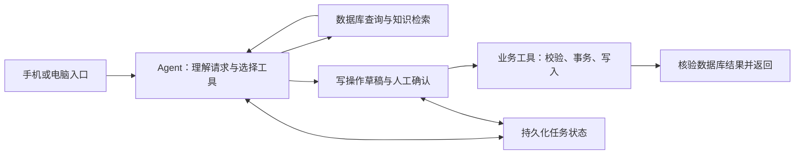

# 门店售后与库存协作智能体：第一版设计稿

日期：2026-10-25  
状态：设计稿（已完成独立规划审阅，待用户核对）；尚未实施。

## 1. 目标与选题依据

为家里经营万和壁挂炉的门店建设一个手机优先、电脑可用的内部智能体，帮助接单人员整理售后记录、帮助师傅查历史与维修依据，并帮助进出货人员登记和查询库存。

用户希望以此展示 AI 应用开发能力，已有 Python、FastAPI 项目经验，时间没有硬限制，允许模型 API 和服务器费用，优先控制成本。门店可安排一两位维修师傅试用和核对内容。

已发现的真实问题是：售后记录散落在微信群和纸本中，需要查找时不清楚记在哪里；库存目前靠记忆，没有持续保存的台账。通用 AI 在现场提供维修建议已经管用，因此本项目以记录查找、归档和业务操作的实际效果为主要价值，维修问答另外做对照评测。

## 2. 用户已经确认的业务事实

| 事项 | 已确认内容 |
| --- | --- |
| 使用方式 | 手机更多，电脑也使用；采用可同时适配两者的网页 |
| 售后来源 | 微信群和纸本，继续保留原来的记录习惯，之后整理 |
| 整理人员 | 负责接单的人统一整理进系统 |
| 报修字段 | 地址、手机号、姓名、问题描述 |
| 维修结果 | 会补记处理方法、更换配件或最终结果 |
| 查找入口 | 手机号和地址 |
| 知识资料 | 可以取得维修手册和产品说明书；格式、质量和型号覆盖尚待实物检查 |
| 经验资料 | 可以收集师傅经验，需要时间，作为后续补充来源 |
| 维修辅助 | 查询故障含义、排查流程及修理建议，首先采用资料问答，缺必要信息时追问 |
| 库存需求 | 按库房和型号查询剩余数量，统计进货 |
| 库存原始状况 | 目前靠脑子记，尚无保存进出库记录的位置 |
| 新库存习惯 | 经手进出货的人能够每次在手机端登记 |
| 调拨 | 目前没有跨库房调货的实际情况 |
| 留货 | 存在已售或已约定、尚未提走的货；口头约定、定金、全款都可能形成留货 |

## 3. 第一版范围与任务

### 3.1 售后记录整理与归档

接单人员粘贴微信群文字，或提交纸本照片。系统保存原始文字或图片及来源标记，Agent 提取报修和维修信息、查找候选客户，生成可编辑草稿。由接单人员核对后确认归档；专业内容有疑问时交师傅核实。

- 同一条售后记录可以包含报修、后续处理和结果；后续补充通过确认后更新同一记录。
- 手机号、地址用作查找条件，同一手机号存在多个地址或设备时展示候选，由人员确认关联。
- 来源至少能打开保存的原文或照片。纸本名称、页码、群名、消息时间有资料时保存；缺失时明确标为未提供。
- 维修日期与归档时间分开保存。历史资料没有日期或型号时保留未知，必要时补问，不从上传时间推断维修日期。
- 一张照片包含多条记录时生成分条草稿，逐条核对；无法识别的内容停在待核对状态。

### 3.2 售后历史查询

用户按手机号、地址或自然语言请求查询。Agent 调用数据库查询工具；多个候选需要确认。结果展示问题、处理措施、更换配件、结果、已知维修日期及来源。

示例任务：“查这个手机号在某小区那户，上次报了什么问题，怎么处理的，把原始记录找出来。”

### 3.3 维修知识辅助

Agent 在明确型号和故障信息后，检索厂家维修手册、说明书和经师傅审核的经验案例，输出故障含义、可能原因、建议检查项、带检查前提的修理建议以及具体出处。

- 型号不清楚时补问；手册检索使用型号等适用条件过滤。
- 手册内容、已审核案例与待核实经验标明来源类别。
- 引用应实际支持对应建议，并能打开原文位置；资料不足时写清缺少的信息或依据。
- 修理建议由维修师傅结合现场检查确认执行。
- 第一批覆盖实际取得完整资料的少量机型；文档解析方式和模型根据样例选择。

### 3.4 库存登记、留货与查询

按库房和整机型号建账。进出货人员通过手机页面输入自然语言或填写简短表单，Agent 整理操作草稿，经确认后调用库存业务工具。查询和统计从已登记的数据库事实计算。

支持期初建账、进货入库、普通出库、留货登记、取消留货、预留货物提走、库存查询及按时间/库房/型号统计进货数量。金额、供应商和财务结算没有作为首版统计要求。

示例任务：“2号库，某型号入库5台，先给我核对。”确认后登记，再查询更新后的数量。

## 4. 库存业务规则（设计建议，供整体核对）

### 4.1 建账与查询含义

上线前按库房、型号盘点实物数量，同时整理已有留货及其客户、库房、型号、剩余数量。两部分经门店人员确认后作为起点。

- 实物在库：已经入库、尚未实际出库的数量，包含已留给客户但尚未提走的货。
- 已预留：已明确为客户留货、尚未完成提货或取消的数量。
- 可售数量 = 实物在库 - 已预留。
- 查询同时返回这三个数和记录截至时间，并可查看变动依据。
- 进货统计覆盖实际登记的时间范围；盘点建账数量与进货数量分开统计。

### 4.2 各操作对数量的影响

| 操作 | 实物在库 | 已预留 | 校验 |
| --- | --- | --- | --- |
| 入库 q 台 | +q | 不变 | q 为正整数，库房和型号明确 |
| 为客户留货 q 台 | 不变 | +q | q 不超过可售数量，客户明确 |
| 取消剩余留货中的 q 台 | 不变 | -q | q 不超过该笔剩余预留 |
| 客户提走已预留的 q 台 | -q | -q | 对应预留明确，数量不超过剩余预留及实物 |
| 普通出库 q 台 | -q | 不变 | q 不超过可售数量 |

口头约定、定金、全款留货统一通过“门店人员明确确认留货”登记，来源作为备注保留。首版取消留货采用人工确认释放，暂不假定存在自动到期规则。已经预留的货提走时同时减少实物和对应预留，可售数量不重复扣减。

在库、预留、可售均保持非负；预留不超过在库。每笔变动保留操作者、发生时间、登记时间、数量、原因和关联记录。库存更正采用经确认的更正流水保留追溯关系。

## 5. 智能体与业务后端的分工

采用单个 Agent，根据请求选择工具、衔接任务、追问缺失信息和等待确认。FastAPI 业务层负责字段校验、权限、数据库查询、库存事务和统计计算。

主要工具按业务能力提供：

- 客户/维修记录候选查询、历史查询、来源读取、记录归档和补充。
- 手册与已审核案例检索。
- 库存查询、进货统计、入库、出库、预留、释放和预留提货。

写操作统一先形成可核对草稿；后端绑定草稿版本、操作者、操作参数和确认结果。修改关键参数后重新确认。聊天文字里的“已确认”不能直接绕过后端的确认状态。

LangGraph 保存当前任务、候选、草稿和待确认状态，支持重启后继续。业务数据库另存已经提交的真实事实。业务写入使用操作标识和数据库唯一约束保证重复确认、重试和恢复只产生一次业务效果；库存提交时重新检查可用数量，并在事务内更新余额、预留和流水。

工具超时、无匹配记录、参数缺失和库存不足分别反馈。读操作可以按限定策略重试；写操作先按操作标识查询执行结果，再决定是否重试。每次运行设置工具调用次数、超时和模型调用预算。

资料原文作为待处理内容，不能给 Agent 授予工具权限。实际权限和数据范围由登录账号及后端规则确定。

## 6. 角色、数据和界面

同一人可以兼任多个业务职责。首版试用账号由门店指定负责人分配。

- 接单人员：提交售后来源、核对归档、查历史、登记或取消留货。
- 维修师傅：查历史、查询维修依据、提供和核对维修结果。
- 进出货人员：核对进出库、预留提货及库存查询。
- 门店指定负责人：初始化库存、基础型号和库房资料、账号及库存更正。

核心数据包括来源文件/文本、客户与地址、售后记录及其修订、知识文档与分块、型号/库房、库存余额与流水、客户预留、操作草稿与执行状态。设备型号在已有资料缺失时可为空，查询具体型号手册时再补齐。

手机优先提供四个入口：统一任务输入、待核对草稿、售后档案与来源、库存与流水。电脑端提供同样功能，便于接单人员整理资料。查询结果可直接操作；业务写入展示确认后的结果及编号。

## 7. 技术与实现选择（设计者建议）

- Python + FastAPI：沿用用户已有基础，提供业务接口与网页后端。
- LangGraph：工具选择、多轮任务、等待确认和持久化恢复。
- PostgreSQL：客户、售后、库存、预留、流水和任务状态；pgvector 存放知识分块向量，减少独立服务数量。
- RAG：型号过滤、关键词/向量检索对照、必要时加入重排序。是否采用更复杂方案以实际评测结果决定。
- 文件：原始文本、照片和手册保存为可访问的来源文件，数据库记录定位信息。
- 模型：使用 API，比较支持工具调用和结构化提取的候选模型；纸本图片识别通过真实样例选定 OCR 或视觉模型。先测效果和单次费用，再确定供应商。
- 前端：简单的响应式网页；样式库、前端框架、依赖版本和目录结构留给实施者按最少组件原则选择。
- 部署：单门店试用，容器化应用和数据库；记录模型、工具调用、耗时、Token/费用、错误、人工修改及最终业务结果。

群消息采用人员提交原文，纸本采用拍照或必要信息录入；现有流程不依赖自动读取个人微信群。新库存每次发生后直接登记。维修经验资料逐步审核加入。

## 8. 验证与验收

下表是待实现的验收条件，尚无测试结果或业务提升数据。

| 场景 | 验证方式 |
| --- | --- |
| 按手机号/地址查记录 | 对照预先核对的档案，匹配正确客户，原文或照片可打开 |
| 多候选和缺字段 | 产生必要追问或待核对草稿，不把不确定关联当已确认事实 |
| 归档和补充维修结果 | 数据库结果与确认草稿一致，保留来源和修订关系 |
| 重复提交和恢复 | 同一操作只产生一条有效业务记录；重启后能继续待确认任务 |
| 写操作确认 | 未确认、参数改变或无操作权限时，业务数据不发生对应写入 |
| 入库/出库/预留/提货 | 各库房型号的数量与规则表一致，预留提货不会重复扣减可售数 |
| 并发占用最后库存 | 多个请求不能使库存为负或超额预留；失败请求返回明确结果 |
| 进货统计 | 按登记范围与基准 SQL 结果一致，盘点期初数不混入进货量 |
| 维修辅助 | 型号适用、出处支持建议、检查前提完整，由师傅核对 |
| 工具失败 | 区分失败原因，限制重试，恢复后保持业务结果一致 |

先整理一组经过人工核对的任务和数据库预期状态，再补充含糊输入、重复确认、并发与失败恢复案例。业务结果用程序检查；维修内容结合师傅评审。分别记录任务完成率、字段/参数准确性、来源支持情况、人工修改量、处理耗时和每任务成本。

维修问答对照“直接问通用 AI”“给同样资料问同一模型”“自建 RAG”。售后档案查询对照当前翻找原记录所需时间。只有真实试用和评测后才描述改善幅度；演示样例明确标注为样例。

## 9. 实施顺序建议

1. 建立小型业务库和确定性的库存工具，打通库存查询、草稿确认、入库/出库与预留；为 Agent 接上这些工具和执行状态。
2. 接入售后来源提交、记录草稿、客户候选、人工核对、历史查询和来源定位。
3. 用实际厂家资料建立 RAG，加入型号约束、出处展示和条件化维修建议；逐步审核经验案例。
4. 完成持久化、幂等、并发、失败恢复、任务轨迹评测和手机试用，形成可复现演示与项目说明。

当前范围集中在单门店的档案、维修知识和库存数量。调拨目前没有实际场景；自动派工、预约排班和财务结算不作为本版必要功能。MCP 作为业务工具稳定之后的可选扩展。

## 10. 待取得的材料与待实施者验证的事项

这些事项通过资料检查、盘点和试用解决，不需要凭空补齐。

- 少量完整售后原始样例，确认纸本可读性、字段缺失和一页多记录情况。
- 首批厂家手册、对应型号、版本信息与来源；确定扫描件、表格和图纸处理方式。
- 实际库房、型号清单、期初实物数量及尚未提走的客户留货。
- 试用人员、样例任务、输入频率及真实模型成本；据此选择模型和运行预算。
- 手册数量、机型覆盖、检索参数、具体数据表和 API 形状，由实施者结合上述材料确定。

## 11. 参考依据

岗位能力映射是设计者根据公开岗位样本作出的选择，不代表所有 AI 应用岗位要求完全相同。

- [企业 Agent 开发与实习岗位样本](https://decact.com/careers/)：工具调用、业务系统集成、数据库、API、业务规则和工程实践。
- [LangGraph 持久化](https://docs.langchain.com/oss/python/langgraph/persistence)：任务状态保存与恢复。
- [LangGraph 中断与恢复](https://docs.langchain.com/oss/python/langgraph/interrupts)：等待外部输入和人工确认。
- [智能体评测](https://docs.langchain.com/langsmith/evaluate-complex-agent)：最终结果、工具调用轨迹和单步选择的评测。
- [pgvector 官方项目](https://github.com/pgvector/pgvector)：PostgreSQL 中的向量检索。
